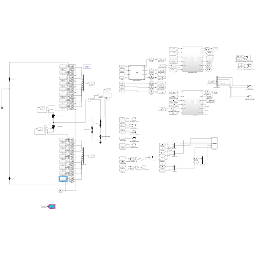
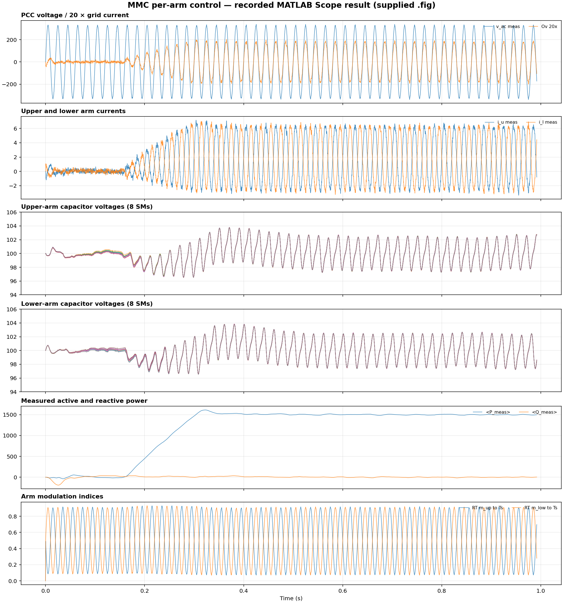

# MMC Per-Arm Control

A **single-phase, grid-connected Modular Multilevel Converter (MMC)** simulation with **independent upper- and lower-arm leaders** and **local submodule capacitor-voltage balancing**.

**Architecture:** distributed **per-arm** control, not fully decentralized control. Each arm leader calculates its own modulation index and sends it to the submodules in that arm.



## Control architecture

```text
         PCC measurements + P* / Q*
                     |
           +---------+---------+
           |                   |
     Upper Arm Leader    Lower Arm Leader
       Outer + Inner       Outer + Inner
           |     < W_arm >      |
           |    (100 us delay)  |
           v                   v
       8 local SMs          8 local SMs
   Neighbor balancing   Neighbor balancing
        + PS-PWM             + PS-PWM
```

- **Outer loop (per arm):** SOGI-PLL, P/Q measurement and regulation -> `i_ac_ref`, grid angle and amplitude.
- **Inner loop (per arm):** arm-energy estimation, total/differential energy control, PI + resonant arm-current control -> `m_arm`.
- **Local SM control (each submodule):** neighbor-voltage balancing and phase-shifted carrier PWM -> half-bridge gate signals.
- **Arm-to-arm communication:** exchange of the arm-energy value `W_arm` with a modeled one-sample (100 us) delay.

## Model configuration

| Parameter | Value |
|:--|--:|
| Submodules | 8 per arm (16 total) |
| DC link / nominal SM voltage | 800 V / 100 V |
| SM capacitance | 2.2 mF |
| Arm inductance / resistance | 5 mH / 0.5 ohm |
| Grid | 230 V RMS, 50 Hz |
| Power set-points | 1500 W / 0 var |
| SM switching carrier | 1250 Hz |
| Local SM / arm-leader sample time | 10 us / 100 us |

These are the values extracted from the supplied Simulink model. Individual control gains are inside its MATLAB Function blocks.

## Files

```text
MMC_Per_Arm_Control/
├── model/
│   └── MMC_Per_arm_outer_v5_G2.slx   # Original Simulink model
├── src/                            # MATLAB Function block snapshots
│   ├── mmc_outer_ctrl.m
│   ├── mmc_energy_estimation.m
│   ├── mmc_energy_balancing.m
│   ├── mmc_inner_current.m
│   ├── mmc_arm_modulation.m
│   ├── hb_sm_local_ctrl.m
│   ├── get_neighbors.m
│   └── meas_avg.m
├── docs/
│   └── Arm_control.pptx            # Architecture and future work
├── results/
│   ├── scope_overview.png
│   └── simulink_thumbnail.png
└── README.md
```

## Open and run

1. Use MATLAB/Simulink (the supplied model was saved with **R2024a**), including the required Simscape Electrical / Specialized Power Systems components.
2. Open `model/MMC_Per_arm_outer_v5_G2.slx`.
3. Run the simulation and inspect the scopes for PCC power, arm currents and capacitor voltages.

The model contains its own parameter initialization callbacks. The `src/` files are **readable snapshots** of code embedded in the model, not automatically linked external dependencies: editing them alone does not update the `.slx` blocks.



## Status and next steps

- **Included:** 8 SM per arm, per-arm outer and inner control, energy exchange, local balancing and PWM.
- **Recorded results:** scope plot derived from a supplied MATLAB figure, **not** a new simulation run or independent validation.
- **Architecture presentation:** illustrates **5 SM per arm** and discusses a possible SM2 backup and future placement of inner-current control inside every SM. These are *proposals*, **not** verified capabilities of this version of the Simulink model.
- **Not verified:** hardware/HIL operation, SM1-to-SM2 failover, communication implementation, embedded timing or fault protection.

The original large `outer per arm.fig` (~99 MiB) is omitted to keep the repository lightweight; the plotted overview is included instead.

## License

This project is licensed under the **MIT License**. See [LICENSE](LICENSE) for the full license text.
