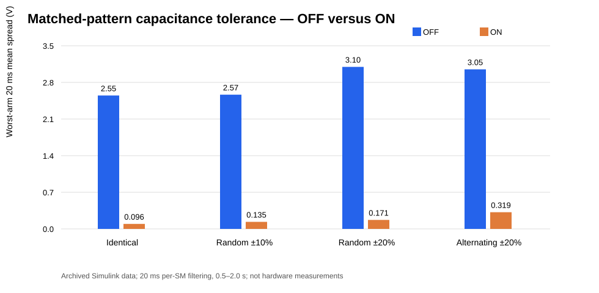
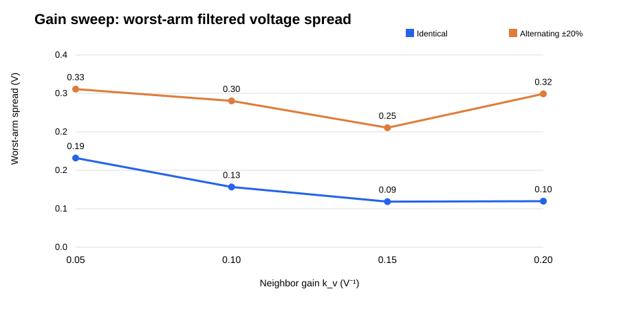
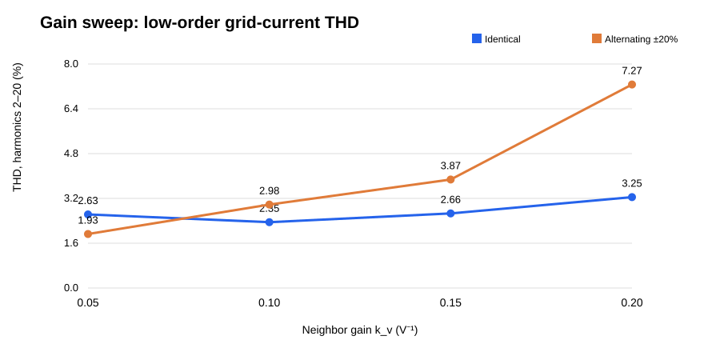
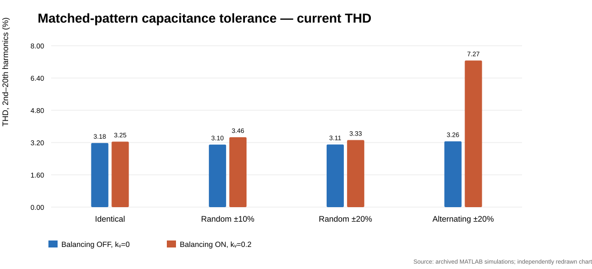

# MMC Per-Arm Control: Experimental Validation

A **single-phase grid-connected Modular Multilevel Converter (MMC)** with independent upper/lower arm leaders, local neighbor-based capacitor-voltage balancing, and phase-shifted PWM.


**[View the illustrated 11-case experiment gallery](docs/EXPERIMENT_GALLERY.md)** · **[Capacitance tolerance, saturation and THD tests](experiments/test1/README.md)** · **[Aligned-delay figures: nine methods and measured outcomes](experiments/aligned/figures/README.md)** · **[Base figures: 13 test methods](experiments/base/figures/README.md)** · **[Historical plots: five methods](experiments/base/source_notes/nvb/README.md)** · **[Browse all 27 original figures](docs/FIGURE_CATALOG.md)** · **[Control architecture](docs/CONTROL_ARCHITECTURE.md)** · **[Measured results](docs/VALIDATION_2026.md)**

## Control architecture

```text
                      Grid / PCC measurements
                       P*, Q*, Vdc, currents
                               |
                  +------------+------------+
                  |                         |
             Upper arm leader         Lower arm leader
             PLL, P/Q, energy,       PLL, P/Q, energy,
              inner current           inner current
                  |     <-- W_arm -->        |
                  |      (100 us)           |
                  v                         v
             8 local SMs                8 local SMs
           Neighbor balancing        Neighbor balancing
                + PS-PWM                  + PS-PWM
                  |                         |
              Gate signals              Gate signals
```

Two arm leaders independently compute their modulation references. Each SM uses neighbor capacitor-voltage differences to adjust its own PWM duty. The **Simulink neighbor vector** is a simulation abstraction, not demonstrated packet-level communication; therefore this is *distributed per-arm control with local balancing*, not proven fully decentralized hardware.

## Nominal model

| Parameter | Value |
|---|---:|
| DC link / nominal SM capacitor | 800 V / 100 V |
| Submodules | 8 per arm, 16 total |
| SM capacitance | 2.2 mF |
| Arm inductance / resistance | 5 mH / 0.5 Ω |
| Grid | 230 V RMS, 50 Hz |
| Carrier per SM | 1,250 Hz |
| Simulation / arm control | 10 µs / 100 µs |
| Baseline P* / Q* | 1,500 W / 0 var |

## Experiment groups

| Group | Cases | Primary purpose | Gallery |
|---|---:|---|---|
| **A: Base converter operation** | 3 | Balancing OFF, initial mismatch, power/load staircase | [A1–A3](docs/EXPERIMENT_GALLERY.md#a-base-model-and-converter-performance-3-cases) |
| **B: Local correction and fresh-own delay** | 4 | Clipped duty, no-delay reference, 0.2/1.0 ms unaligned delay | [B1–B4](docs/EXPERIMENT_GALLERY.md#b-balancing-correction-and-fresh-own-sample-delay-4-cases) |
| **C: Timestamp-aligned delay** | 4 | Aligned 0.2/1.0/1.4/5.5 ms, stability and deadband effects | [C1–C4](docs/EXPERIMENT_GALLERY.md#c-time-aligned-neighbor-voltage-delay-4-cases) |

## PCC load-switching validation


**Test procedure:** Operate the MMC near **1,500 W** active power and connect a **1 kW PCC load at 2.4 s**. Connect a second **1 kW load at 2.7 s**, then disconnect the second load at **3.0 s**. Monitor converter power, total load power and grid power, using consistent sign conventions and a 20 ms averaging window.

**Recorded result:** Converter output remains near **1,501–1,504 W** while grid exchange changes with the loads: approximately **+487 W**, **−509 W**, then **+491 W**. The recorded power balance follows `P_converter ≈ P_load + P_grid` under the archived sign convention. These are simulation results, not HIL or hardware measurements.

[View the original figure with the experimental method and result](experiments/base/figures/fig4_case3_load_test.md). The **time-aligned communication delay** comparisons remain documented in the [aligned-delay experiment gallery](experiments/aligned/figures/README.md).

**[Browse the separate Test 3 archive (repeat of base cases)](experiments/test3/README.md)** — 18 original figures and figure-by-figure test methods; the upload is identical to the base archive and does not increase the 11 unique case count.

## Capacitance-tolerance robustness: Balancing OFF versus ON


**Test:** Four SM capacitance patterns (identical, random ±10%, random ±20%, alternating ±20%) were each simulated for 2 s at P*=1,500 W, with local neighbor balancing disabled (`k_v=0`) and enabled (`k_v=0.2`). Each of the eight submodule voltages in the upper arm was separately averaged over 20 ms.

**Recorded result:** The balancing correction strongly reduces inter-SM mean-voltage divergence: worst-arm spread improves by **26.6×, 19.0×, 10.2× and 9.6×** across the four patterns. **Trade-off:** for alternating ±20% capacitors, the reported low-order grid-current THD rises to **7.27%** at `k_v=0.2`; subsequent clipping and gain-sensitivity tests reduce the distortion, with a balancing-error trade-off.

**[Complete Test 1: models, data, all six original figures and per-image methods](experiments/test1/README.md)** · [Explain this comparison figure](experiments/test1/figures/ctol_C_mean_voltages_upper.md).

## New controlled robustness experiments (25 November 2026)

- **[Matched-pattern capacitance tolerance (D4)](experiments/capacitance_samepattern/README.md):** fixes the old cross-tolerance comparison in which random ±10% and ±20% used different draws. The same random pattern now gives worst-arm OFF/ON spreads of **2.565/0.135 V at ±10%** and **3.097/0.171 V at ±20%**. Original Test 1 values are preserved as a *different random realization*.
- **[Neighbor-gain sweep and convergence (D5)](experiments/gain_sweep/README.md):** twelve saved simulations at `k_v=0.05, 0.10, 0.15, 0.20`. With alternating ±20% capacitance, the lowest sampled filtered imbalance is **0.249 V at 0.15**, while the lowest sampled THD(2–20) is **1.93% at 0.05**. Initial ±2 V mismatch settling is documented separately.

The two new documentation pages analyze the user's supplied MAT/CSV results; associated binary SLX/MAT/PNG/FIG files are in a separate corrected experiment package and are **not uploaded to these GitHub experiment folders**. No fresh Simulink execution is claimed. The originally featured `ctol_C_mean_voltages_upper.png` figure below remains the *historical Test 1 realization*, not the matched-pattern replacement.

### Updated robustness figures



**Method:** Fixed SM capacitances within each OFF/ON pair, identical random realization scaled from ±10% to ±20%, and max–min of separately 20 ms-averaged capacitor voltages during 0.5–2.0 s. **Result:** Random ±20% worst-arm spread changes from 3.097 V (OFF) to 0.171 V (ON). [Data and interpretation](experiments/capacitance_samepattern/README.md).







**Method:** Compare OFF/ON low-order THD(2–20) for identical, matched random ±10%, matched random ±20% and alternating ±20% capacitances. **Recorded result:** THD reaches 7.27% under alternating mismatch when `k_v=0.2`.


**Method:** Initialize upper SM3/SM6 at 102/98 V and measure persistent absolute-error and arm-spread thresholds. **Recorded result:** upper-arm filtered spread stays below 0.5 V from 0.257 s at `k_v=0.2`, versus 0.318 s at `k_v=0.05`.

**Method:** Sweep `k_v` in 0.05/0.10/0.15/0.20 V^-1 under nominal and alternating ±20% capacitances. **Result:** For alternating C, the lowest sampled filtered spread is 0.249 V at `k_v=0.15`; the lowest sampled THD(2–20) is 1.93% at `k_v=0.05`. [Full procedures and convergence data](experiments/gain_sweep/README.md).

## Files and reproduction

- `model/MMC_Per_arm_outer_v5_G2.slx` — original published model (preserved).
- `src/` — readable original MATLAB Function snapshots; editing snapshots does **not** modify blocks embedded inside a `.slx`.
- `docs/Arm_control.pptx` — original conceptual architecture presentation (preserved).
- `experiments/base/figures/` and `experiments/aligned/figures/` — original published PNG plots.
- `experiments/base/source_notes/nvb/` — supplementary published analysis plots.
- `docs/EXPERIMENT_GALLERY.md` — 11 visual case descriptions.
- `docs/FIGURE_CATALOG.md` — original image inventory.
- `scripts/` — validation/import checkers.
- **Large binary research supplements:** 8 new model variants, 3 archived MAT datasets and test runners are **not yet uploaded** here; see [import instructions](docs/IMPORT_BINARY_SUPPLEMENT.md) and [dataset schema](docs/REPRODUCE_RECORDED_DATA.md).

The new `experiments/test1/` robustness study includes its **four original Simulink models, six PNGs, scripts and MAT/CSV results online**. Earlier A/B/C model variants and datasets have a separate historical import status described above.

## Interpretation and research limitations

The displayed figures are original saved simulation artifacts, not fresh runs. Instantaneous SM spread and **20 ms-averaged** voltage offset measure different behaviors. THD values here summarize harmonics **2–20** of the stored current, not full switching-frequency THD. No physical communication network, TWIST/STM32 embedded controller, OPAL-RT HIL, protection, or experimental validation is claimed.

## License

MIT License — see [LICENSE](LICENSE). Existing repository files and license have been preserved.
