# Illustrated MMC experiment gallery

**Recorded evidence:** 11 MATLAB/Simulink cases, with 27 original figures from the uploaded research archives. These are archived simulation outputs: no new MATLAB runs or hardware/HIL validation were performed when publishing this gallery.

**Experiment taxonomy**

| Group | Cases | Question | Main evidence |
|---|---:|---|---|
| **A — Core converter validation** | 3 | Does local balancing work, recover an initial mismatch, and track P/load transients? | Capacitor spread, arm current, active power, PCC power |
| **B — Balancing protection and unaligned communication** | 4 | What changes with correction clipping, neighbor delay and unmatched timestamps? | DC voltage drift, grid-current harmonics, instability |
| **C — Time-aligned communication** | 4 | Does timestamp alignment restore stability, and what delay can the local loop tolerate? | Convergence, harmonic THD, residual voltage offset, oscillation |

**System:** one phase, two arms, eight half-bridge SMs per arm, `Vdc=800 V`, `Vc_nom=100 V`, `Csm=2.2 mF`, `Larm=5 mH`, 230 V RMS/50 Hz grid and local neighbor-voltage balancing with phase-shifted PWM. Control is **distributed between arm leaders**, with **local neighbor-based SM balancing**; it is not a fully decentralized physical communication network.

> **Reading the figures:** *instantaneous capacitor spread* = max(SM voltages) − min(SM voltages); *20 ms averaged imbalance* uses separately filtered capacitor traces to suppress PWM ripple. These are different quantities. Reported grid-current THD uses harmonics **2–20** from the saved sampled signals, not full-band switching THD.

---

## A. Base model and converter performance (3 cases)

### A1 — No local voltage balancing (`case1_kv0`)

**Setup:** `k_v=0`, balanced start, `P*=1500 W`, 2 s.

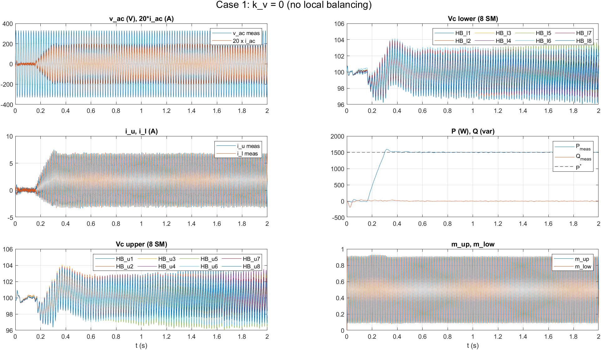

**Observation:** the upper-arm instantaneous capacitor spread grows to **2.07 V at 2 s**, with an estimated drift slope near **1.19 V/s** over 0.5–2 s. This is a short-duration negative control showing that modulation alone does not equalize individual SM voltages.

**Direct comparison:**

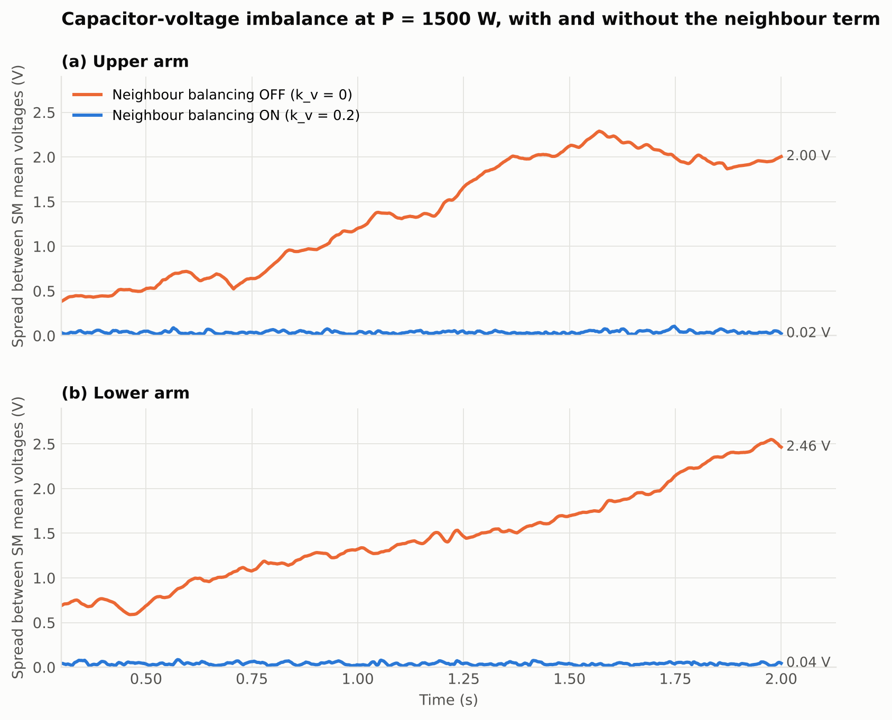

### A2 — Large initial capacitor imbalance (`case2_imbalance`)

**Setup:** initial upper-arm SM3 = **110 V**, SM6 = **90 V** (20 V spread), `k_v=0.2`.

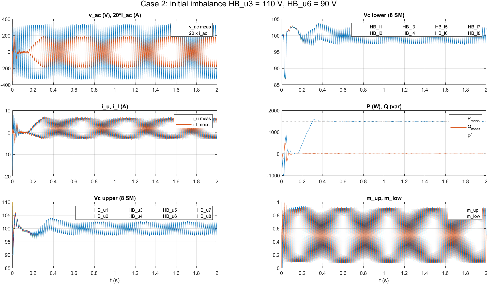

**Observation:** the stored base run maintains upper-arm spread below **1 V from approximately 170 ms**, and below **0.5 V from approximately 242 ms**, after current becomes active. The initial transient can be large, motivating the **clipped balancing correction** studied in B1.

**Focused view:**

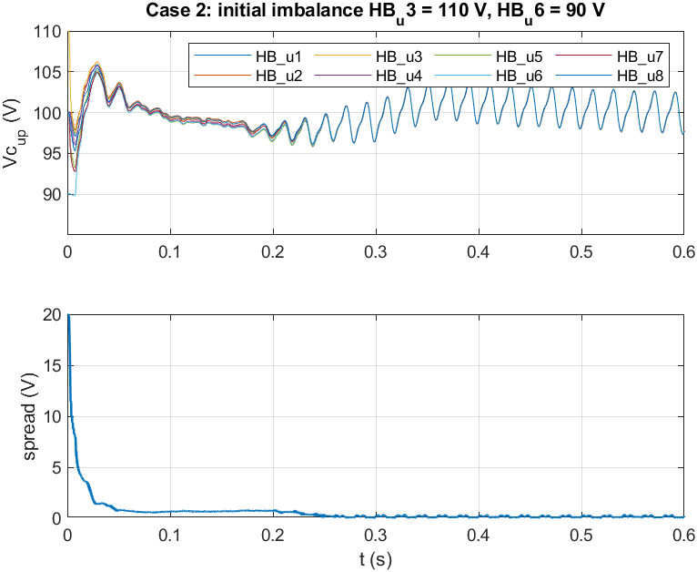

### A3 — Active-power staircase and PCC load switching (`case3_base`)

**Setup:** `P*` follows 1500→1750→2000→2250→2500→1500 W, with power steps at 0.6, 1.0, 1.4, 1.8 and 2.2 s. A 1 kW PCC load connects at 2.4 s; a second 1 kW load at 2.7 s; the second disconnects at 3.0 s.

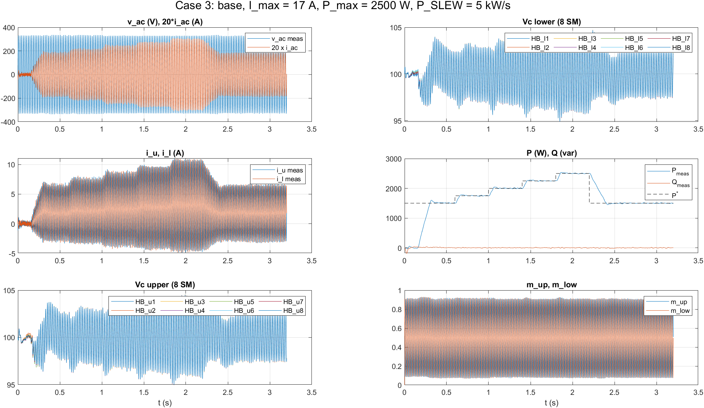

**Observation:** the reported steady P measurements at the five increasing setpoints are **1506, 1754, 2003, 2250 and 2502 W**. Their steady errors are ≤6 W. The 2.2 s decrease is **slew-limited**, so the subsequent 1500 W window must not be interpreted as an ordinary settled step.

**Power and load detail:**

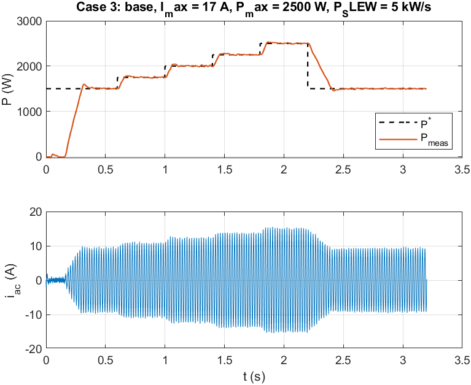

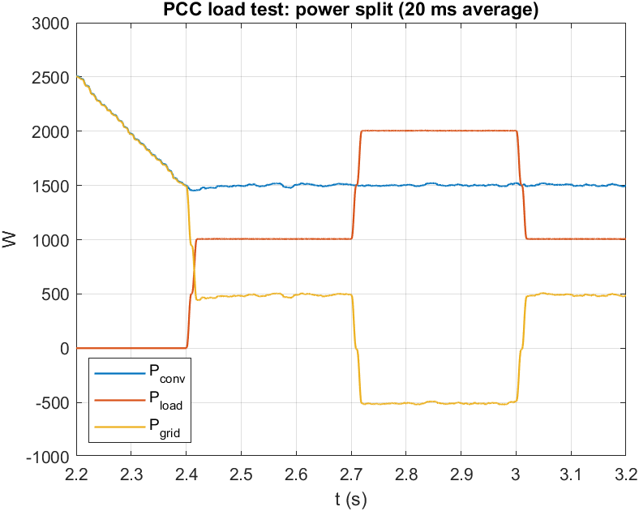

---

## B. Balancing correction and fresh-own-sample delay (4 cases)

The following **four recorded cases are in `followup_results.mat`**, but their four original standalone `.slx` variants were not in the uploaded archives. For these cases, the figures shown are **shared comparative plots** from the supplied material, rather than four separate case-specific scope exports.

### B1 — Initial mismatch with clipped correction (`case2_clip`)

**Setup:** upper-arm +10 V/−10 V initial mismatch; bound the local modulation correction to `|Δm_i| ≤ 0.1`.

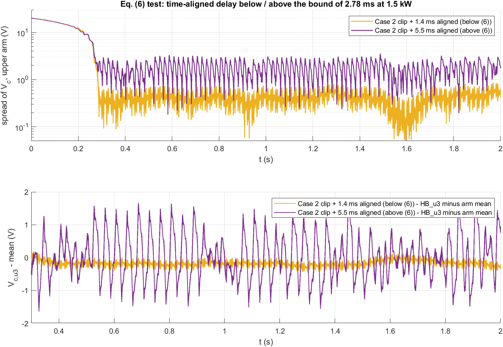

**Observation:** clipping prevents excessive duty-correction commands in the mismatch transient. In the recorded no-delay clipped reference, the upper spread settles below **1 V at approximately 284 ms**. **Figure note:** this comparison also plots later 1.4/5.5 ms *aligned* cases (C3/C4); do not attribute their oscillations to B1.

### B2 — Local balancing enabled, no communication delay (`case1b_kv02`)

**Setup:** `k_v=0.2`, a balanced initial condition and zero neighbor delay; nominal power 1500 W.

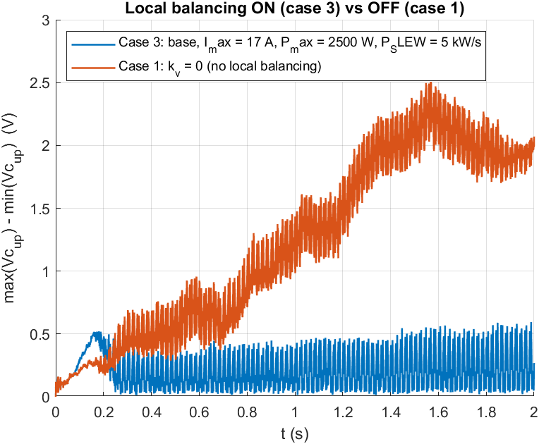

**Observation:** stable reference operation and low-order grid-current THD of approximately **3.7%**. The typical steady **20 ms averaged** inter-SM offset is approximately **0.04 V**. **Figure note:** this plot was produced for the base ON/OFF comparison and illustrates the same no-delay mechanism; B2 has no dedicated original PNG.

### B3 — Fresh own voltage, 0.2 ms old neighbor voltages (`case1b_delay02`)

**Setup:** compare `Vc_i(t)` against neighbors at `t−0.2 ms`.

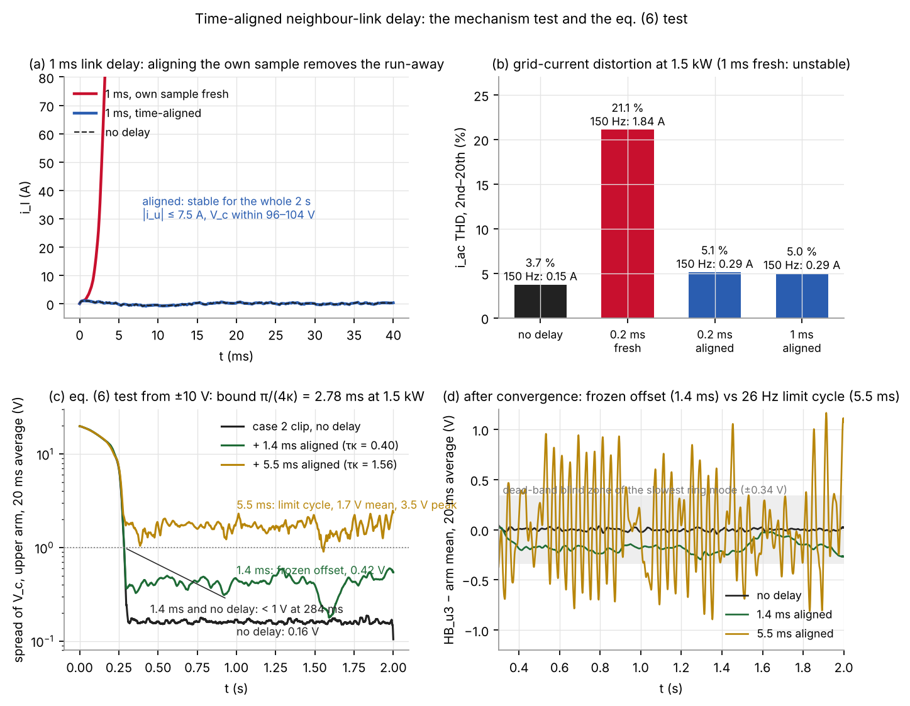

**Observation:** the unaligned sampling introduces a pronounced **150 Hz/third-harmonic** component. The reported **2nd–20th** grid-current THD rises to **21.1%**, compared with **3.7%** for the no-delay baseline and **5.1%** for an aligned 0.2 ms sample (C2). **Figure note:** the image explicitly compares several delay implementations.

### B4 — Fresh own voltage, 1.0 ms old neighbor voltages (`case1b_delay1`)

**Setup:** compare `Vc_i(t)` against neighbors at `t−1.0 ms`.

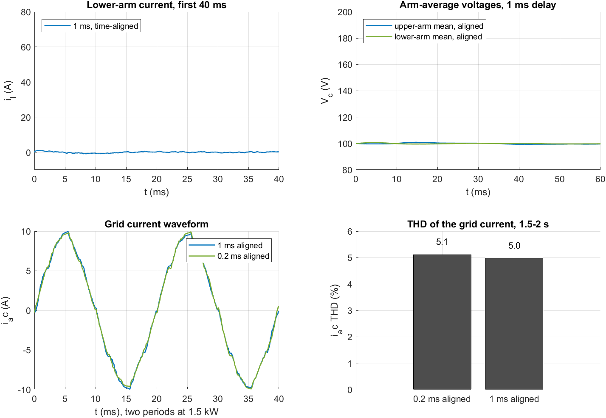

**Observation:** the unaligned model **runs away**, producing extreme arm current (reported up to ~845 A) and capacitor voltages of several kV; a steady-state THD is therefore **not meaningful**. This is a simulation failure mode, **not a safe hardware operating condition**. The aligned 1 ms counterpart is documented in C1.

---

## C. Time-aligned neighbor-voltage delay (4 cases)

Here each SM compares its local voltage and both neighbors **from the same delayed timestamp**. The original case-specific PNG and model variants are available in the supplemental archive.

### C1 — Aligned 1.0 ms delay (`case1b_delay1_aligned`)

**Setup:** all three local/neighbor capacitor samples are delayed by **1.0 ms**, balanced start.

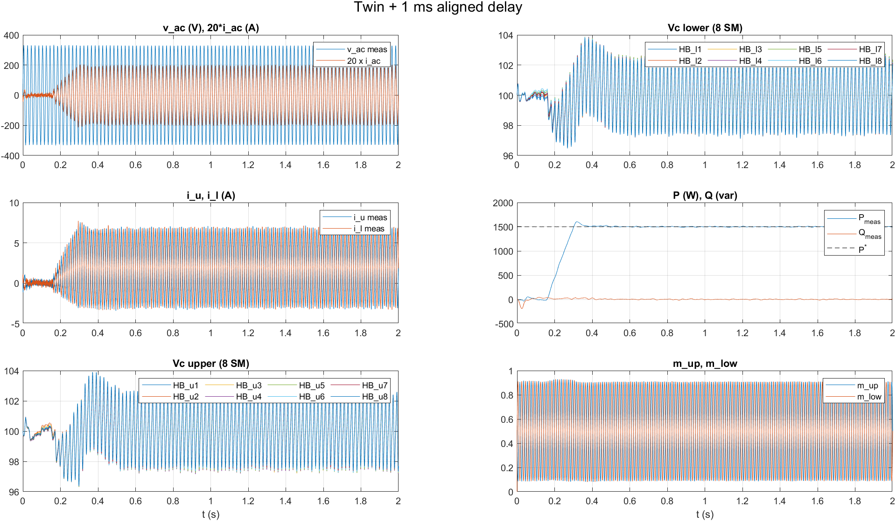

**Observation:** unlike B4, the arm currents and capacitor voltages remain bounded; reported low-order grid-current THD is **~5.0%**. The residual averaged SM imbalance is higher than the zero-delay reference (~0.2 V vs ~0.04 V).

### C2 — Aligned 0.2 ms delay (`case1b_delay02_aligned`)

**Setup:** all three samples delayed by **0.2 ms**, balanced start.

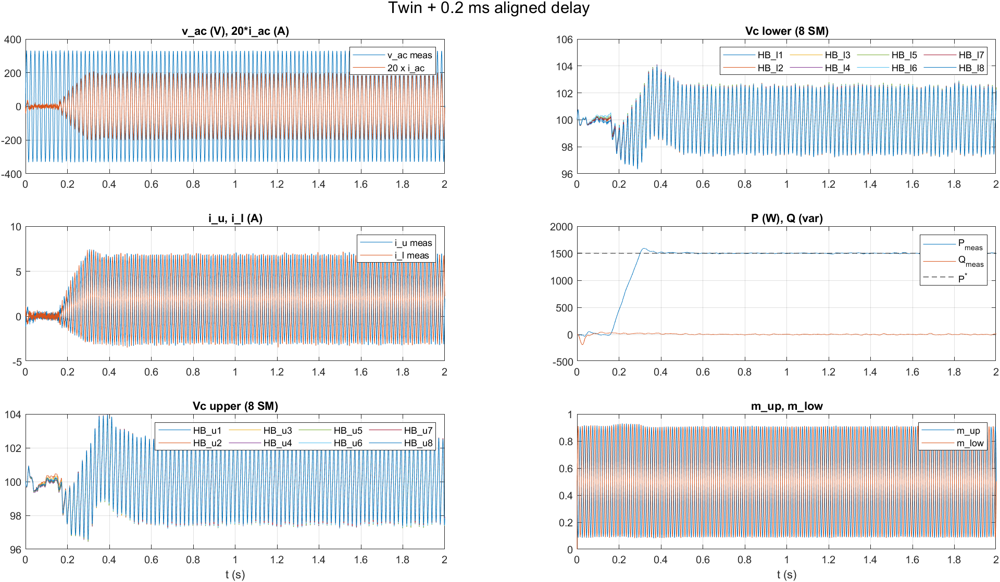

**Observation:** stable current and capacitor voltages; reported low-order grid-current THD **~5.1%**, much lower than the unaligned B3 case (**21.1%**).

### C3 — Clipping and aligned 1.4 ms delay (`case2_clip_delay1p4_aligned`)

**Setup:** ±10 V initial mismatch, `|Δm_i| ≤ 0.1`, aligned `τ=1.4 ms`.

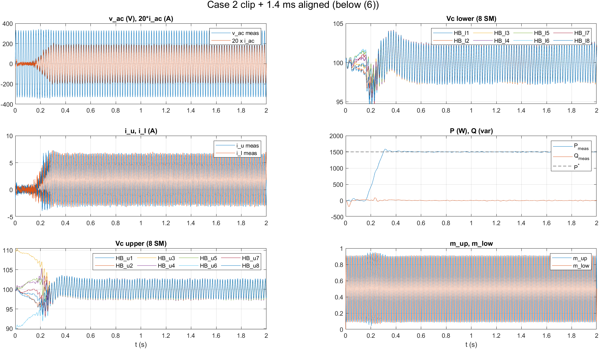

**Observation:** upper-arm spread stays below **1 V after approximately 284 ms**. The stored 20 ms-averaged inter-SM deviation settles to a nonzero offset (roughly **0.2–0.4 V**), influenced by the neighbor-error deadband. This is *convergence with residual error*, not perfect consensus.

### C4 — Clipping and aligned 5.5 ms delay (`case2_clip_delay5p5_aligned`)

**Setup:** ±10 V mismatch, clipped `|Δm_i| ≤ 0.1`, aligned `τ=5.5 ms`.

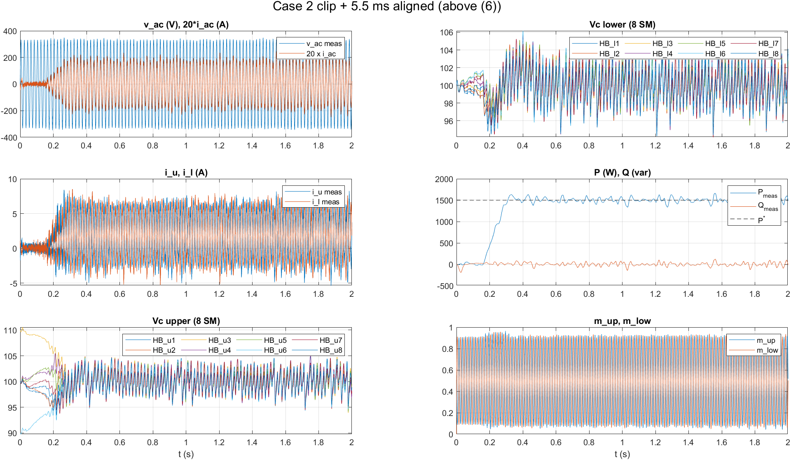

**Observation:** the SM voltage mismatch does **not remain below 1 V**, and a bounded oscillation near **26 Hz** appears. Mean instantaneous upper spread is approximately **1.67 V** during 1–2 s, peaking around **3.54 V**. Small reported current THD alone is **not** evidence of capacitor consensus stability.

---

## Cross-case explanation: why timestamp alignment matters

```text
Unaligned : e_i(t) = [Vc_(i−1)(t−τ) + Vc_(i+1)(t−τ)] / 2 − Vc_i(t)
Aligned   : e_i(t) = [Vc_(i−1)(t−τ) + Vc_(i+1)(t−τ)] / 2 − Vc_i(t−τ)
```

With unaligned samples, common capacitor ripple is incorrectly interpreted as a voltage-balancing error. With aligned samples, the comparison is temporally consistent, but the consensus loop still experiences a pure delay. The simplified ring-consensus estimate gives a **conditional** critical delay of approximately **2.78 ms** at 1.5 kW (`k_v=0.2`, mean |arm current| ≈3.11 A, `C=2.2 mF`), **not** a validated hardware latency allowance.


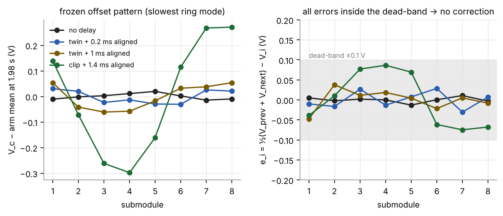

## Files and limitations

- **Images:** all 27 original uploaded PNG figures, catalogued in [Figure catalog](FIGURE_CATALOG.md).
- **Original datasets:** `three_cases_results.mat` (A1–A3); `followup_results.mat` (B1–B4); `aligned_results.mat` (C1–C4). Dataset records, not reconstructed traces, ground the numerical results.
- **Online availability:** Figures and documentation are committed to GitHub. Large `.mat` datasets and added `.slx` variants remain available in the [supplemental import package instructions](IMPORT_BINARY_SUPPLEMENT.md) until separately pushed to GitHub.
- **Method:** metrics depend on finite simulation windows and controller configuration; they are not full switching-frequency THD, a formal stability proof, or proof of embedded/TWIST/HIL deployment.
