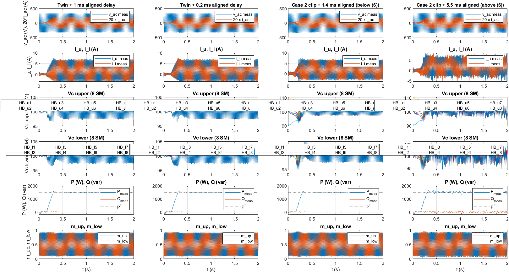
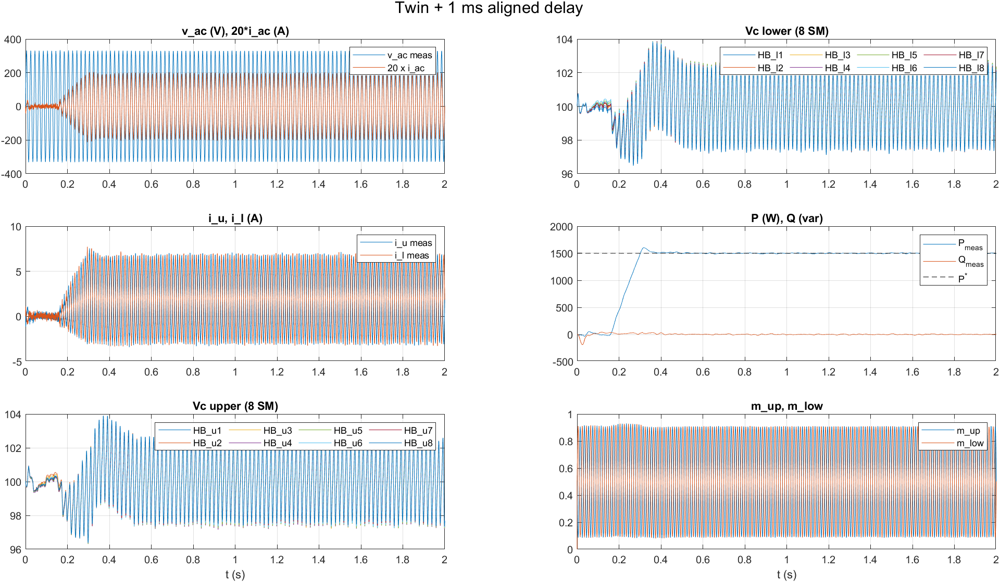
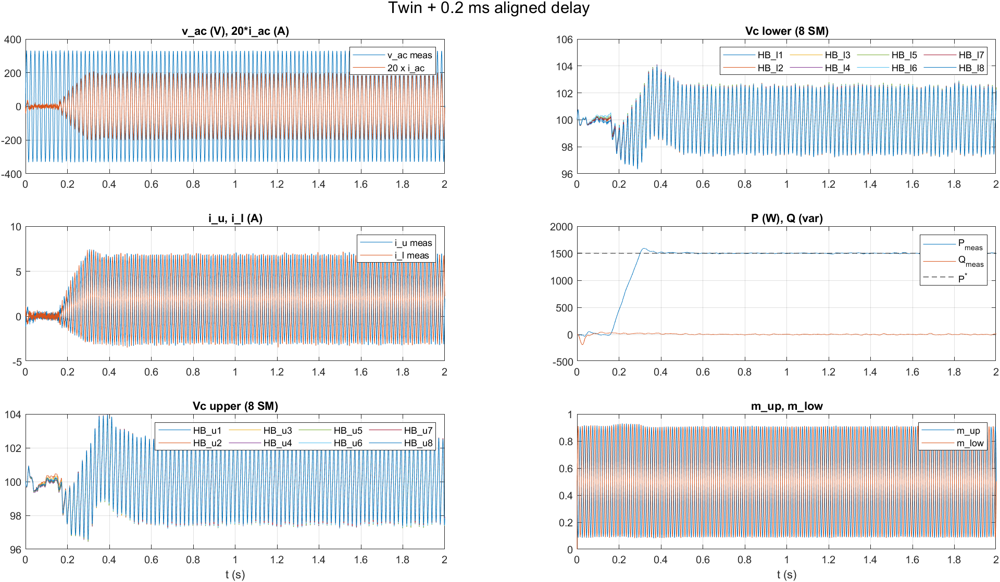
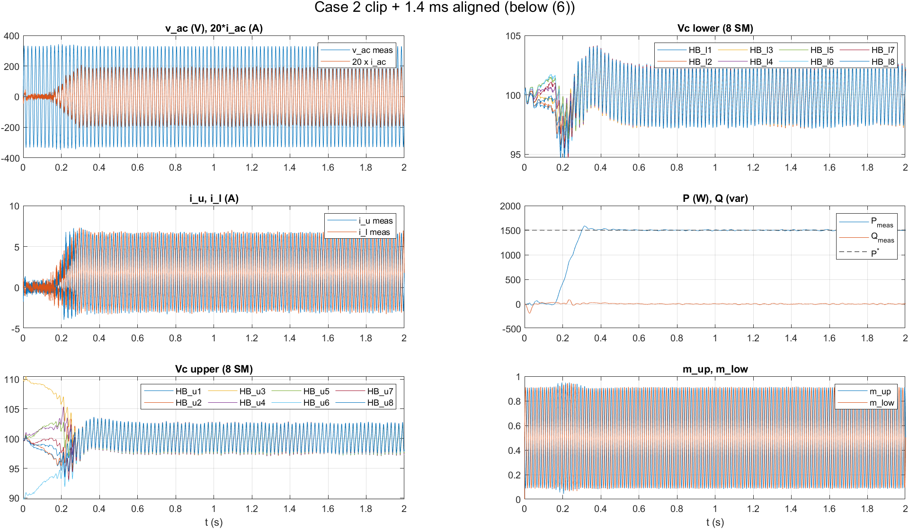
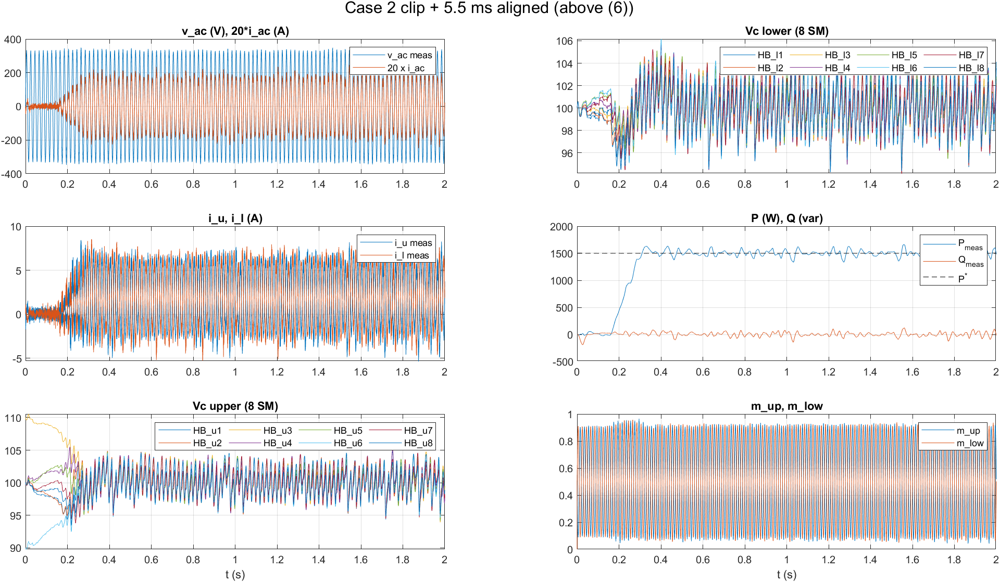
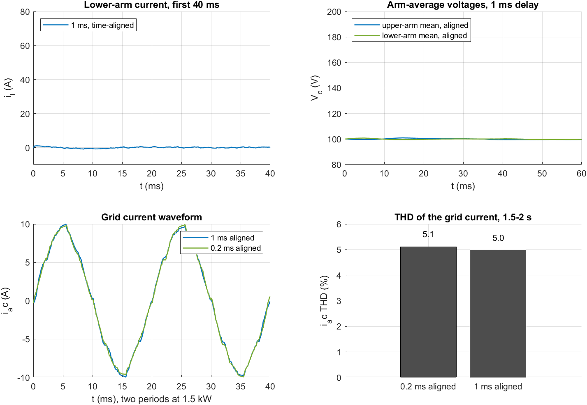
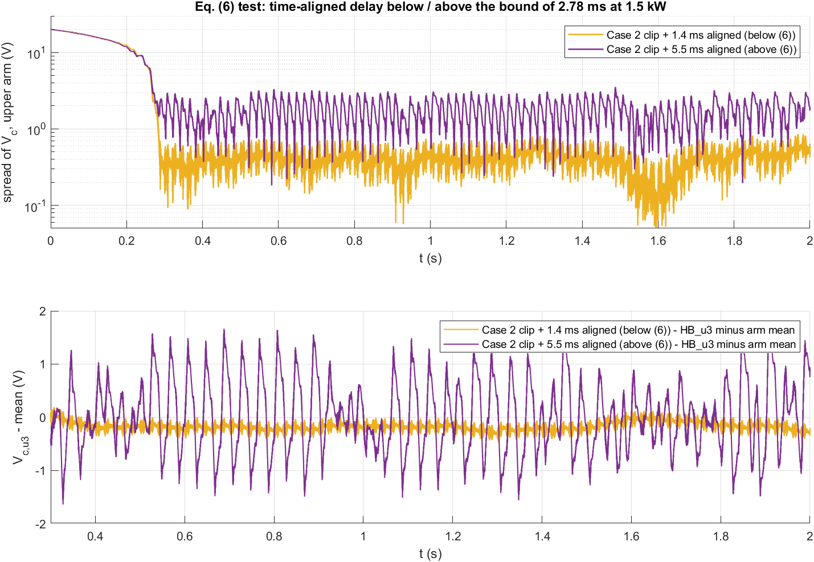
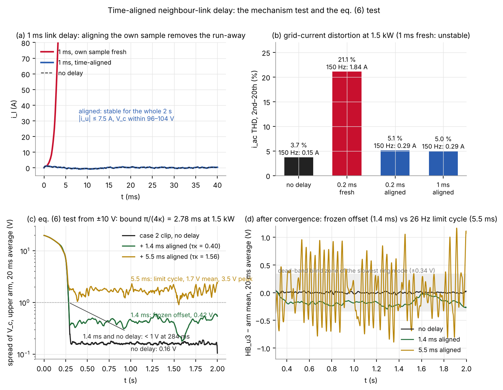
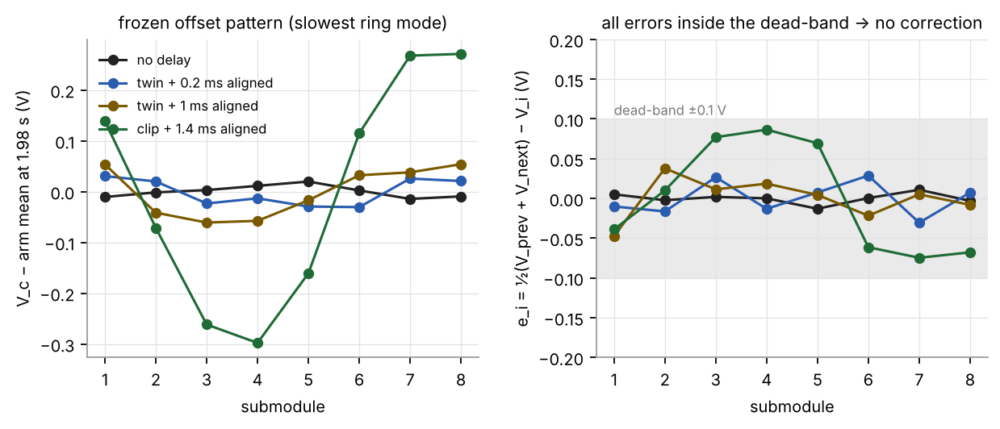

# Time-aligned neighbor-delay tests — figure-by-figure guide

This folder contains **nine original PNG figures** from the single-phase MMC time-aligned neighbor-consensus study. For every figure, this guide states **which experiment was run, what the plot checks, how to inspect it, and what the recorded result means**. The images have not been redrawn or altered.

**[Main repository](../../../README.md)** · **[11-case gallery](../../../docs/EXPERIMENT_GALLERY.md)** · **[Dataset and metrics](../source_notes/aligned_delay_results.md)** · **[Original MATLAB test runner](../scripts/run_aligned_cases.m)**

## Test setup

| Item | Setting |
|---|---|
| Converter | Single-phase grid-connected MMC, 8 half-bridge submodules per arm (16 total) |
| DC link and SM nominal voltage | 800 V / 100 V |
| Submodule capacitance and arm inductance | 2.2 mF and 5 mH |
| Grid / power reference | 230 V RMS, 50 Hz / 1,500 W, 0 var |
| Balancing | Local voltage correction, `k_v = 0.2` |
| Recorded run / data spacing | 2.0 s / 100 µs after logging decimation |
| Case A: 1 ms aligned | `ND=100` delays at 10 µs simulation step |
| Case B: 0.2 ms aligned | `ND=20` |
| Case C: 1.4 ms aligned | `ND=140`, ±10 V initial SM mismatch, correction clip ±0.1 |
| Case D: 5.5 ms aligned | `ND=550`, same mismatch and clip |

**Signal alignment (the controlled variable).** Every local SM compares its own capacitor voltage and the two neighbors **from the same delayed instant**, rather than comparing a fresh own sample with delayed neighbors:

```text
Aligned:   e_i(t) = [Vc_(i-1)(t-τ) + Vc_(i+1)(t-τ)]/2 − Vc_i(t-τ)
Unaligned: e_i(t) = [Vc_(i-1)(t-τ) + Vc_(i+1)(t-τ)]/2 − Vc_i(t)
```

The eight SMs form a ring (SM8 neighbors SM1). This is a simulated local-neighbor signal path, **not** verified timestamped hardware traffic.

## Measurements used in the figures

- **Instantaneous upper-arm spread:** `S_up(t) = max(Vc_up(t,:), [], 2) − min(Vc_up(t,:), [], 2)`, in V. This must be evaluated before any smoothing.
- **20 ms-averaged imbalance:** smooth *each* of the eight capacitor traces over 200 logged samples at 100 µs, then calculate max minus min. This suppresses PWM ripple but is **not interchangeable with instantaneous spread**.
- **Relative SM error:** `d_i(t) = Vc_i(t) − mean(Vc_arm(t,:))`. For the ring, `e_i = [Vc_(i-1)+Vc_(i+1)]/2 − Vc_i` using same-time samples.
- **Grid-current THD:** Hann-window FFT of `i_ac` from **1.5 to 2.0 s**; harmonics 2–20 relative to the 50 Hz fundamental. This is a **low-order sampled-signal THD**, not full-band switching THD.
- **Convergence time:** the first timestamp *after the last excursion above a threshold*, e.g. `S_up < 1 V` for the entire remaining recorded run.
- **Consensus oscillation:** spectrum of `Vc_up(:,3) − mean(Vc_up,2)` over 1–2 s, excluding 50/100/150/200 Hz switching/line-ripple neighborhoods.

The original MATLAB script `../scripts/run_aligned_cases.m` computes these indicators and generates the overview and comparison images. The stored `aligned_results.mat` is needed to repeat numerical analysis.

---

## 1. `grid_all_aligned.png` — overview of all four tests



**Test method:** run all four aligned models under the same 1.5 kW reference, logging the grid voltage/current, upper/lower arm currents, eight upper/lower capacitor voltages, measured P/Q, and modulation commands. Arrange **six measured quantities by four test columns**.

**How to read:** compare corresponding *rows*, not unrelated panels. In particular, check current and modulation limits, whether P follows its reference, and whether the eight capacitor curves remain grouped after startup.

**Observation:** 0.2 and 1.0 ms are bounded, 1.4 ms reduces a deliberately imposed capacitor mismatch, whereas 5.5 ms shows persistent voltage-balancing oscillation. This montage is a visual overview; use the dedicated spread and spectrum plots below for convergence claims.

## 2. `grid_case1b_delay1_aligned.png` — 1.0 ms aligned communication



**Test method:** start with balanced SM voltages, set the aligned neighbor buffer to `ND=100` (`τ=1.0 ms`), run for 2 s, and inspect all six panels. Measure `i_u`, `i_l` and all 16 capacitor voltages, plus THD on 1.5–2.0 s.

**Recorded checks:** all SM voltages remained **96.31–103.90 V** over the run; upper current **−3.41 to +7.54 A**; mean active power after 0.45 s **1500.4 W**; low-order THD **4.97%**.

**Conclusion:** stable **for this simulated run**. Compare with the *fresh-own-sample* 1.0 ms counterpart in `followup_results.mat`, which runs away; this particular image alone does not show that reference.

## 3. `grid_case1b_delay02_aligned.png` — 0.2 ms aligned communication



**Test method:** same balanced-start experiment, but set `ND=20` (`τ=0.2 ms`). Inspect capacitor grouping, sinusoidal grid current and the P reference tracking. Calculate harmonic 3 (150 Hz) and THD over the final 0.5 s.

**Recorded checks:** capacitor voltages **96.34–104.11 V**; `i_u` **−3.35 to +7.45 A**; P mean **1500.6 W**; THD **5.11%**; 150 Hz current component **0.288 A**.

**Conclusion:** time alignment avoids the pronounced distortion of the 0.2 ms unaligned case (**21.1%** low-order THD, 150 Hz **1.841 A**). Use Figure 8 for the true cross-dataset comparison.

## 4. `grid_case2_clip_delay1p4_aligned.png` — balancing recovery below the delay estimate



**Test method:** initialize upper-arm SM3 at **110 V** and SM6 at **90 V** (20 V initial spread), limit local balancing modulation correction to `|Δm_i| ≤ 0.1`, and set aligned delay `ND=140` (`τ=1.4 ms`). Verify the eight Vc traces and the instantaneous spread.

**Recorded checks:** upper-arm spread becomes **<1 V from 283.6 ms** onward; mean measured P after 0.45 s **1500.7 W**; 2–20 harmonic current THD **4.54%**. Nonzero inter-SM offset persists after recovery.

**Conclusion:** the initial mismatch converges under the applied clipping and 1.4 ms alignment. It does **not** establish exact equality of all capacitor voltages; the neighbor deadband can freeze a residual error.

## 5. `grid_case2_clip_delay5p5_aligned.png` — high-delay consensus oscillation



**Test method:** repeat test 4 with **`ND=550` (`τ=5.5 ms`)**, keeping the same 20 V initial mismatch, `k_v` and clipping. Track spread **after 0.5 s**, the arm currents, the grid power variations, and the upper SM3 differential voltage spectrum over 1–2 s.

**Recorded checks:** spread does **not settle below 1 V** in the 2 s run; peak instantaneous upper spread in the late window **3.54 V**; a bounded component at approximately **26 Hz** occurs in SM3's relative voltage. Current THD is still **4.40%**, so current THD alone is insufficient to claim voltage consensus.

**Conclusion:** bounded *oscillatory* behavior rather than stable capacitor-voltage consensus. The numerical 2.78 ms linear estimate is context dependent; it is not a hardware timing guarantee.

## 6. `fig1_delay_fresh_vs_aligned.png` — waveform and THD panels



**Test method:** create a four-panel figure: (top left) lower-arm current for **0–40 ms**, (top right) arm-average capacitor voltages for **0–60 ms**, (bottom left) grid-current waveform for **1.90–1.94 s** (two 50 Hz cycles), and (bottom right) 2nd–20th harmonic THD for **1.5–2.0 s**.

**What is actually in this uploaded PNG:** **only the two aligned curves (0.2 and 1.0 ms)** appear in the current/THD comparisons, although the filename says `fresh_vs_aligned`. The script adds fresh/no-delay reference curves **only when `followup_results.mat` is present at figure-generation time**. Do not interpret missing curves as zero measurements.

**Recorded checks:** aligned THD **5.11%** (0.2 ms) versus **4.97%** (1 ms), with stable arm current and near-100 V arm means.

## 7. `fig2_eq6_test.png` — delay-dependent consensus stability



**Test method:** start from the same clipped ±10 V capacitor mismatch at **1.4 ms** and **5.5 ms** aligned delay. Top panel: plot *instantaneous* upper-arm spread versus time on a **logarithmic y-axis**. Bottom: plot `Vc_up(:,3) − mean(Vc_up,2)` after approximately 0.3 s. Compare with the simplified half-ring Laplacian estimate

```text
κ = k_v × mean(|i_arm|) / C ≈ 0.2 × 3.11 / 0.0022 ≈ 283 s⁻¹
τ_crit ≈ π/(4κ) ≈ 2.78 ms  (simplified linear model at 1.5 kW)
```

**What is actually in this PNG:** the two **aligned** cases only, **not** the no-delay reference (the script includes that curve only if `followup_results.mat` was available).

**Result:** the **1.4 ms** trace falls below 1 V from **~284 ms**; the **5.5 ms** trace remains oscillatory, with a measured ~26 Hz component. The model-dependent linear limit is **consistent with these two points**, not a rigorous empirical measurement of a universal critical delay.

## 8. `figC_aligned_delay.png` — complete alignment-mechanism comparison



**Test method:** combine **`followup_results.mat`** (no delay, 0.2 ms fresh, 1.0 ms fresh, clipped reference) and **`aligned_results.mat`** (four aligned runs) to make four panels:

1. **0–40 ms lower-arm current:** 1.0 ms fresh-own sampling versus aligned 1.0 ms and zero delay; test current run-away.
2. **THD and 150 Hz harmonic:** use `i_ac` sampled over **1.5–2.0 s**, with harmonic bins 2–20.
3. **Initial mismatch and convergence:** upper capacitor spread for clipped no-delay, 1.4 and 5.5 ms aligned cases; compare against **1 V**.
4. **Residual or oscillatory consensus mode:** upper SM3 minus arm mean versus time; distinguish a frozen offset from the ~26 Hz limit cycle.

**Recorded result:** **0.2 ms fresh** gives THD **21.1%**, while **0.2 ms aligned** gives **5.1%**. **1.0 ms fresh** diverges, but **1.0 ms aligned** stays bounded, THD **5.0%**. The 1.4 ms case settles, while 5.5 ms has persistent ~26 Hz oscillations. **Use this figure, rather than Figure 6, when presenting the fresh-versus-aligned mechanism.**

## 9. `figD_deadband_frozen_pattern.png` — why a residual voltage offset remains



**Test method:** at approximately **t=1.98 s**, compute the per-SM profile

```text
d_i = Vc_i − mean(Vc_arm)
e_i = [Vc_(i-1) + Vc_(i+1)]/2 − Vc_i
```

using wraparound ring neighbors (SM8→SM1). Plot `d_i` for no delay, 0.2 ms aligned, 1.0 ms aligned, and the 1.4 ms clipped-aligned test (left panel). Plot the corresponding local balancing errors `e_i` with the **±0.1 V deadband** (right panel).

**Recorded observation:** the 1.4 ms case has a spatial low-frequency ring pattern, roughly **−0.30 to +0.27 V**, but all neighbor errors lie **inside ±0.1 V**, so local deadband logic no longer commands a correction.

**Interpretation:** the slowest ring mode has `λ = 1 − cos(π/4) ≈ 0.293`. A ±0.1 V deadband can therefore leave roughly **±0.34 V** of that mode's voltage amplitude uncorrected. The figure explains *residual balancing error*, **not** a failure of grid-current tracking; the unstable 5.5 ms case is **not plotted** here.

---

## How to reproduce the checks in MATLAB

**Data-only inspection** (no simulation run required): obtain `experiments/aligned/data/aligned_results.mat`. The supplied runner stores the array `R` in this order: `R(1)` = 1.0 ms aligned; `R(2)` = 0.2 ms aligned; `R(3)` = clipped 1.4 ms; `R(4)` = clipped 5.5 ms. `followup_results.mat` is required for the *fresh-own* reference curves in Figure 8.

```matlab
S = load('experiments/aligned/data/aligned_results.mat');
R = S.R;
assert(numel(R) == 4);

% One case: instantaneous upper-arm spread and threshold
k = 3;                               % 1.4 ms aligned, clipped mismatch
t = R(k).Vc_up.Time;
V = R(k).Vc_up.Data;                 % [samples x 8 SM]
spread = max(V, [], 2) - min(V, [], 2);
lastAbove = find(spread >= 1, 1, 'last');
if ~isempty(lastAbove) && lastAbove < numel(t)
    fprintf('Permanently <1 V after %.1f ms\n', t(lastAbove+1)*1e3);
end
plot(t, spread); grid on;
xlabel('Time (s)'); ylabel('Instantaneous Vc spread (V)');

% Another diagnostic: 20 ms moving average per SM at 100 us logging
Vavg = movmean(V, 200, 1);
spreadAvg = max(Vavg, [], 2) - min(Vavg, [], 2);
fprintf('Mean filtered spread during 1-2 s: %.3f V\n', ...
    mean(spreadAvg(t>=1 & t<2)));
```

**Rerun the Simulink tests:** use MATLAB/Simulink R2024a with the model's electrical dependencies, and make a *working copy* containing the four `.slx` files plus `run_aligned_cases.m` in the **same current MATLAB directory**; optionally place `followup_results.mat` there for reference curves. Run `run_aligned_cases`; it performs four 2 s simulations, logs 13 measured signals, writes `aligned_metrics.txt` and `aligned_results.mat`, and exports the `grid_*.png` and `fig1/fig2` PNGs. Figure 8 and Figure 9 are additional saved analysis figures; the supplied runner does not explicitly recreate them.

**Availability / scientific caution:** all nine PNGs and this guide are present on GitHub. Large experiment `.slx` variants and `.mat` data are still in the offline supplement until imported. The stored figures and metrics are simulations, not physical TWIST or OPAL-RT measurements.
