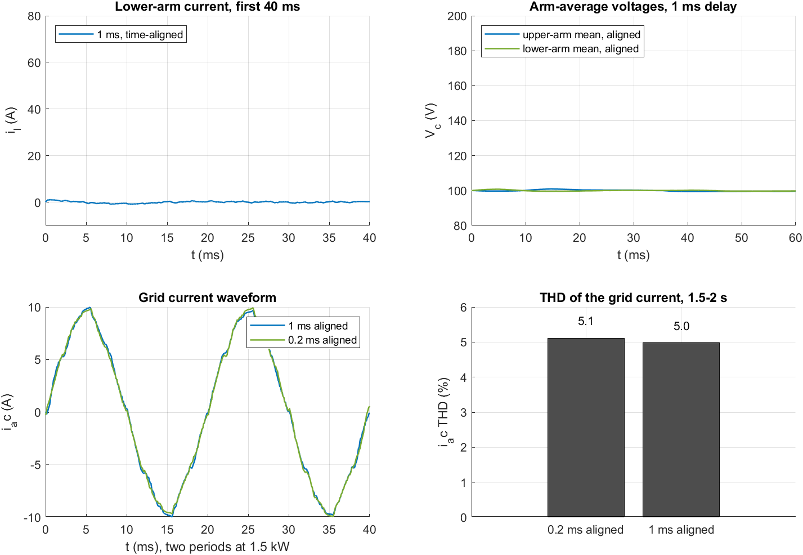

# waveform and THD panels

**Experiment setup:** Aligned neighbor-delay cases at 0.2 and 1.0 ms; 2 s steady 1.5 kW runs.

**Test procedure / measurements:** Inspect lower-arm current at 0–40 ms, arm-average SM Vc at 0–60 ms, i_ac at 1.90–1.94 s, and THD(2–20) on 1.5–2.0 s.

**Recorded result:** Aligned THD≈5.11% (0.2 ms) and ≈4.97% (1.0 ms). **Despite the filename, this saved PNG does not show fresh-own-sample reference traces.**

**Interpretation:** These statements describe the supplied simulation and its recorded analysis. No new MATLAB or physical HIL/TWIST run was performed to produce this page. Voltage spread, arm-average ripple and low-order sampled-current THD should not be treated as interchangeable metrics.

**Sources:** [Aligned-delay dataset notes](../source_notes/aligned_delay_results.md) · [All figures and methods](README.md) · [Original PNG](fig1_delay_fresh_vs_aligned.png)
