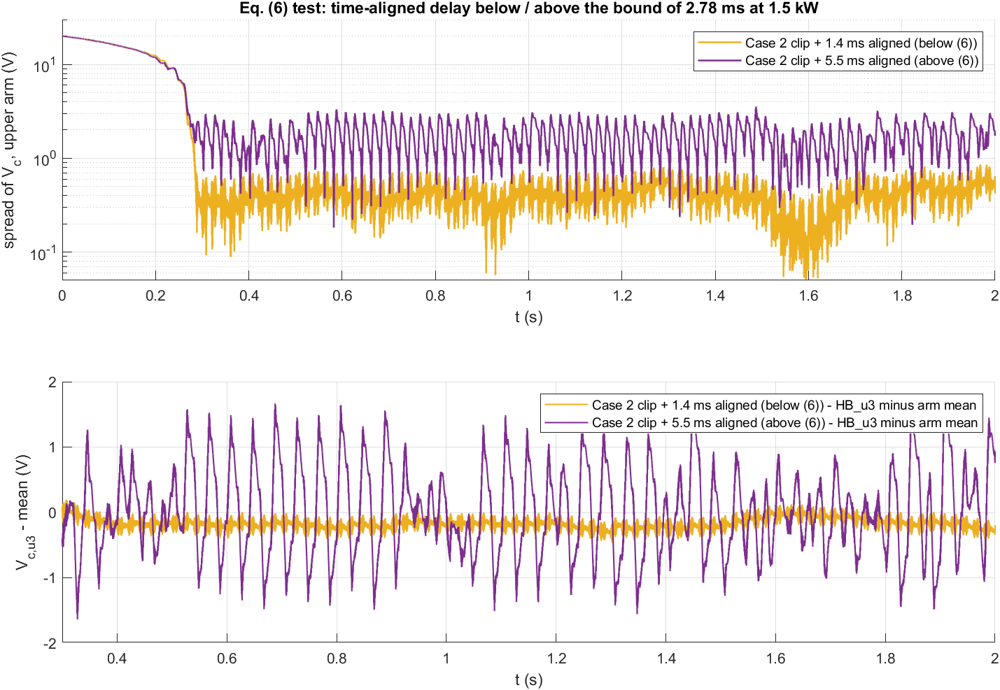

# delay-dependent consensus stability

**Experiment setup:** Compare the 20 V initial mismatch cases with aligned delay 1.4 ms and 5.5 ms, both clipped at |Δm_i|≤0.1.

**Test procedure / measurements:** Plot instantaneous upper SM voltage spread on a log scale and relative SM3 voltage. Compare observed convergence with the simplified ring model’s context-dependent τcrit≈2.78 ms.

**Recorded result:** At 1.4 ms, spread stays below 1 V from ~284 ms. At 5.5 ms, the relative-voltage mode oscillates near 26 Hz. The saved PNG contains **only these two aligned runs**, not a no-delay trace.

**Interpretation:** These statements describe the supplied simulation and its recorded analysis. No new MATLAB or physical HIL/TWIST run was performed to produce this page. Voltage spread, arm-average ripple and low-order sampled-current THD should not be treated as interchangeable metrics.

**Sources:** [Aligned-delay dataset notes](../source_notes/aligned_delay_results.md) · [All figures and methods](README.md) · [Original PNG](fig2_eq6_test.png)
