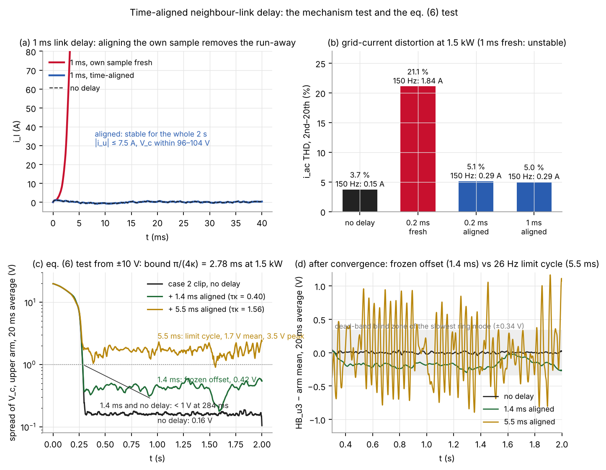

# complete alignment-mechanism comparison

**Experiment setup:** Use both followup_results.mat (fresh-own 0/0.2/1.0 ms and a clipped reference) and aligned_results.mat (four time-aligned cases).

**Test procedure / measurements:** Compare early arm current, low-order grid-current THD, initial-mismatch spread and relative SM3 voltage. Use harmonics 2–20 of i_ac over 1.5–2.0 s.

**Recorded result:** At 0.2 ms, fresh-own sampling produces THD≈21.1% versus ≈5.1% aligned. At 1.0 ms fresh-own diverges while aligned stays bounded. At 5.5 ms aligned, a ~26 Hz balancing oscillation remains.

**Interpretation:** These statements describe the supplied simulation and its recorded analysis. No new MATLAB or physical HIL/TWIST run was performed to produce this page. Voltage spread, arm-average ripple and low-order sampled-current THD should not be treated as interchangeable metrics.

**Sources:** [Aligned-delay dataset notes](../source_notes/aligned_delay_results.md) · [All figures and methods](README.md) · [Original PNG](figC_aligned_delay.png)
