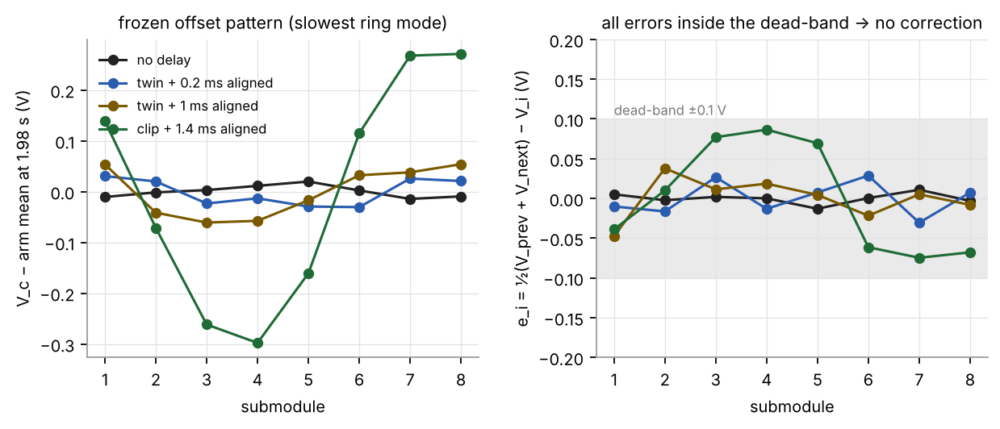

# why a residual voltage offset remains

**Experiment setup:** At ~1.98 s, compare no-delay, 0.2/1.0 ms aligned and the 1.4 ms clipped-aligned mismatch case.

**Test procedure / measurements:** For each upper SM calculate d_i=Vc_i−mean(Vc_arm) and e_i=(Vc_prev+Vc_next)/2−Vc_i with wraparound neighbors. Compare e_i to the ±0.1 V deadband.

**Recorded result:** A residual upper-SM pattern (~−0.30 to +0.27 V for 1.4 ms) remains even with |e_i|<0.1 V at each node. The deadband halts further correction; the unstable 5.5 ms case is not shown.

**Interpretation:** These statements describe the supplied simulation and its recorded analysis. No new MATLAB or physical HIL/TWIST run was performed to produce this page. Voltage spread, arm-average ripple and low-order sampled-current THD should not be treated as interchangeable metrics.

**Sources:** [Aligned-delay dataset notes](../source_notes/aligned_delay_results.md) · [All figures and methods](README.md) · [Original PNG](figD_deadband_frozen_pattern.png)
