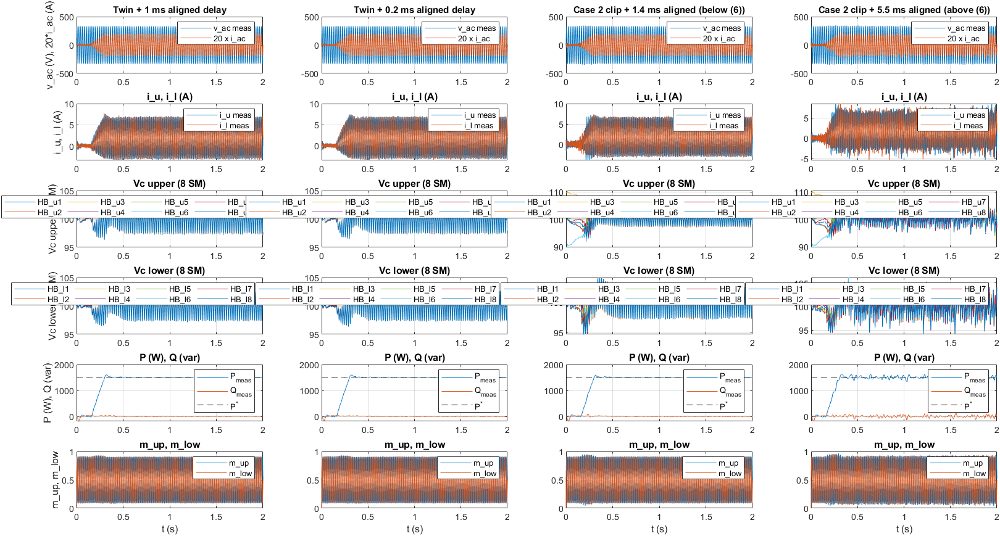

# overview of all four tests

**Experiment setup:** Run the four 2 s aligned-delay models at P*=1,500 W, Q*=0 and k_v=0.2; delays 0.2, 1.0, 1.4 and 5.5 ms. The latter two tests start with a 20 V upper-arm capacitor mismatch and limit |Δm_i| to 0.1.

**Test procedure / measurements:** Compare the same row across the four six-panel scope columns: grid current, upper/lower arm currents, 16 capacitor voltages, P/Q and modulation.

**Recorded result:** 0.2 and 1.0 ms runs remain bounded, 1.4 ms reduces the imposed mismatch, and 5.5 ms shows persistent SM balancing oscillation.

**Interpretation:** These statements describe the supplied simulation and its recorded analysis. No new MATLAB or physical HIL/TWIST run was performed to produce this page. Voltage spread, arm-average ripple and low-order sampled-current THD should not be treated as interchangeable metrics.

**Sources:** [Aligned-delay dataset notes](../source_notes/aligned_delay_results.md) · [All figures and methods](README.md) · [Original PNG](grid_all_aligned.png)
