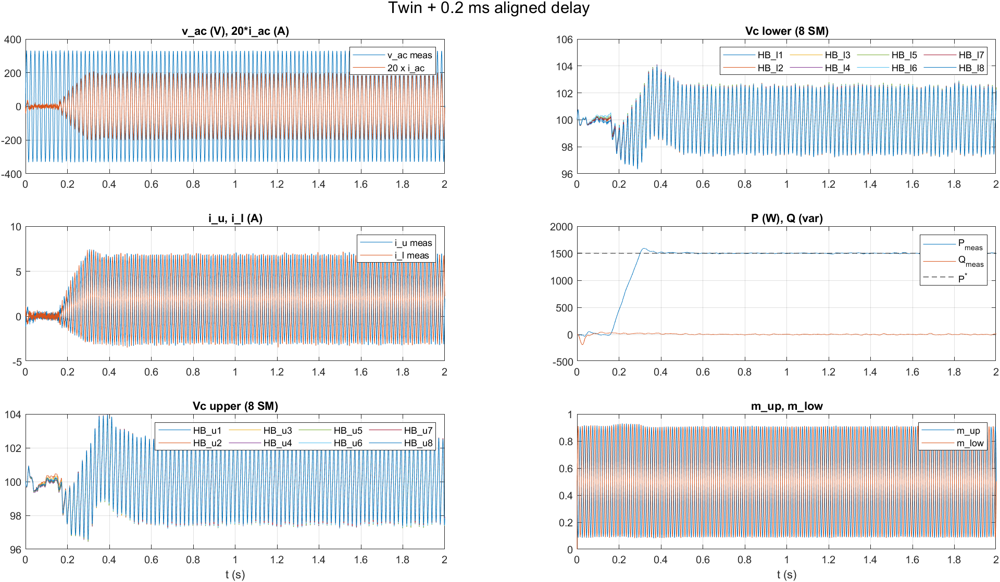

# 0.2 ms aligned communication

**Experiment setup:** Balanced 100 V SM initial conditions; 0.2 ms time-aligned feedback (20 samples at Ts=10 µs); P*=1,500 W; 2 s.

**Test procedure / measurements:** Monitor grid current, upper/lower SM Vc spread, mean P after 0.45 s and THD(2–20) over 1.5–2.0 s. Compare with the unmatched 0.2 ms run.

**Recorded result:** P≈1,500.6 W, low-order THD≈5.11% and 150 Hz current component≈0.288 A, compared with 21.1% THD for unaligned feedback.

**Interpretation:** These statements describe the supplied simulation and its recorded analysis. No new MATLAB or physical HIL/TWIST run was performed to produce this page. Voltage spread, arm-average ripple and low-order sampled-current THD should not be treated as interchangeable metrics.

**Sources:** [Aligned-delay dataset notes](../source_notes/aligned_delay_results.md) · [All figures and methods](README.md) · [Original PNG](grid_case1b_delay02_aligned.png)
