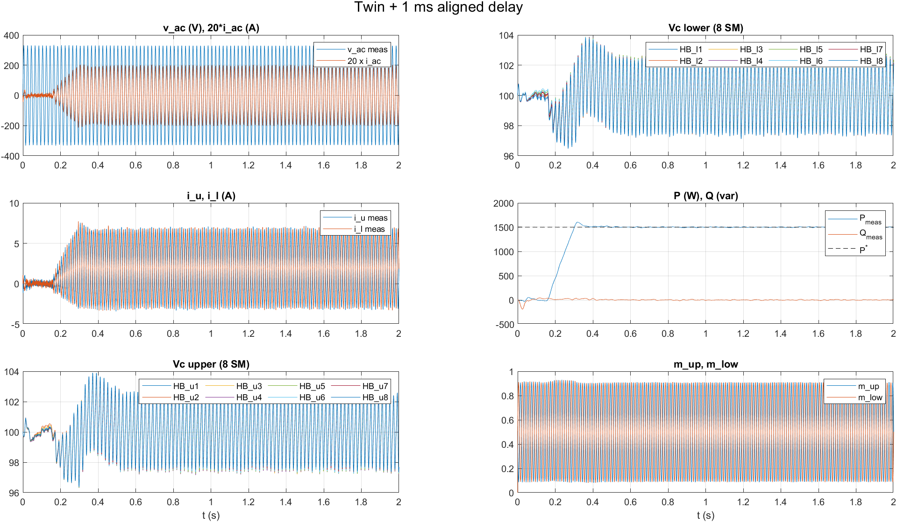

# 1.0 ms aligned communication

**Experiment setup:** Balanced 100 V SM initial conditions; 1.0 ms aligned neighbor feedback (100 samples at Ts=10 µs); P*=1,500 W; 2 s.

**Test procedure / measurements:** Check grid-current waveform, current limits, per-SM capacitor-voltage grouping, mean active power after 0.45 s, and 2nd–20th current harmonics on 1.5–2.0 s.

**Recorded result:** P≈1,500.4 W, low-order THD≈4.97%, upper arm current −3.41 to +7.54 A. The case stays bounded during the simulated window; the unmatched 1 ms feedback case diverges.

**Interpretation:** These statements describe the supplied simulation and its recorded analysis. No new MATLAB or physical HIL/TWIST run was performed to produce this page. Voltage spread, arm-average ripple and low-order sampled-current THD should not be treated as interchangeable metrics.

**Sources:** [Aligned-delay dataset notes](../source_notes/aligned_delay_results.md) · [All figures and methods](README.md) · [Original PNG](grid_case1b_delay1_aligned.png)
