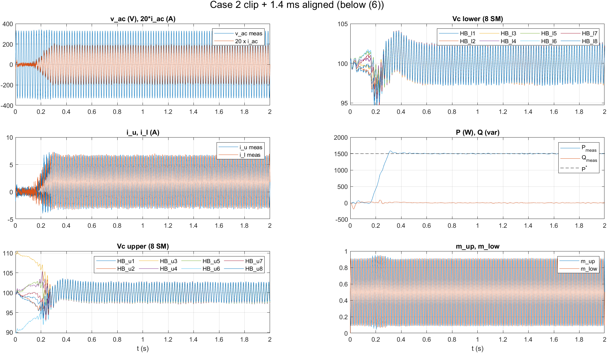

# balancing recovery below the delay estimate

**Experiment setup:** Upper SM3 starts at 110 V and SM6 at 90 V (20 V spread); k_v=0.2, |Δm_i|≤0.1, aligned delay 1.4 ms; 2 s.

**Test procedure / measurements:** Calculate instantaneous upper Vc spread=max(Vc_up)-min(Vc_up) at each recorded time; report the time **after the last excursion above 1 V**. Inspect initial arm-current stress.

**Recorded result:** Spread remains below 1 V from about 283.6 ms; mean P≈1,500.7 W; low-order grid-current THD≈4.54%. A small inter-SM residual voltage offset persists.

**Interpretation:** These statements describe the supplied simulation and its recorded analysis. No new MATLAB or physical HIL/TWIST run was performed to produce this page. Voltage spread, arm-average ripple and low-order sampled-current THD should not be treated as interchangeable metrics.

**Sources:** [Aligned-delay dataset notes](../source_notes/aligned_delay_results.md) · [All figures and methods](README.md) · [Original PNG](grid_case2_clip_delay1p4_aligned.png)
