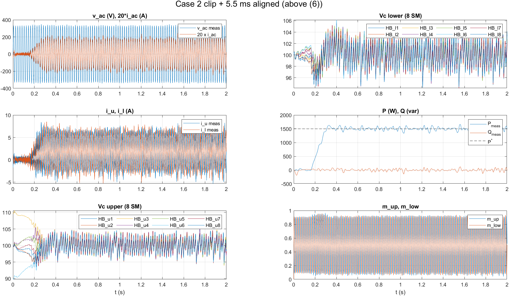

# high-delay consensus oscillation

**Experiment setup:** Identical to the 1.4 ms mismatch test, except aligned neighbor delay is 5.5 ms (550 steps at Ts=10 µs).

**Test procedure / measurements:** Monitor late-time instantaneous upper voltage spread, relative SM3 voltage Vc3−mean(Vc_up), power and arm currents; inspect the 1–2 s relative-voltage spectrum.

**Recorded result:** No sustained spread <1 V; late upper spread peaks around 3.54 V, with a bounded oscillatory component near 26 Hz. Low-order THD≈4.40% does not imply stable voltage consensus.

**Interpretation:** These statements describe the supplied simulation and its recorded analysis. No new MATLAB or physical HIL/TWIST run was performed to produce this page. Voltage spread, arm-average ripple and low-order sampled-current THD should not be treated as interchangeable metrics.

**Sources:** [Aligned-delay dataset notes](../source_notes/aligned_delay_results.md) · [All figures and methods](README.md) · [Original PNG](grid_case2_clip_delay5p5_aligned.png)
