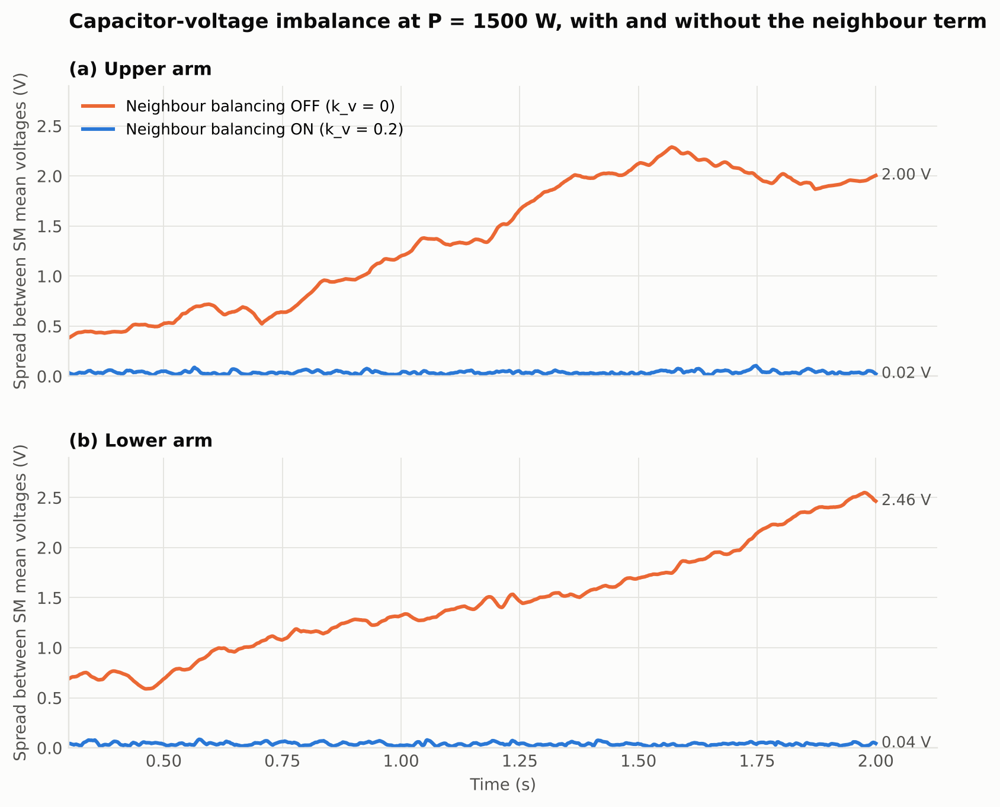

# Disabled versus enabled capacitor balancing

**Experiment setup:** Compare case A1 (`k_v=0`) and enabled case A3 or its balanced reference (`k_v=0.2`) at overlapping time windows.

**Test procedure / measurements:** Compute max–min differences after applying the **same** optional 20 ms moving average separately to each SM; do not mix these with raw instantaneous spread.

**Recorded result:** With balancing OFF, the 20 ms-averaged upper/lower SM spreads at 2.0 s are approximately 2.00/2.46 V. With neighbor balancing ON (`k_v=0.2`), they are approximately 0.02/0.04 V. This supports improved local capacitor-voltage equalization over the recorded 2 s run.

**Interpretation:** These statements describe the supplied simulation and its recorded analysis. No new MATLAB or physical HIL/TWIST run was performed to produce this page. Voltage spread, arm-average ripple and low-order sampled-current THD should not be treated as interchangeable metrics.

**Sources:** [Corrected experiment measurements](../source_notes/grid_base_results.md) · [All figures and methods](README.md) · [Original PNG](FigA_balancing_on_off.png)
