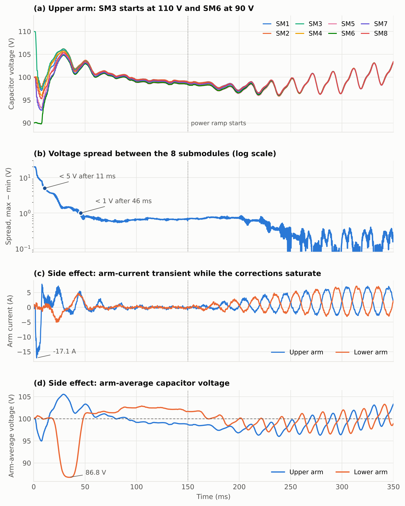

# Initial capacitor mismatch and current stress

**Experiment setup:** Plot the 110 V / 90 V upper-SM initial condition and simultaneous upper-arm current during A2.

**Test procedure / measurements:** Check fast spread decay at startup and any current excursion during clipped/unclipped PWM duty saturation; note when the current reference becomes active.

**Recorded result:** The voltage mismatch reduces rapidly but creates a strong transient, motivating a clipped duty-correction follow-up.

**Interpretation:** These statements describe the supplied simulation and its recorded analysis. No new MATLAB or physical HIL/TWIST run was performed to produce this page. Voltage spread, arm-average ripple and low-order sampled-current THD should not be treated as interchangeable metrics.

**Sources:** [Corrected experiment measurements](../source_notes/grid_base_results.md) · [All figures and methods](README.md) · [Original PNG](FigB_initial_imbalance.png)
