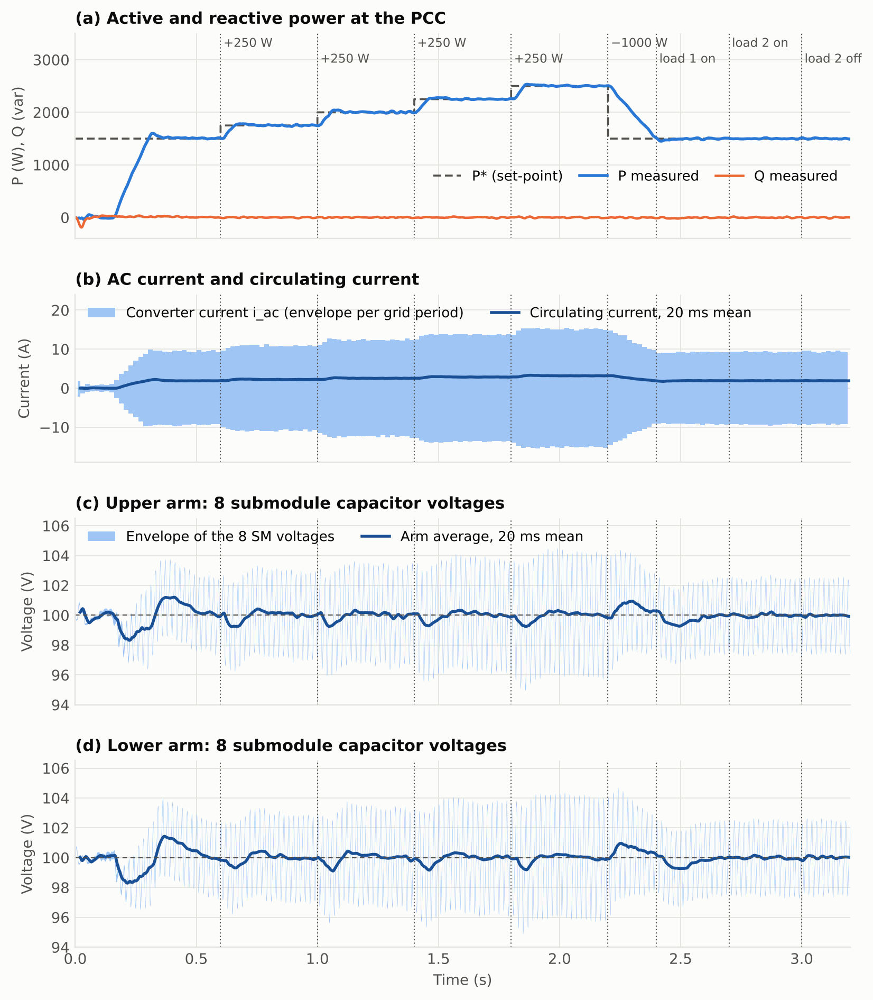

# Power staircase overview

**Experiment setup:** Use A3 and display P_ref, P_measured, arm-average capacitor voltages and/or current traces across 0–3.2 s.

**Test procedure / measurements:** Compare each 100 ms pre-transition steady window and transient peak around each command; check negative-step slew rate.

**Recorded result:** Steps increase from 1500 to 2500 W with small steady errors; transient overshoot is about 29–43 W for upward 250 W increments.

**Interpretation:** These statements describe the supplied simulation and its recorded analysis. No new MATLAB or physical HIL/TWIST run was performed to produce this page. Voltage spread, arm-average ripple and low-order sampled-current THD should not be treated as interchangeable metrics.

**Sources:** [Corrected experiment measurements](../source_notes/grid_base_results.md) · [All figures and methods](README.md) · [Original PNG](FigC_staircase_overview.png)
