# Base experiments: figure-by-figure methods and outcomes

> Each original PNG has a **companion Markdown page** with its own image, experiment setup, test procedure, and recorded result. GitHub’s direct PNG preview cannot display captions; open the adjacent `.md` page to view the explanation directly under the image.

All **13 original PNG images** are displayed below with the experimental procedure, how to read the graph, and the archived numerical result. The figures have not been edited.

**[Main project](../../../README.md)** · **[Historical five-image guide](../source_notes/nvb/README.md)** · **[Corrected measured results](../source_notes/grid_base_results.md)** · **[Three-case MATLAB runner](../scripts/run_three_cases.m)**

## Shared setup

Single-phase grid-connected MMC; 8 half-bridge SMs per arm; Vdc 800 V; Vc_nom 100 V; Csm 2.2 mF; Larm 5 mH; grid 230 V RMS, 50 Hz; SM carrier 1,250 Hz; simulation step 10 µs; arm-controller step 100 µs.

- **A1 (2 s):** disable local balancing (`k_v=0`); test individual capacitor drift at 1,500 W.
- **A2 (2 s):** initialize upper SM3/SM6 at 110/90 V (`k_v=0.2`); test voltage convergence and startup-current transients.
- **A3 (3.2 s):** change P* through 1,500–2,500 W in 250 W increments then back to 1,500 W; switch two PCC loads at 2.4/2.7/3.0 s; test power tracking and arm energy ripple.

**Interpretation rule:** instantaneous spread, spread after 20 ms averaging *per SM*, and peak-to-peak ripple of the **arm-average voltage** are three different metrics.

## 1. `grid_all_cases.png` — Three-case multi-panel overview

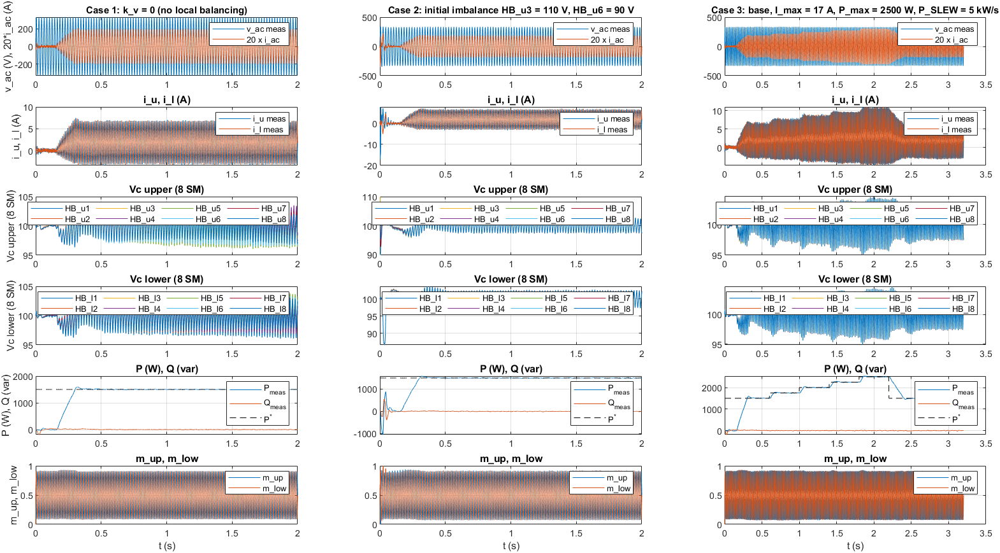

**[Open the figure with its experiment setup, test procedure and result](grid_all_cases.md)**

**How the test was performed:** Run the three corrected base models with `run_three_cases.m`, logging voltage/current, P/Q, SM capacitor voltages, and upper/lower arm quantities. Group panels by test case.

**What to verify in the figure:** Compare the capacitor-voltage spread in the disabled-balancing case against the mismatch recovery and power/load test. Keep each plot's time window and vertical scaling in mind.

**Recorded outcome / interpretation:** A comparison display, not a quantitative convergence estimate: refer to the individual plots below for thresholds.

## 2. `grid_case1_kv0.png` — A1 — balancing OFF, full scope

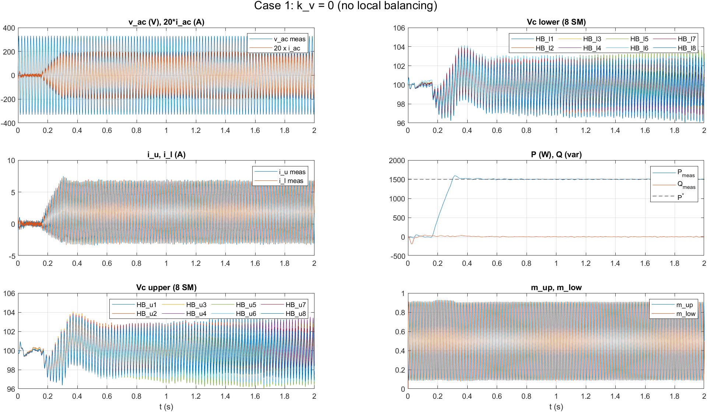

**[Open the figure with its experiment setup, test procedure and result](grid_case1_kv0.md)**

**How the test was performed:** Set `k_v=0` in all 16 local SM controllers. Start all capacitor voltages equally; command P*=1500 W for 2 s.

**What to verify in the figure:** Inspect all upper/lower Vc traces, their instantaneous min–max spread, and whether arm currents and active power remain bounded.

**Recorded outcome / interpretation:** At 2 s the instantaneous upper spread is ~2.07 V; this negative-control test shows growing SM voltage dispersion without local correction.

## 3. `grid_case2_imbalance.png` — A2 — initial mismatch, full scope

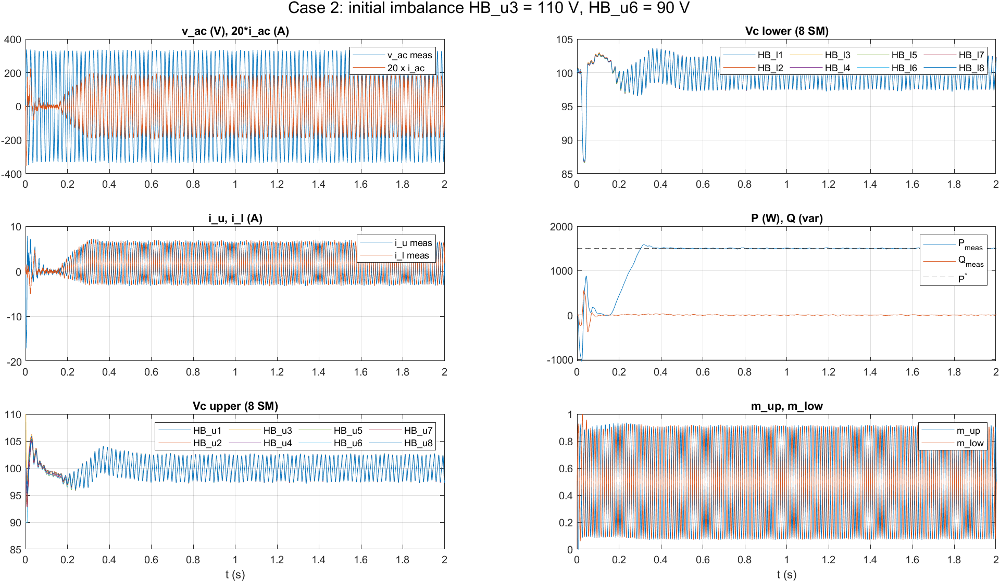

**[Open the figure with its experiment setup, test procedure and result](grid_case2_imbalance.md)**

**How the test was performed:** With `k_v=0.2`, initialize upper SM3 to 110 V and SM6 to 90 V, leaving the rest nominal. Run 2 s and log SM voltages and arm/grid currents.

**What to verify in the figure:** Measure instantaneous spread; find the *last time* that spread exceeds 1 V and 0.5 V. Inspect the startup peak current as a possible saturation side effect.

**Recorded outcome / interpretation:** The archived run stays below 1 V from ~0.170 s and below 0.5 V from ~0.242 s; a large initial current transient remains a limitation.

## 4. `grid_case3_base.png` — A3 — staircase and PCC-load scope

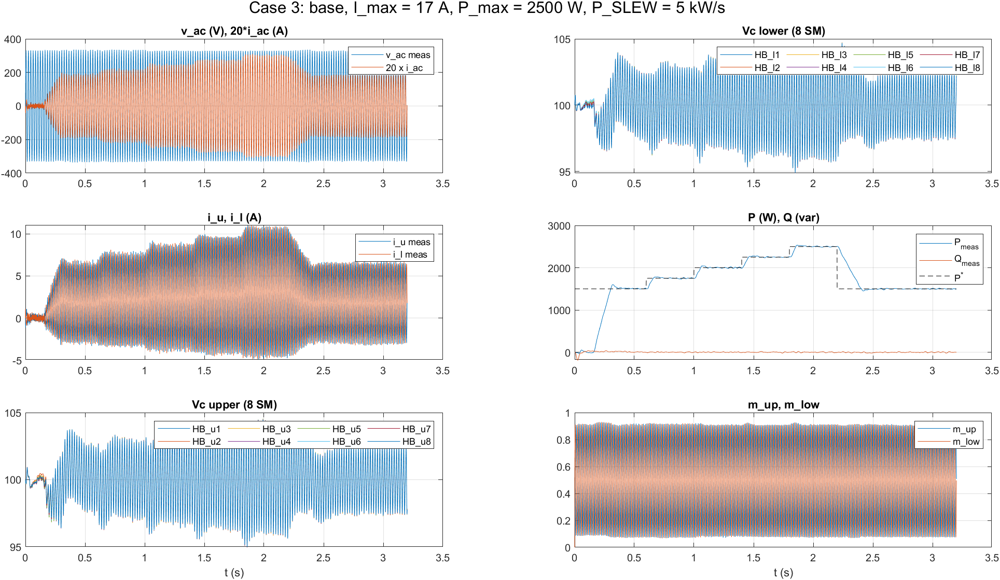

**[Open the figure with its experiment setup, test procedure and result](grid_case3_base.md)**

**How the test was performed:** Apply P*=1500→1750→2000→2250→2500→1500 W at 0.6/1.0/1.4/1.8/2.2 s. Connect 1 kW load at 2.4 s, another at 2.7 s, disconnect the second at 3.0 s.

**What to verify in the figure:** Verify P tracking, upper/lower arm currents and Vc, modulation staying inside [0,1], and PCC power balance.

**Recorded outcome / interpretation:** Steady P near targets in increasing staircase; the 2.2 s downward command uses a 5 kW/s slew limiter.

## 5. `FigA_balancing_on_off.png` — Disabled versus enabled capacitor balancing

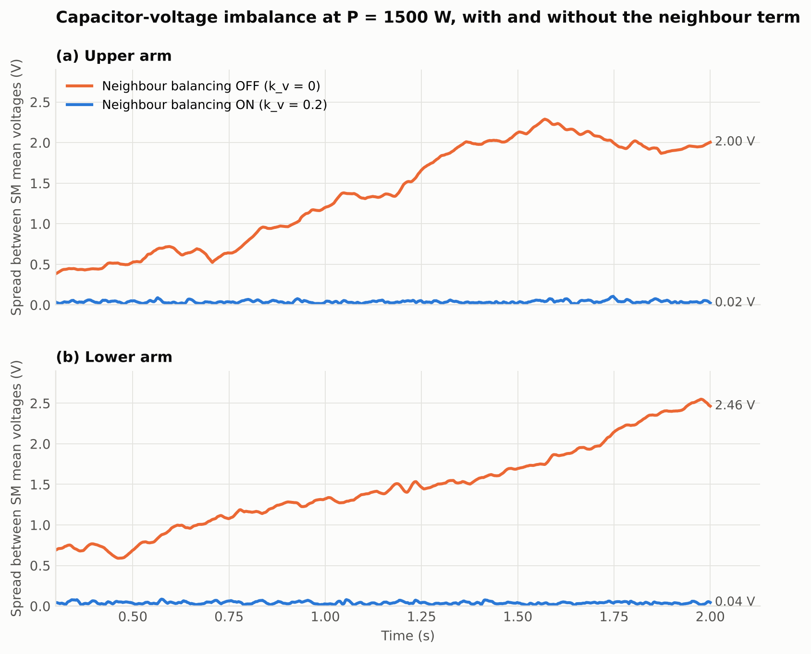

**[Open the figure with its experiment setup, test procedure and result](FigA_balancing_on_off.md)**

**How the test was performed:** Compare case A1 (`k_v=0`) and enabled case A3 or its balanced reference (`k_v=0.2`) at overlapping time windows.

**What to verify in the figure:** Compute max–min differences after applying the **same** optional 20 ms moving average separately to each SM; do not mix these with raw instantaneous spread.

**Recorded outcome / interpretation:** At 2 s, the 20 ms-averaged upper/lower inter-SM spreads are ~2.00/2.46 V without balancing versus ~0.02/0.04 V with `k_v=0.2`. This is balancing performance, not a comparison of arm-average voltage ripple.

## 6. `FigB_initial_imbalance.png` — Initial capacitor mismatch and current stress

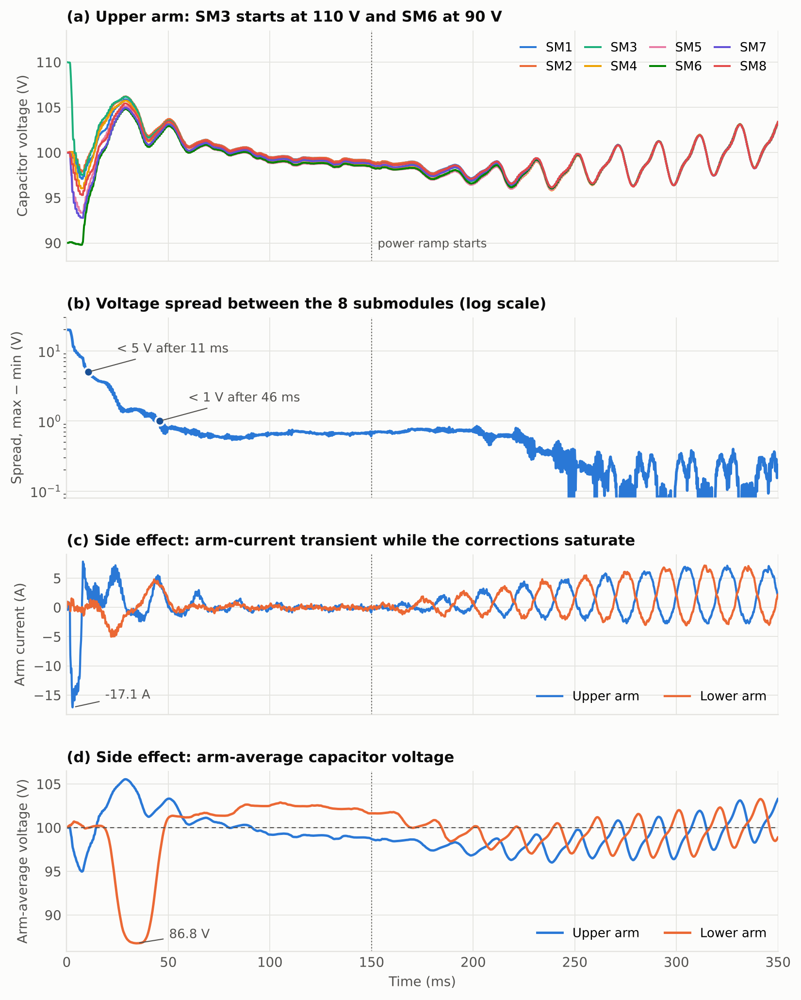

**[Open the figure with its experiment setup, test procedure and result](FigB_initial_imbalance.md)**

**How the test was performed:** Plot the 110 V / 90 V upper-SM initial condition and simultaneous upper-arm current during A2.

**What to verify in the figure:** Check fast spread decay at startup and any current excursion during clipped/unclipped PWM duty saturation; note when the current reference becomes active.

**Recorded outcome / interpretation:** Upper-SM voltage spread starts at 20 V, first crosses below 1 V at ~46 ms, and remains under 0.5 V after ~242 ms. The original *unclipped* correction causes a startup current excursion near −17.1 A; later experiments test duty-correction clipping.

## 7. `FigC_staircase_overview.png` — Power staircase overview

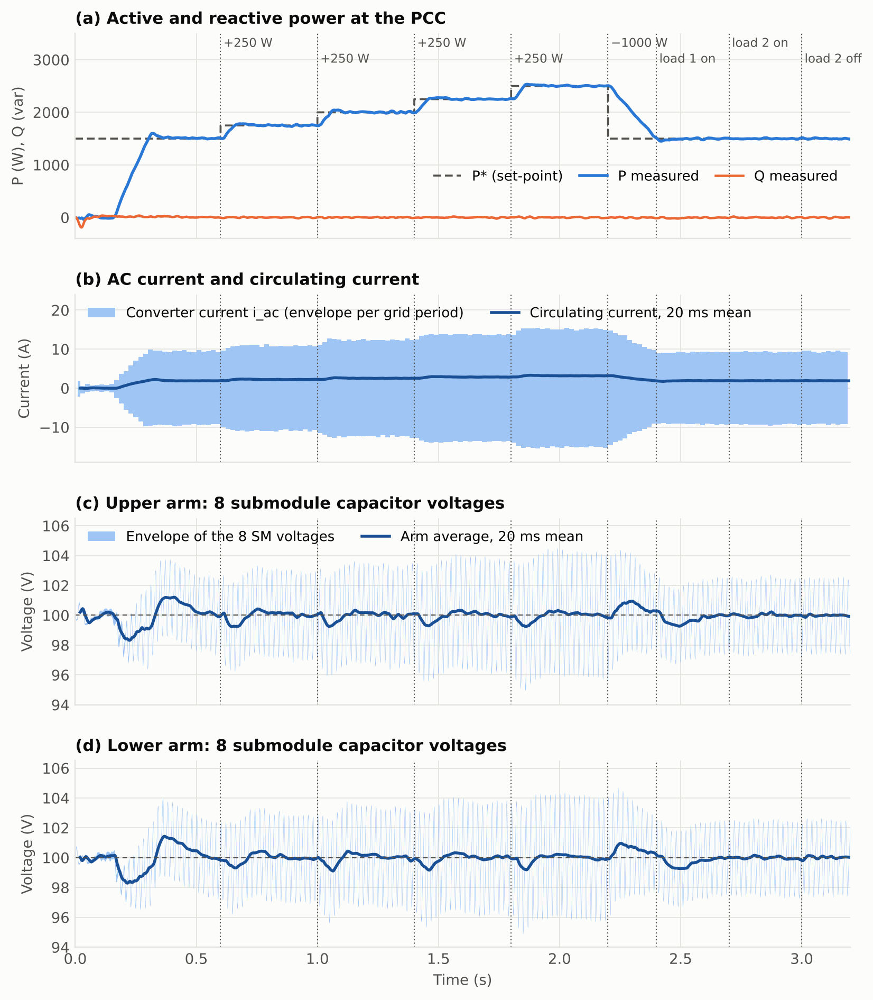

**[Open the figure with its experiment setup, test procedure and result](FigC_staircase_overview.md)**

**How the test was performed:** Use A3 and display P_ref, P_measured, arm-average capacitor voltages and/or current traces across 0–3.2 s.

**What to verify in the figure:** Compare each 100 ms pre-transition steady window and transient peak around each command; check negative-step slew rate.

**Recorded outcome / interpretation:** Steps increase from 1500 to 2500 W with small steady errors; transient overshoot is about 29–43 W for upward 250 W increments.

## 8. `FigD_ripple_vs_P.png` — Capacitor ripple versus active power

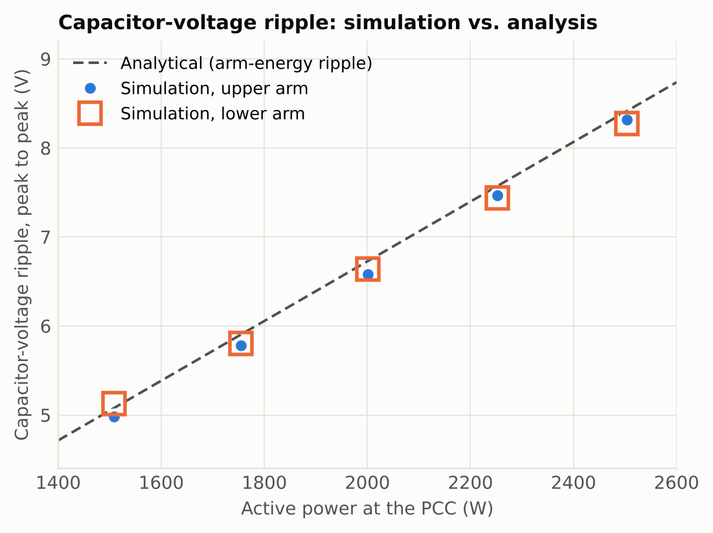

**[Open the figure with its experiment setup, test procedure and result](FigD_ripple_vs_P.md)**

**How the test was performed:** For A3, take the last 100 ms of each steady P level and compute peak-to-peak ripple of the arm-average Vc; compare against the analytical energy-ripple estimate.

**What to verify in the figure:** Plot both upper and lower values versus P and the analytical curve; inspect *relative* analytical error.

**Recorded outcome / interpretation:** Measured upper-arm ripple rises approximately 4.98→8.32 V and lower-arm ripple 5.13→8.27 V from 1500→2500 W.

## 9. `fig1_spread_kv_on_vs_off.png` — Focused SM voltage spread: OFF versus ON

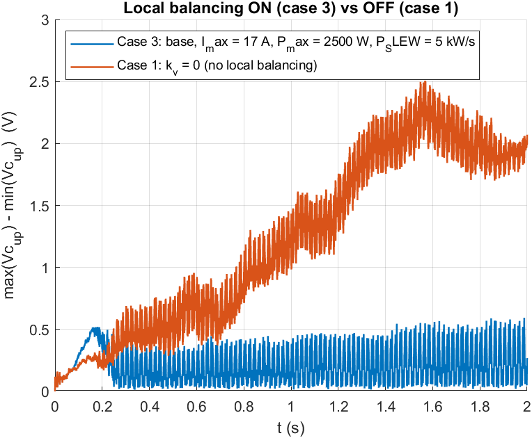

**[Open the figure with its experiment setup, test procedure and result](fig1_spread_kv_on_vs_off.md)**

**How the test was performed:** Calculate `max(Vc_up,[],2)-min(Vc_up,[],2)` for A1 and enabled-balancing comparison, or filter each SM voltage identically before computing spread.

**What to verify in the figure:** Confirm the legend and specify whether instantaneous or 20 ms moving-averaged signals were plotted.

**Recorded outcome / interpretation:** Visible growth for `k_v=0` compared with tighter voltage grouping when local balancing is enabled.

## 10. `fig2_case2_initial_imbalance.png` — Focused transient recovery from ±10 V mismatch

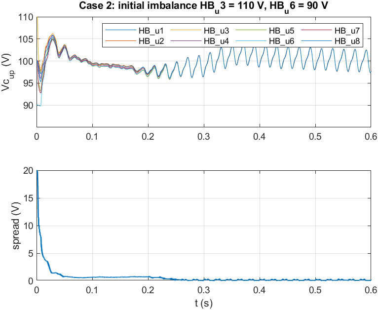

**[Open the figure with its experiment setup, test procedure and result](fig2_case2_initial_imbalance.md)**

**How the test was performed:** From A2 plot SM capacitor voltages, min–max spread and startup arm current around 0–0.3 s.

**What to verify in the figure:** Mark initial spread 20 V, onset of current ~0.17 s and first *sustained* crossing of 1 V / 0.5 V thresholds.

**Recorded outcome / interpretation:** Effective mismatch recovery with a potentially excessive early arm-current excursion; include protection/clipping before embedded implementation.

## 11. `fig3_case3_staircase.png` — Measured power versus P reference

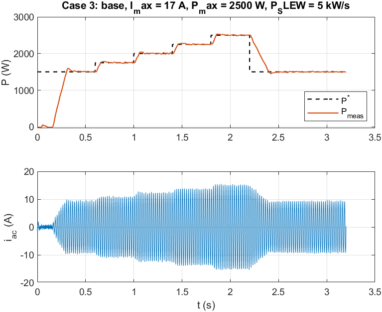

**[Open the figure with its experiment setup, test procedure and result](fig3_case3_staircase.md)**

**How the test was performed:** Run A3, display power command and 20 ms moving-average measured active power across each step.

**What to verify in the figure:** Quantify steady-state error and maximum overshoot; account for `P_SLEW=5000 W/s` and avoid interpreting 2.3–2.4 s as settled after the −1000 W transition.

**Recorded outcome / interpretation:** Increasing steps settle to approximately 1506, 1754, 2003, 2250 and 2502 W.

## 12. `fig4_case3_load_test.png` — PCC active-power balance under load switching

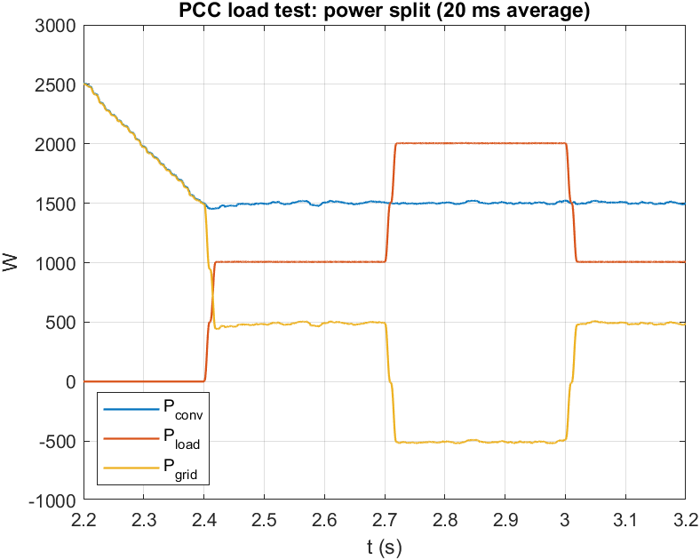

**[Open the figure with its experiment setup, test procedure and result](fig4_case3_load_test.md)**

**How the test was performed:** During A3, measure or estimate converter-side P, load P, and grid P around 2.4, 2.7, and 3.0 s; use the same 20 ms averaging window.

**What to verify in the figure:** Verify `P_converter ≈ P_load + P_grid` with consistent sign convention before, during and after both 1 kW load connections.

**Recorded outcome / interpretation:** With both 1 kW loads, grid power reverses to roughly −509 W while converter power stays near 1.5 kW.

## 13. `fig5_case3_Vc_ripple_vs_P.png` — P-dependent SM capacitor ripple

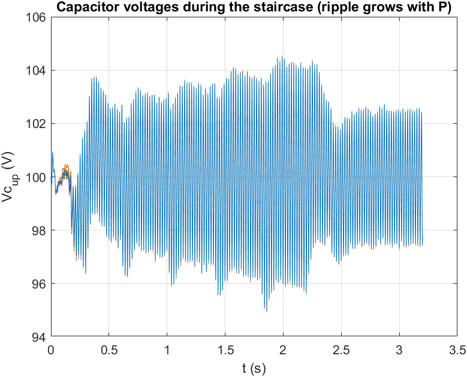

**[Open the figure with its experiment setup, test procedure and result](fig5_case3_Vc_ripple_vs_P.md)**

**How the test was performed:** Sweep the five rising P levels of A3; compute steady-state capacitor peak-to-peak ripple from equivalent upper/lower arm measurements.

**What to verify in the figure:** Assess monotonicity of ripple versus power and avoid confusing common arm energy ripple with among-SM imbalance.

**Recorded outcome / interpretation:** The upper/lower arm-average ripple grows with P; the result concerns the energy-storage requirement, not solely voltage balancing.

---

## Verification from the original files

1. Import the original A1–A3 Simulink models and `three_cases_results.mat` from the research ZIP, then use the [MATLAB runner](../scripts/run_three_cases.m).
2. Inspect all eight upper and all eight lower capacitor traces, arm currents and measured P/Q.
3. Calculate instantaneous capacitor spread before smoothing and the separate, 20 ms-averaged spread to quantify balancing.
4. Evaluate steady-state P during the last 100 ms of each step; distinguish the 200 ms down-slew from an unslewed transient.
5. Cross-check the values against [corrected case results](../source_notes/grid_base_results.md). Saved 100 µs traces do not support full-band switching THD.

**Scientific status:** archived simulations only; no new model run, TWIST experiment or OPAL-RT HIL verification was performed during this documentation update.
