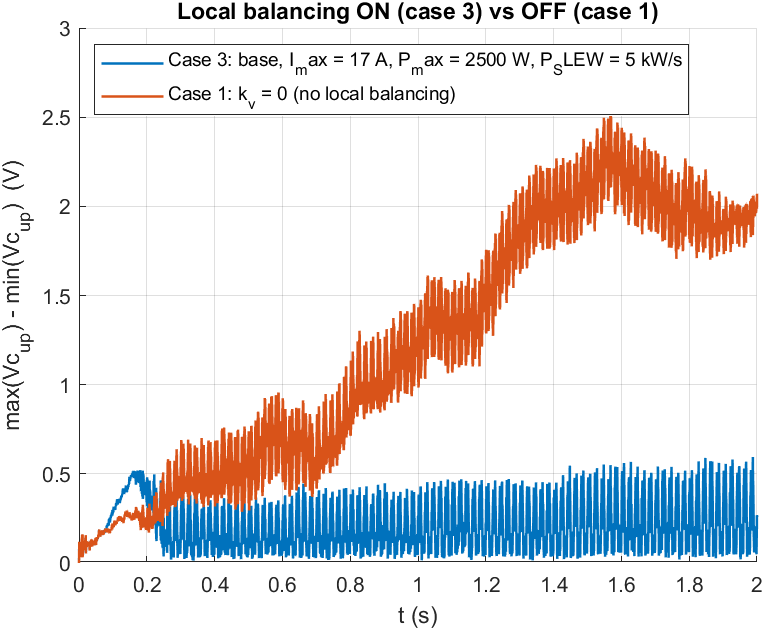

# Focused SM voltage spread: OFF versus ON

**Experiment setup:** Calculate `max(Vc_up,[],2)-min(Vc_up,[],2)` for A1 and enabled-balancing comparison, or filter each SM voltage identically before computing spread.

**Test procedure / measurements:** Confirm the legend and specify whether instantaneous or 20 ms moving-averaged signals were plotted.

**Recorded result:** Visible growth for `k_v=0` compared with tighter voltage grouping when local balancing is enabled.

**Interpretation:** These statements describe the supplied simulation and its recorded analysis. No new MATLAB or physical HIL/TWIST run was performed to produce this page. Voltage spread, arm-average ripple and low-order sampled-current THD should not be treated as interchangeable metrics.

**Sources:** [Corrected experiment measurements](../source_notes/grid_base_results.md) · [All figures and methods](README.md) · [Original PNG](fig1_spread_kv_on_vs_off.png)
