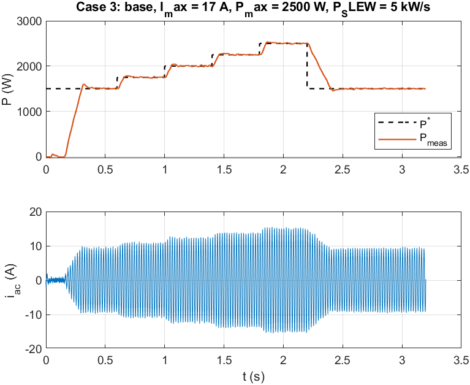

# Measured power versus P reference

**Experiment setup:** Run A3, display power command and 20 ms moving-average measured active power across each step.

**Test procedure / measurements:** Quantify steady-state error and maximum overshoot; account for `P_SLEW=5000 W/s` and avoid interpreting 2.3–2.4 s as settled after the −1000 W transition.

**Recorded result:** Increasing steps settle to approximately 1506, 1754, 2003, 2250 and 2502 W.

**Interpretation:** These statements describe the supplied simulation and its recorded analysis. No new MATLAB or physical HIL/TWIST run was performed to produce this page. Voltage spread, arm-average ripple and low-order sampled-current THD should not be treated as interchangeable metrics.

**Sources:** [Corrected experiment measurements](../source_notes/grid_base_results.md) · [All figures and methods](README.md) · [Original PNG](fig3_case3_staircase.png)
