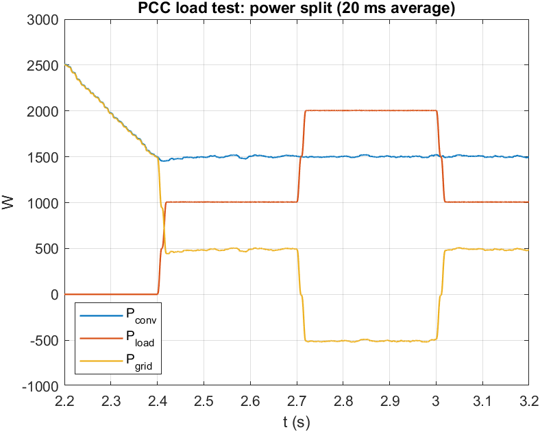

# PCC active-power balance under load switching

**Experiment setup:** During A3, measure or estimate converter-side P, load P, and grid P around 2.4, 2.7, and 3.0 s; use the same 20 ms averaging window.

**Test procedure / measurements:** Verify `P_converter ≈ P_load + P_grid` with consistent sign convention before, during and after both 1 kW load connections.

**Recorded result:** With both 1 kW loads, grid power reverses to roughly −509 W while converter power stays near 1.5 kW.

**Interpretation:** These statements describe the supplied simulation and its recorded analysis. No new MATLAB or physical HIL/TWIST run was performed to produce this page. Voltage spread, arm-average ripple and low-order sampled-current THD should not be treated as interchangeable metrics.

**Sources:** [Corrected experiment measurements](../source_notes/grid_base_results.md) · [All figures and methods](README.md) · [Original PNG](fig4_case3_load_test.png)
