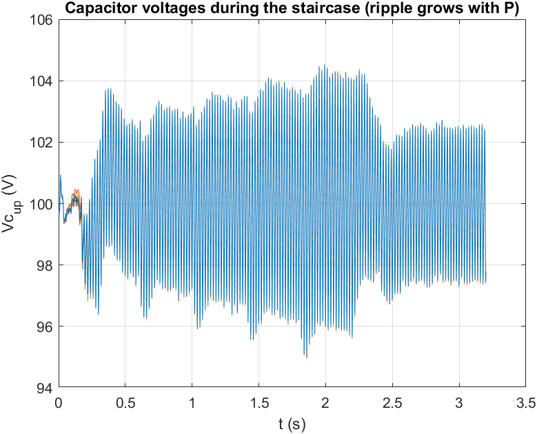

# P-dependent SM capacitor ripple

**Experiment setup:** Sweep the five rising P levels of A3; compute steady-state capacitor peak-to-peak ripple from equivalent upper/lower arm measurements.

**Test procedure / measurements:** Assess monotonicity of ripple versus power and avoid confusing common arm energy ripple with among-SM imbalance.

**Recorded result:** The upper/lower arm-average ripple grows with P; the result concerns the energy-storage requirement, not solely voltage balancing.

**Interpretation:** These statements describe the supplied simulation and its recorded analysis. No new MATLAB or physical HIL/TWIST run was performed to produce this page. Voltage spread, arm-average ripple and low-order sampled-current THD should not be treated as interchangeable metrics.

**Sources:** [Corrected experiment measurements](../source_notes/grid_base_results.md) · [All figures and methods](README.md) · [Original PNG](fig5_case3_Vc_ripple_vs_P.png)
