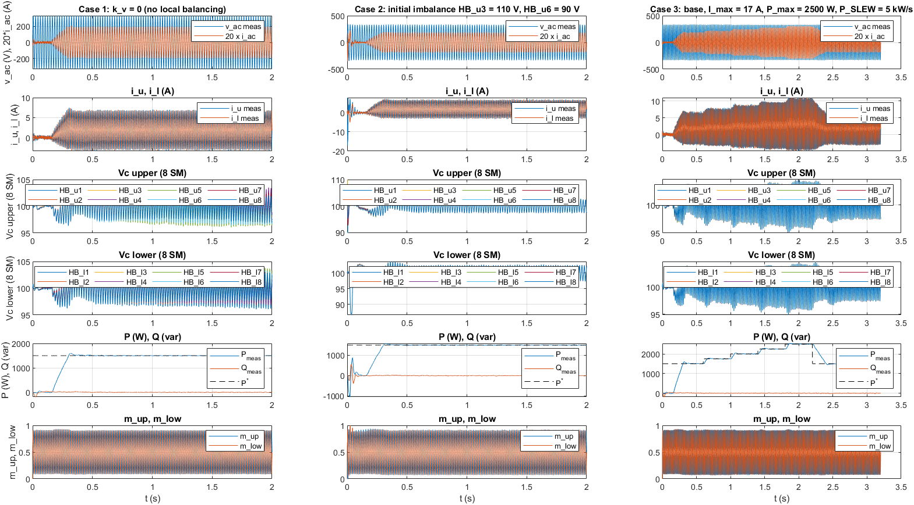

# Three-case multi-panel overview

**Experiment setup:** Run the three corrected base models with `run_three_cases.m`, logging voltage/current, P/Q, SM capacitor voltages, and upper/lower arm quantities. Group panels by test case.

**Test procedure / measurements:** Compare the capacitor-voltage spread in the disabled-balancing case against the mismatch recovery and power/load test. Keep each plot's time window and vertical scaling in mind.

**Recorded result:** A comparison display, not a quantitative convergence estimate: refer to the individual plots below for thresholds.

**Interpretation:** These statements describe the supplied simulation and its recorded analysis. No new MATLAB or physical HIL/TWIST run was performed to produce this page. Voltage spread, arm-average ripple and low-order sampled-current THD should not be treated as interchangeable metrics.

**Sources:** [Corrected experiment measurements](../source_notes/grid_base_results.md) · [All figures and methods](README.md) · [Original PNG](grid_all_cases.png)
