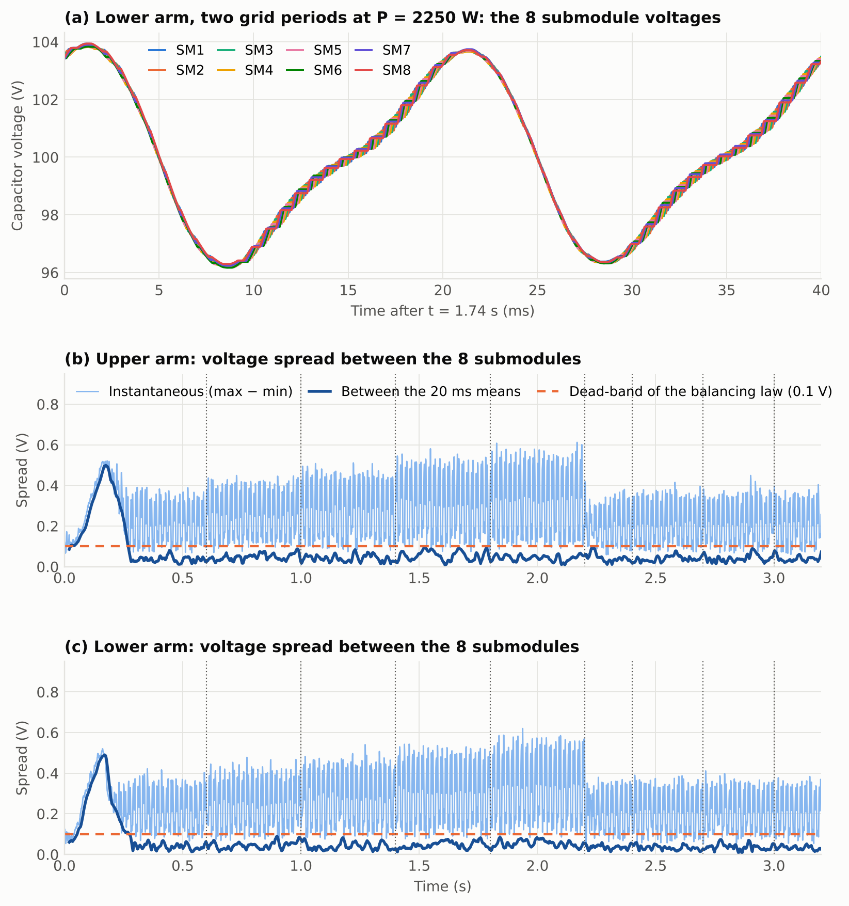

# NVB historical balancing trace (supplement)

**Experiment setup:** Inspect upper/lower SM voltage average offsets for the earlier enabled-balancing run at several power levels.

**Test procedure / measurements:** Apply per-SM moving averages before claiming a few-hundredths-volt residual; compare against 0.1 V deadband and current limits.

**Recorded result:** Illustrates tight steady inter-SM mean voltage matching under enabled local correction; not the direct output of T3.1.

**Interpretation:** These statements describe the supplied simulation and its recorded analysis. No new MATLAB or physical HIL/TWIST run was performed to produce this page. Voltage spread, arm-average ripple and low-order sampled-current THD should not be treated as interchangeable metrics.

**Sources:** [Historical baseline measurements](grid_base_results.md) · [All figures and methods](README.md) · [Original PNG](Fig2_balancing.png)
