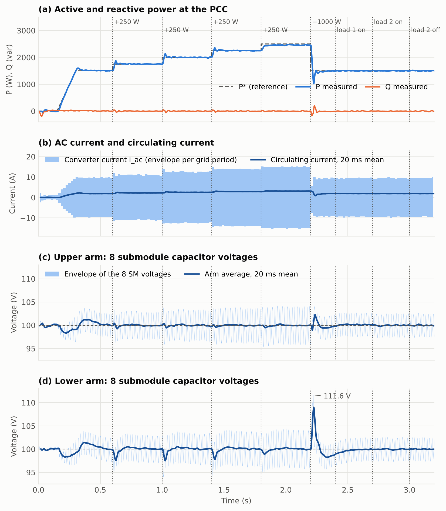
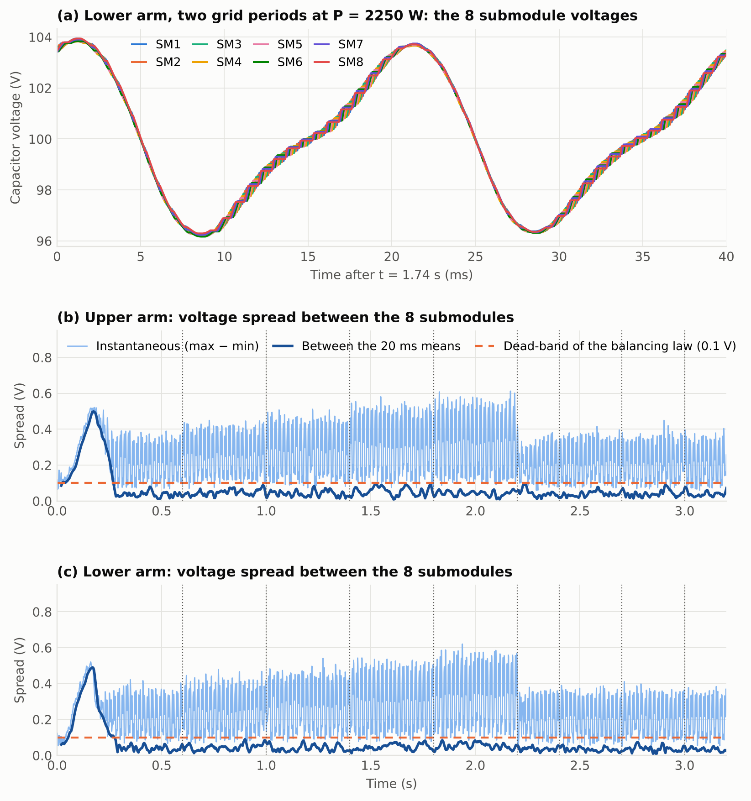
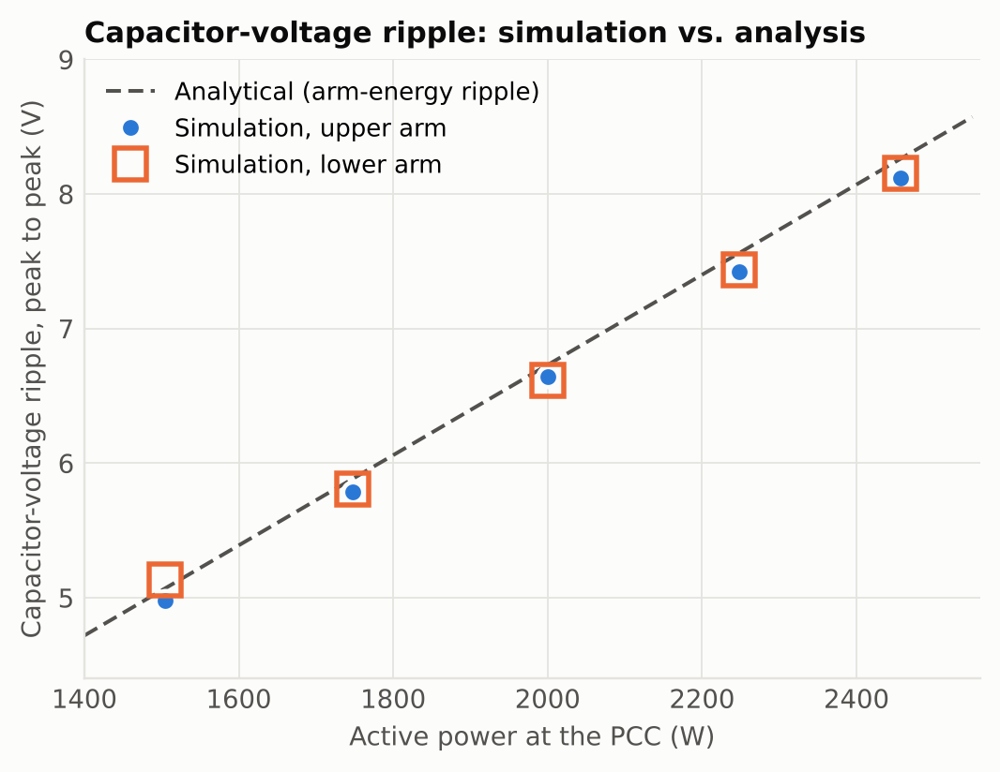
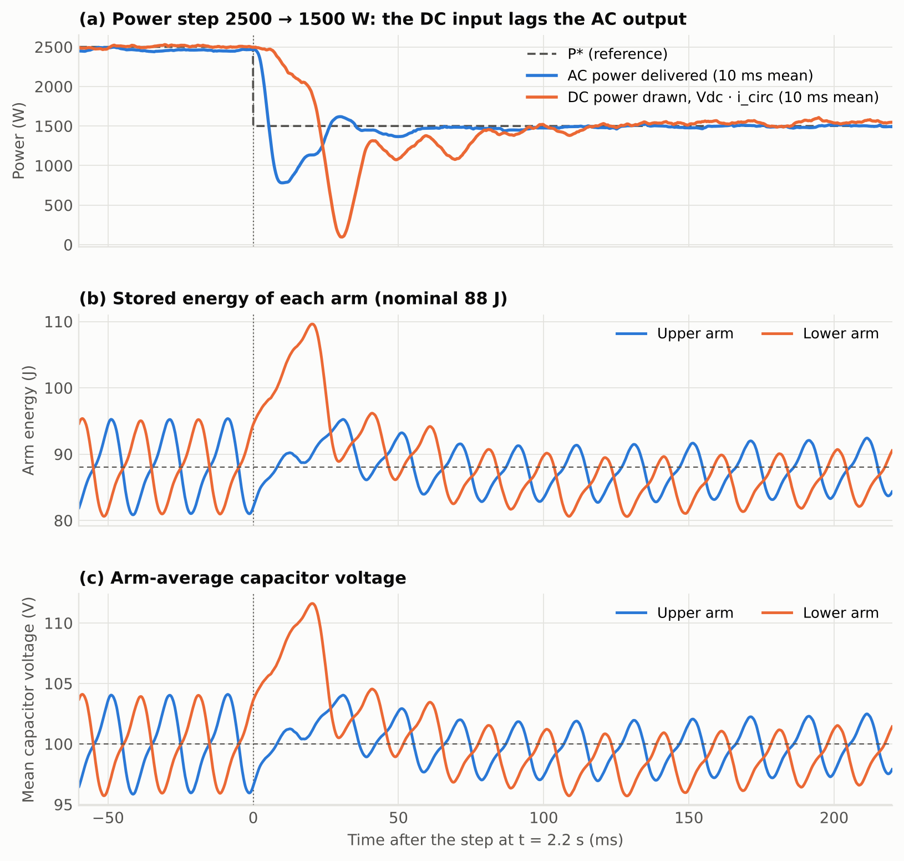
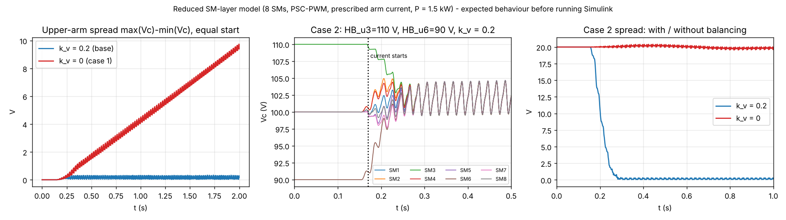

# Historical and reduced-order NVB images — detailed methods

The five original images in this folder document historical grid-case diagnostics and a reduced-order **prediction**. They must not be counted as new cases or silently mixed with the corrected 17 A, slew-limited A1–A3 simulations.

**[Corrected figure guide](../../figures/README.md)** · **[Original historical measurements](grid_base_results.md)**

## 1. `Fig1_overview.png` — NVB historical baseline overview (supplement)

**How the test was performed:** Use the previously archived `grid_base.mat` baseline with enabled local balancing, not the corrected T3.1–T3.3 array.

**What to verify in the figure:** Check nominal power, current and arm-average Vc, and compare instrumentation or initial parameters only after verifying the different historical run.

**Recorded outcome / interpretation:** Historical validation context; do not count as an additional recorded case in the 11-case matrix.

## 2. `Fig2_balancing.png` — NVB historical balancing trace (supplement)

**How the test was performed:** Inspect upper/lower SM voltage average offsets for the earlier enabled-balancing run at several power levels.

**What to verify in the figure:** Apply per-SM moving averages before claiming a few-hundredths-volt residual; compare against 0.1 V deadband and current limits.

**Recorded outcome / interpretation:** Illustrates tight steady inter-SM mean voltage matching under enabled local correction; not the direct output of T3.1.

## 3. `Fig3_ripple_vs_P.png` — NVB earlier analytic ripple comparison (supplement)

**How the test was performed:** From the historical baseline, compute arm-mean Vc peak-to-peak ripple per P step and compare with energy-balance theory.

**What to verify in the figure:** Check the analytical and measured trends, capacitor capacitance, RMS grid voltage and power/current saturation.

**Recorded outcome / interpretation:** An earlier ripple-versus-P reference. It can differ at the 2500 W level due to the old `I_max=15 A` limitation.

## 4. `Fig4_step_2p2s_diagnostic.png` — Historical 2.2 s down-step diagnostic

**How the test was performed:** On the older baseline, zoom around the −1000 W power-reference drop at 2.2 s and inspect the two arm mean voltages.

**What to verify in the figure:** Look for delayed DC-energy compensation and lower-arm overvoltage; compare with the corrected staircase's bounded slew.

**Recorded outcome / interpretation:** Prior model reached about 111.65 V in the lower arm in the older reference. This is **not** a measurement from the corrected T3.3 run.

## 5. `expected_cases_1_2_reduced_model.png` — Predicted behavior from reduced-order model

**How the test was performed:** Use the simplified analytical model to illustrate expected voltage-spread divergence with `k_v=0` versus controlled recovery after a mismatch.

**What to verify in the figure:** Label these curves as **predictions**; compare to full Simulink results only qualitatively and avoid copying its drift rate as a measured result.

**Recorded outcome / interpretation:** Reduced-model expectation, not an observed trace from any uploaded Simulink case.

## Provenance

The historical baseline used `k_v=0.2`, `I_max=15 A`, all SM capacitors initially at 100 V and no additional P slew limit. The later corrected three-case archive instead sets `I_max=17 A` and explicitly slew-limits the reference. The predicted reduced-order figure is *not* a direct Simulink measurement. No additional simulations were run during publication.
