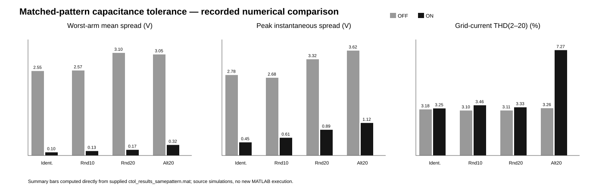
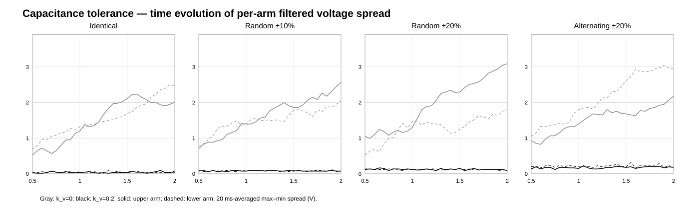
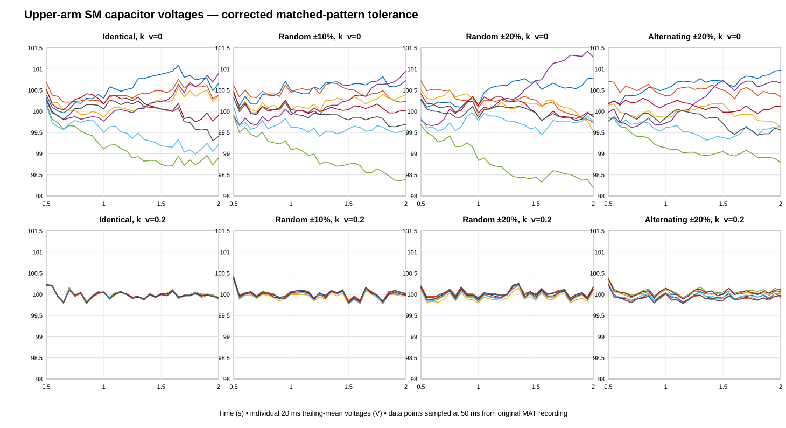
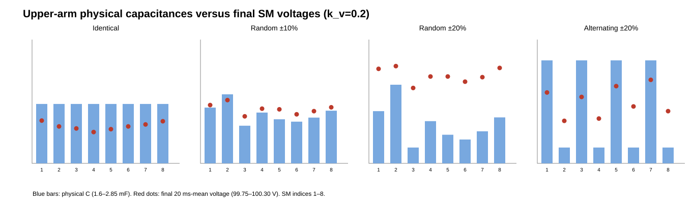

# D4 — Corrected matched-pattern capacitance tolerance

**Canonical source:** uploaded `12(3).zip` containing `ctol_results_samepattern.mat`, `run_capacitance_tolerance_samepattern.m`, the corrected `MMC_Per_arm_outer_v5_G2_tests_Ctol.slx` and MATLAB figures `ctol_A`–`ctol_D`. This is the **replacement**, not an addition to the obsolete Test 1 random-realization comparison.

## Test definition

- **Converter:** single-phase grid-connected MMC, 8 half-bridge SMs per arm (16 total), Vdc=800 V, 100 V nominal Vc, Cnom=2.2 mF, grid=230 V RMS / 50 Hz, P*=1,500 W.
- **C patterns:** identical; random ±10%; random ±20%; alternating ±20%. Use `rng(1)`, fixed upper/lower unit random vectors, and `Cu,Cl=Cnom*(1+tolerance*unit_pattern)`. The random ±20% deviations are **exactly twice** the random ±10% deviations.
- **Control:** 2 s per condition, balanced SM start, fixed 1,500 W; each pattern is run with `k_v=0` (OFF) and `k_v=0.2 V⁻¹` (ON). **Eight runs.** Arm-leader energy estimates retain nominal capacitance.
- **Voltage spread:** compute the trailing 20 ms moving mean independently for each SM; at each instant take max–min within each arm; report its maximum over t=0.5–2.0 s and the worse arm.
- **Instantaneous spread:** largest max–min of unsmoothed capacitor voltages over the same window, a **different metric**.
- **Grid-current THD:** 50 Hz harmonics 2–20 of recorded `i_ac` during t=1.8–2.0 s, not full-band THD.

## Recorded numeric results

| Physical capacitance pattern | Mean spread OFF (V) | Mean spread ON (V) | Improvement | Instantaneous OFF / ON (V) | THD OFF / ON (%) |
|---|---:|---:|---:|---:|---:|
| Identical | 2.550 | 0.096 | 26.6× | 2.776 / 0.453 | 3.18 / 3.25 |
| Random ±10%, fixed pattern | 2.565 | 0.135 | 19.0× | 2.681 / 0.612 | 3.10 / 3.47 |
| **Random ±20%, same pattern ×2** | **3.097** | **0.171** | **18.1×** | 3.318 / 0.887 | 3.11 / 3.32 |
| Alternating ±20% | 3.050 | 0.319 | 9.6× | 3.618 / 1.123 | 3.26 / 7.27 |

**Do not cite or mix the retired random ±20% values** from the earlier distinct random draw; they have been removed from the current repo documentation. Compare ±10% to ±20% only using these matched-pattern measurements.

## Figure A — Full robustness comparison

**Test method:** For each of four physical C distributions, hold every SM capacitance fixed between OFF and ON. Calculate the worse arm's maximum filtered and instantaneous spread and grid-current THD(2–20). **Result:** matched random ±20% changes mean spread from 3.097 V to 0.171 V; alternating ±20% produces 7.27% THD when balancing is on.

## Figure B — Voltage dispersion versus time

**Test method:** Plot each arm's max–min across independently 20 ms-smoothed capacitor voltages against time (gray OFF, black ON; solid upper, dashed lower). **Result:** uncontrolled drift is suppressed by local balancing for all four capacitance patterns; the maximum corrected worst-arm spread is 0.096–0.319 V over the evaluation interval. The SVG displays time traces sampled from the MAT recording at 50 ms spacing, so short transients may require inspecting the source MAT/PNG.

## Figure C — Eight individual upper-arm SM voltages (primary comparison)

**Test method:** For each of eight runs, plot the eight individual upper SM capacitor voltages after their own trailing 20 ms averages, t=0.5–2.0 s, on the same 98–101.5 V scale. The upper row disables the neighbor correction; the lower row enables it. **Result:** the eight traces cluster near 100 V with balancing on. This is the corrected matched-pattern plot; it does not use the former independent ±20% random realization. **Note:** The SVG is redrawn from 50 ms-spaced MAT samples, not the original full-resolution MATLAB PNG.

## Figure D — Assigned capacitance and final SM mean voltage

**Test method:** At `k_v=0.2`, compare each upper SM's physical C (mF) and individually filtered terminal voltage at 2 s. **Result:** the alternating pattern alternates between 2.64 and 1.76 mF while the eight mean voltages stay approximately near 100 V. Equalized Vc is **not** evidence of equal capacitor energy, since `E_i=0.5*C_i*Vc_i²`.

## Data and scientific limitations

[Recorded comparison values (CSV)](data/verified_summary.csv) · [All figure captions](figures/README.md).

These are archived simulations. The five-panel/topology figures are data-based GitHub SVG redraws; the source ZIP contains the original MATLAB PNGs, which are not byte-for-byte committed here. The original source runner explicitly asserts the random ±20% deviations equal twice those in ±10%. MATLAB was not rerun during the GitHub documentation update. No physical peer-to-peer packet timing, TWIST, hardware or HIL validation is claimed.
