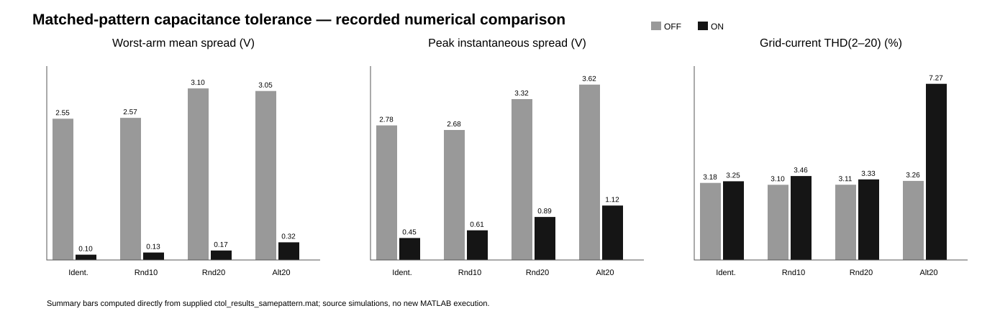
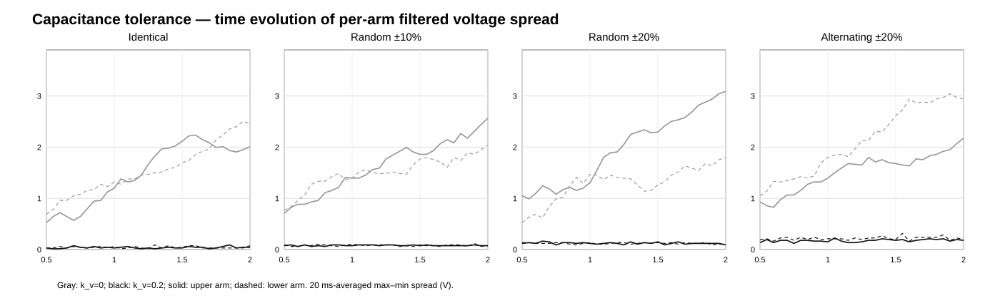
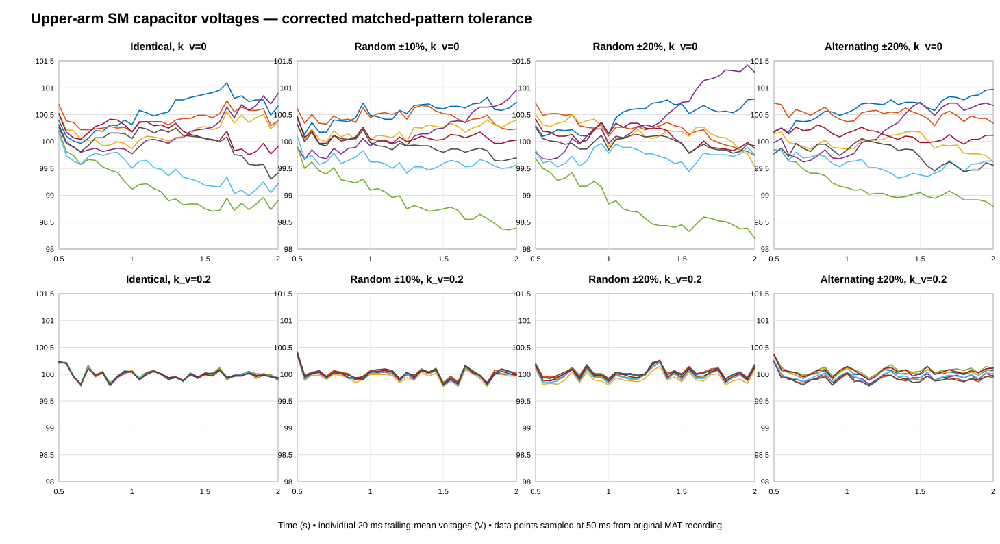
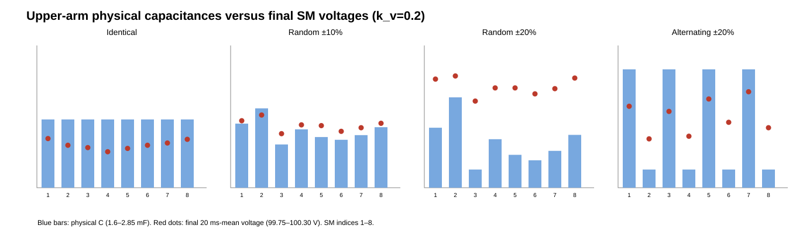

# D4 — Each corrected figure with test method and result

**[Experiment overview](../README.md)**

## Figure A — balancing ON versus OFF

**Procedure:** For four fixed capacitance patterns, compare `k_v=0` with `k_v=0.2`, measuring the worst-arm 20 ms-filtered spread, instantaneous spread and 2nd–20th current THD. **Result:** matched random ±20% improves from 3.097 V to 0.171 V while alternating ±20% ON raises THD to 7.27%. [Standalone explanation](ctol_A_comparison_samepattern.md).

## Figure B — voltage-spread time evolution

**Procedure:** Compute max–min of individual SM trailing 20 ms means in both arms throughout each 2 s run; compare OFF/ON traces for each physical C pattern. **Result:** local balancing suppresses mean-voltage drift in all patterns; the plotted traces are 50 ms samples of recorded MAT data. [Standalone explanation](ctol_B_imbalance_vs_time_samepattern.md).

## Figure C — eight upper-arm SM means, corrected random pattern

**Procedure:** Each panel shows eight individual upper-arm SM 20 ms averaged capacitor voltages. Four capacitance patterns in columns, `k_v=0` in the upper row, `k_v=0.2` below; window t=0.5–2.0 s. **Result:** every ON trace group stays near 100 V despite mismatched C, including the new matched ±20% pattern. [Standalone explanation](ctol_C_mean_voltages_upper_samepattern.md).

## Figure D — C variation and final voltage

**Procedure:** For each ON case, plot physical C and final per-SM averaged Vc. **Result:** approximate voltage equalization persists even for alternating 1.76/2.64 mF C; equality of capacitor energy does not follow. [Standalone explanation](ctol_D_capacitance_vs_voltage_samepattern.md).

All figures are **SVG redraws based on the newly supplied source MAT values**, not pixel-for-pixel original MATLAB PNG files. Curve traces are sampled at 50 ms steps for online presentation. Tables in the experiment overview use full-precision recorded summary metrics.
