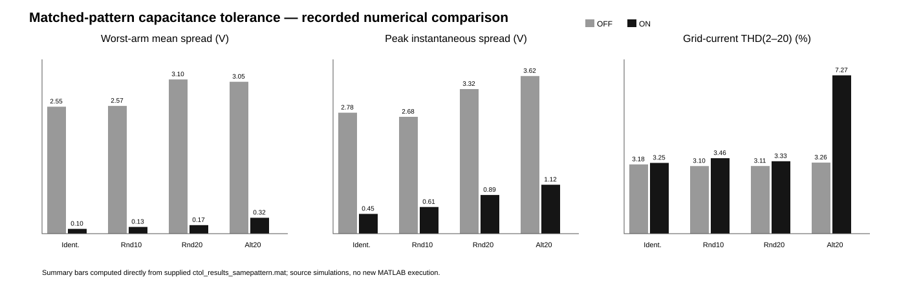

# Four capacitance-pattern OFF/ON comparisons

**Original MATLAB source:** `12(3).zip` / `ctol_A_comparison_samepattern.png` and `ctol_results_samepattern.mat`. The displayed SVG is a **source-derived reconstruction**, not the original PNG pixels.

**Test setup:** Single-phase 800 V DC MMC; 8 SM/arm, 2.2 mF nominal C, P*=1500 W, t=0–2 s, Vc(0)=100 V. The random ±10% and ±20% cases use the **same** upper/lower unit pattern, scaled by tolerance, and the same physical C vector is held fixed within OFF/ON pairs.

**Method and monitored signals:** Use four physical capacitor patterns, each simulated twice at k_v=0 and 0.2 V^-1 with all capacitor values held fixed between the pair. Determine the maximum worst-arm spread after separate 20 ms SM means (0.5–2.0 s), instantaneous spread, and grid-current THD of harmonic orders 2–20 (1.8–2.0 s).

**Recorded result:** Corrected matched random ±20% filtered spread is 3.097 V OFF and 0.171 V ON, improvement 18.1×. Alternating ±20% THD is 3.26% OFF and 7.27% ON.

**Scientific interpretation:** These are numerical MATLAB/Simulink results. 20 ms-mean spread is not the same as instantaneous switching ripple; current THD(h2–h20) is not full switching-harmonic THD. No new simulation or embedded/HIL hardware proof is claimed.

[Experiment overview](../README.md) · [Figure index](README.md) · [Rendered SVG](ctol_A_comparison_samepattern.svg)
