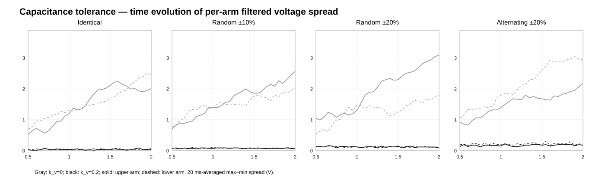

# Upper/lower voltage dispersion over time

**Original MATLAB source:** `12(3).zip` / `ctol_B_imbalance_vs_time_samepattern.png` and `ctol_results_samepattern.mat`. The displayed SVG is a **source-derived reconstruction**, not the original PNG pixels.

**Test setup:** Single-phase 800 V DC MMC; 8 SM/arm, 2.2 mF nominal C, P*=1500 W, t=0–2 s, Vc(0)=100 V. The random ±10% and ±20% cases use the **same** upper/lower unit pattern, scaled by tolerance, and the same physical C vector is held fixed within OFF/ON pairs.

**Method and monitored signals:** For each pattern and balancing gain, filter individual SM voltages with a trailing 20 ms mean and calculate per-arm max–min at successive times. Gray = balancing OFF; black = ON; solid = upper arm, dashed = lower arm. Time traces shown are sampled every 50 ms from stored MAT arrays.

**Recorded result:** Local balancing suppresses progressive dispersion under every capacitance pattern; the worst-arm corrected peak spreads (over 0.5–2.0 s, from full MAT data) are 0.096, 0.135, 0.171 and 0.319 V across the four patterns.

**Scientific interpretation:** These are numerical MATLAB/Simulink results. 20 ms-mean spread is not the same as instantaneous switching ripple; current THD(h2–h20) is not full switching-harmonic THD. No new simulation or embedded/HIL hardware proof is claimed.

[Experiment overview](../README.md) · [Figure index](README.md) · [Rendered SVG](ctol_B_imbalance_vs_time_samepattern.svg)
