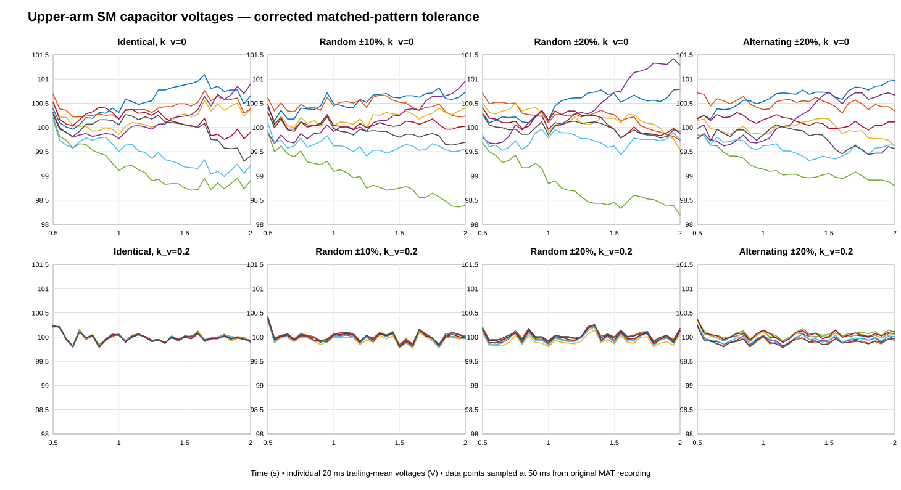

# Eight individual upper-arm mean capacitor voltages

**Original MATLAB source:** `12(3).zip` / `ctol_C_mean_voltages_upper_samepattern.png` and `ctol_results_samepattern.mat`. The displayed SVG is a **source-derived reconstruction**, not the original PNG pixels.

**Test setup:** Single-phase 800 V DC MMC; 8 SM/arm, 2.2 mF nominal C, P*=1500 W, t=0–2 s, Vc(0)=100 V. The random ±10% and ±20% cases use the **same** upper/lower unit pattern, scaled by tolerance, and the same physical C vector is held fixed within OFF/ON pairs.

**Method and monitored signals:** Run identical, random ±10%, matched-pattern random ±20%, and alternating ±20% with balancing OFF (top) and ON (bottom). Track all eight separate trailing 20 ms SM capacitor means, t=0.5–2.0 s; common y scale 98–101.5 V. Graphic samples archived MAT at 50 ms intervals for display.

**Recorded result:** Without balancing, upper SM trajectories diverge. With k_v=0.2 V^-1, all eight mean traces cluster near 100 V even with corrected matched random ±20% capacitors. The associated worst-arm spread is 3.097→0.171 V; this worst-arm statistic is not a measurement from upper-arm curves alone.

**Scientific interpretation:** These are numerical MATLAB/Simulink results. 20 ms-mean spread is not the same as instantaneous switching ripple; current THD(h2–h20) is not full switching-harmonic THD. No new simulation or embedded/HIL hardware proof is claimed.

[Experiment overview](../README.md) · [Figure index](README.md) · [Rendered SVG](ctol_C_mean_voltages_upper_samepattern.svg)
