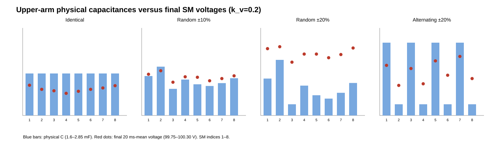

# Physical C values versus terminal upper-arm SM mean voltage

**Original MATLAB source:** `12(3).zip` / `ctol_D_capacitance_vs_voltage_samepattern.png` and `ctol_results_samepattern.mat`. The displayed SVG is a **source-derived reconstruction**, not the original PNG pixels.

**Test setup:** Single-phase 800 V DC MMC; 8 SM/arm, 2.2 mF nominal C, P*=1500 W, t=0–2 s, Vc(0)=100 V. The random ±10% and ±20% cases use the **same** upper/lower unit pattern, scaled by tolerance, and the same physical C vector is held fixed within OFF/ON pairs.

**Method and monitored signals:** For each gain-on run (k_v=0.2 V^-1), plot the eight physical upper-arm capacitances (mF) and separate terminal trailing 20 ms means of their capacitor voltages at t=2 s. Capacitance bars and voltage points have different physical units and scales.

**Recorded result:** The alternating upper arm uses 2.64/1.76 mF and maintains mean voltages near nominal 100 V. Equal voltages do not imply equal stored energies, which depend on 0.5*C_i*Vc_i^2.

**Scientific interpretation:** These are numerical MATLAB/Simulink results. 20 ms-mean spread is not the same as instantaneous switching ripple; current THD(h2–h20) is not full switching-harmonic THD. No new simulation or embedded/HIL hardware proof is claimed.

[Experiment overview](../README.md) · [Figure index](README.md) · [Rendered SVG](ctol_D_capacitance_vs_voltage_samepattern.svg)
