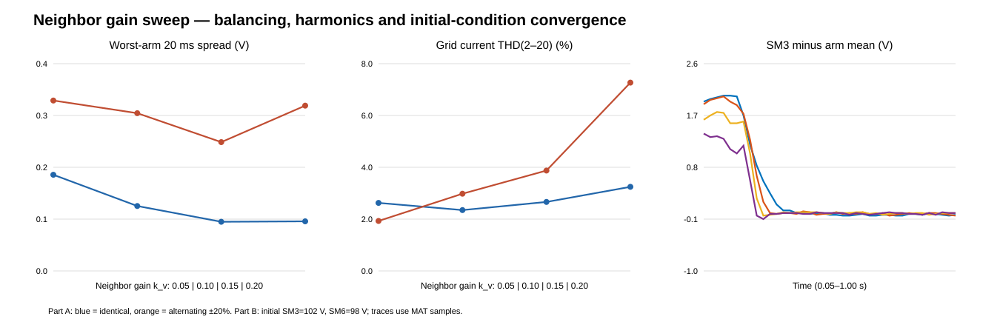

# D5 — Neighbor-gain sweep, current harmonics and initial mismatch

**Canonical source:** uploaded `13 thadkv(3).zip`, including `kv_sweep_results.mat`, `kv_sweep_summary.csv`, `run_kv_sweep.m` and original `kv_sweep.png`. These **12 saved simulations** supersede the previous overlapping gain/THD figure set.

## Test procedure

Single-phase grid MMC with eight SMs per arm, Vdc=800 V, Cnom=2.2 mF, 100 V initial nominal Vc, fixed P*=1500 W and 2 s simulation runs. Neighbor gains are `k_v={0.05,0.10,0.15,0.20}` V⁻¹.

**Part A (eight runs):** four gains for identical physical capacitances, plus four gains for alternating physical capacitances ±20% (`1.76/2.64 mF`). Compute worst-arm peak spread after a separate 20 ms trailing voltage mean per SM over t=0.5–2 s; compute grid-current THD from 50 Hz orders 2–20, t=1.8–2.0 s.

**Part B (four runs):** identical physical capacitances; initialize upper SM3=102 V, SM6=98 V, others 100 V. Evaluate the **absolute** deviation of upper SM3 from its arm mean and the filtered upper-arm spread. Settling time means the point after which the specified inequality remains true for the rest of the run; it is not the first threshold crossing and not communication-consensus latency.

## Source results — Part A

| Physical C | `k_v` (V⁻¹) | Worst-arm 20 ms-mean spread (V) | THD, h2–h20 (%) |
|---|---:|---:|---:|
| Identical | 0.05 | 0.186 | 2.63 |
| Identical | 0.10 | 0.125 | 2.35 |
| Identical | 0.15 | 0.095 | 2.66 |
| Identical | 0.20 | 0.096 | 3.25 |
| Alternating ±20% | 0.05 | 0.329 | **1.93** |
| Alternating ±20% | 0.10 | 0.304 | 2.98 |
| Alternating ±20% | 0.15 | **0.249** | 3.87 |
| Alternating ±20% | 0.20 | 0.319 | 7.27 |

Within the sampled alternating-C configurations, `k_v=0.15` minimizes peak **filtered spread**, whereas `k_v=0.05` minimizes the reported low-order THD. Neither is a universally optimized controller gain.

## Source results — Part B

| Gain `k_v` | SM3 absolute error stays below 1 V | SM3 absolute error stays below 0.5 V | Upper spread stays below 0.5 V |
|---|---:|---:|---:|
| 0.05 | 0.238 s | 0.281 s | 0.318 s |
| 0.10 | 0.237 s | 0.258 s | 0.290 s |
| 0.15 | 0.227 s | 0.241 s | 0.271 s |
| 0.20 | **0.212 s** | **0.228 s** | **0.257 s** |

## Figure — Gain, THD and convergence

**Left — Method:** Run identical and alternating C patterns at all four `k_v` settings and plot maximum worst-arm 20 ms-filtered spread. **Result:** alternating ±20% has its lowest tested value, 0.249 V, at `k_v=0.15`.

**Center — Method:** Analyze `i_ac` in the final 0.2 s for harmonics 2–20. **Result:** at alternating ±20%, THD rises from 1.93% (`k_v=0.05`) to 7.27% (`k_v=0.20`).

**Right — Method:** With SM3 at 102 V and SM6 at 98 V, plot signed 20 ms-filtered SM3-minus-arm-mean error for four gains and measure permanent absolute settling thresholds separately. **Result:** `k_v=0.20` has the fastest measured settling for these specific mismatch conditions.

## MATLAB reproduction from GitHub

The [source-equivalent gain-sweep MATLAB runner](scripts/run_kv_sweep.m) uses the [same archived base model](../saturation/models/MMC_Per_arm_outer_v5_G2_tests.slx). Copy both into a MATLAB R2024a working directory and execute `run_kv_sweep`. The runner saves `kv_sweep_results.mat`, `kv_sweep_summary.csv`, `kv_sweep.png` and `kv_sweep.fig`. **Part B requires a unique initial-voltage parameter in the SM mask:** if auto-detection is ambiguous, set `VC0_PARAM` in the script and rerun before claiming 12 reproduced cases. The GitHub runner reproduces the supplied method but is not a byte-for-byte copy of the ZIP script.

## Source values and interpretation limits

[Gain/THD CSV](data/gain_sweep_summary.csv) · [Initial-mismatch settling CSV](data/initial_mismatch_settling.csv) · [Figure-specific caption](figures/kv_sweep.md).

SVG uses recorded MAT values and time-series sampling; the source ZIP's MATLAB PNG is not byte-identical to this redraw. Neither full switching-frequency THD nor a new MATLAB execution, physical SM communication, STM32 timing or hardware/HIL verification is claimed.
