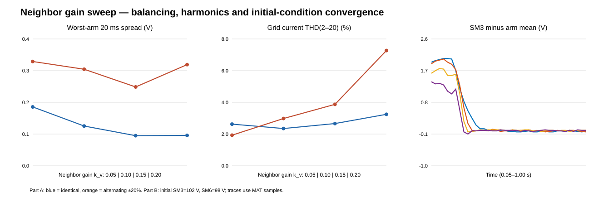

# D5 — Gain sweep original-data visualization

**Method:** Compare four `k_v` values with identical versus alternating ±20% capacitor distributions for steady inter-SM voltage spread and low-order grid-current THD; in separate runs initialize SM3/SM6 at 102/98 V to measure convergence.

**Result:** Alternating ±20% minimum measured spread is 0.249 V at `k_v=0.15`; lowest THD is 1.93% at `k_v=0.05`; fast ±2 V startup settling occurs at `k_v=0.20` (0.257 s for upper spread below 0.5 V).

[Full figure caption](kv_sweep.md) · [Experiment tables](../README.md). Curve plotting uses recorded MAT samples; no rerun or hardware validation.
