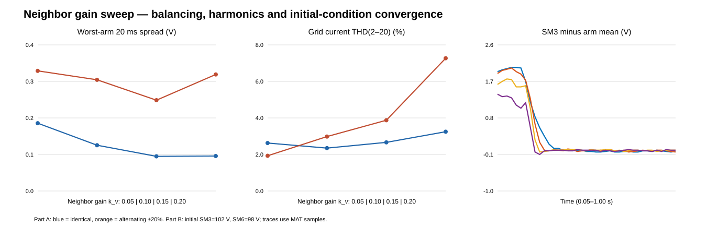

# Neighbor-gain sweep — three-panel comparison

**Source:** `13 thadkv(3).zip`, MATLAB `kv_sweep_results.mat` and `kv_sweep_summary.csv`.

**Panel 1 — Test method:** Fix identical or alternating ±20% SM capacitance values, sweep `k_v=0.05,0.10,0.15,0.20 V⁻¹`, run 2 s at P*=1500 W, compute the worse arm's largest max–min inter-SM spread after 20 ms trailing moving averages during 0.5–2.0 s. **Result:** alternating C gives the smallest sampled spread of 0.249 V at `k_v=0.15`.

**Panel 2 — Test method:** Use the last 0.2 s of logged grid current, compute harmonics h2–h20 relative to the 50 Hz fundamental. **Result:** alternating C THD ranges 1.93–7.27% across sampled gains, highest at `k_v=0.20`.

**Panel 3 — Test method:** Keep nominal C, initialize upper SM3 at 102 V and SM6 at 98 V; plot SM3 minus arm mean after separate 20 ms filtering and determine *sustained* absolute settling times. **Result:** at `k_v=0.20`, SM3 stays within ±1 V after 0.212 s and ±0.5 V after 0.228 s; upper-arm spread remains below 0.5 V after 0.257 s.

**Interpretation:** Better capacitor equalization, lower current distortion and faster initial-condition settling are distinct, potentially competing objectives. Values are from saved simulations, not HIL/hardware or formal communications consensus timing. This SVG is reconstructed from MAT data, not the original PNG pixels.

[Full recorded results](../README.md).
