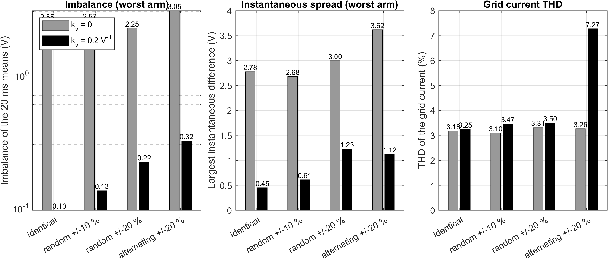
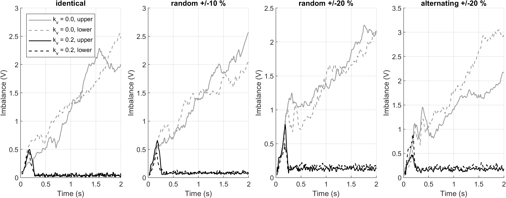
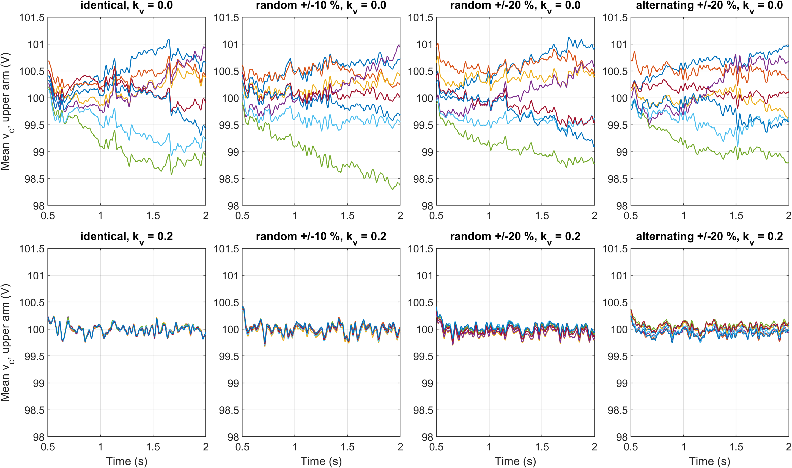
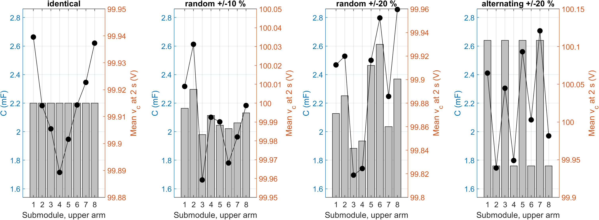
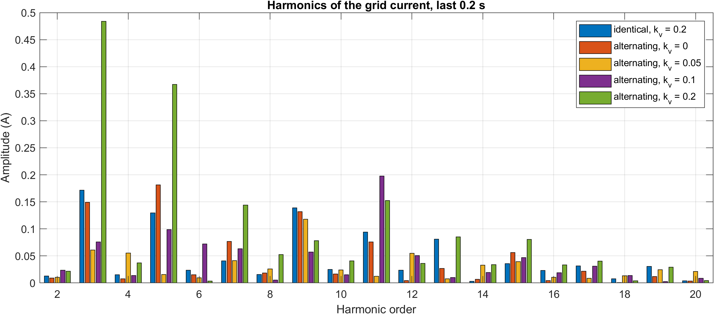
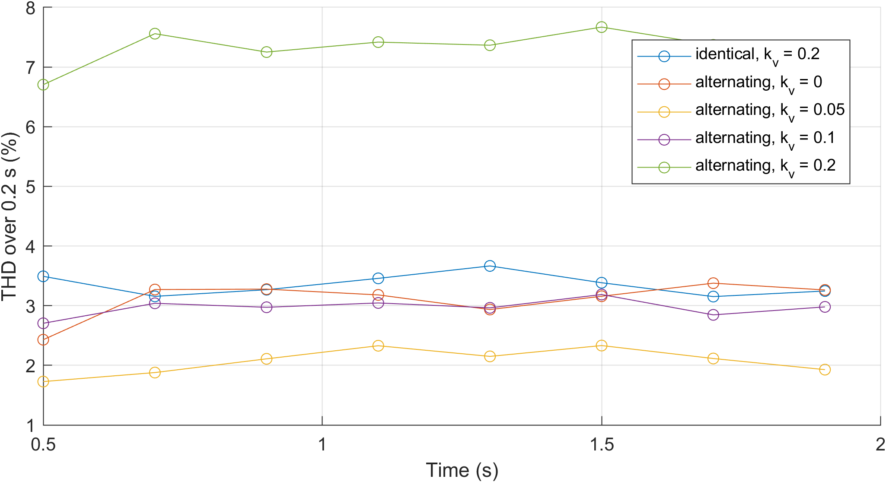

# Test 1 — MMC robustness under capacitor tolerance, duty saturation and grid-current harmonics

**Source:** `test1.rar` — MATLAB/Simulink R2024a models and archived data. All original six PNG images, four source SLX models, seven original test scripts/reports, three MAT result files, four CSV tables, an XLSX workbook and six MATLAB FIG sources are preserved in this folder. Generated `slprj/` and `*.slxc` caches were intentionally excluded.

This is an **independent robustness-study program** in the same single-phase, grid-connected, distributed per-arm MMC architecture as the parent repository. It is not a replacement for the earlier A/B/C experiment series.

## Quick findings

| Study | Test variations | Key recorded finding |
|---|---|---|
| D1 — SM capacitance tolerance | Identical; random ±10%; random ±20%; alternating ±20%, each with `k_v=0` and `0.2` (8 simulations) | Worst-arm inter-SM 20 ms-mean spread improves **9.6× to 26.6×** when local balancing is enabled |
| D2 — Local correction saturation | Alternating ±20% with no bound, ±0.10 and ±0.05 modulation-correction bounds; identical-capacitance ±0.05 reference (4 simulations) | Under alternating mismatch, THD falls from **7.27%** unbounded to **4.17%** at ±0.10 and **3.32%** at ±0.05, while residual imbalance grows |
| D3 — Grid-current THD sensitivity | Identical `k_v=0.2` and alternating ±20% at `k_v=0, 0.05, 0.1, 0.2` (5 simulations) | In alternating ±20%, `k_v=0.05` gives **1.93%** low-order THD versus **7.27%** at `k_v=0.2` |

The test sets contain some overlapping operating conditions. **Do not sum 8+4+5 into a claim of 17 statistically independent scenarios.** No new MATLAB run or TWIST/HIL measurement was performed for this repository update.

## Experimental setup

| Parameter | Recorded setting |
|---|---|
| Topology | Single-phase MMC, 8 half-bridge submodules per arm, 16 total |
| DC voltage / nominal SM voltage | 800 V / 100 V |
| Nominal SM capacitor | 2.2 mF |
| Grid / active power reference | 230 V RMS, 50 Hz / 1,500 W |
| Test duration | 2 s per simulation |
| Starting capacitor voltages | 100 V per SM (balanced) |
| Capacitance distribution | Identical; random ±10%; random ±20%; alternating ±20% |
| Balancing gain | `k_v=0`, `0.05`, `0.1` or `0.2`, according to study |
| Analysis window for tolerance | 0.5–2.0 s |
| Voltage metric | Worst SM spread **after a separate trailing 20 ms filter per SM**; also record instantaneous spread |
| Current THD metric | Harmonics 2–20 of 50 Hz sampled `i_ac` over the last 0.2 s |

For reproducible random patterns the runner uses `rng(1)`. The physical `C_u` and `C_l` are varied in each half-bridge, **but the arm leaders continue to estimate energy with the nominal 2.2 mF capacitor value**. This intentionally examines model-parameter robustness; the energy estimator is not reidentified for the true component tolerances.

### Update: controlled random-pattern comparison (25 November 2026)

The original D1 `random ±20%` values listed **below** came from a different random-number draw than the `random ±10%` values. Those archived results and images are preserved, but cross-magnitude conclusions from them are *confounded by random-pattern changes*. The [matched-pattern D4 extension](../capacitance_samepattern/README.md) uses the **same seeded random realization** for both tolerance magnitudes; its random ±20% worst-arm values are **3.097 V OFF and 0.171 V ON**, compared with **2.565 V OFF and 0.135 V ON** at ±10%. Do not substitute the D4 values into historical D1 figures.

A separate [D5 neighbor-gain sweep](../gain_sweep/README.md) tests `k_v=0.05/0.10/0.15/0.20` and ±2 V startup convergence. It finds that the smallest sampled alternating-capacitance imbalance (0.249 V) is at `k_v=0.15`, whereas the smallest sampled THD (1.93%) is at `k_v=0.05`.

## D1 — Capacitance tolerance and voltage balancing (8 runs)

The four recorded worst-arm peak spreads among 20 ms-averaged SM voltages are:

| SM capacitance pattern | `k_v=0` (V) | `k_v=0.2` (V) | Improvement factor |
|---|---:|---:|---:|
| Identical 2.2 mF | 2.550 | 0.096 | 26.6× |
| Random ±10% | 2.565 | 0.135 | 19.0× |
| Random ±20% | 2.248 | 0.221 | 10.2× |
| Alternating ±20% | 3.050 | 0.319 | 9.6× |

### Voltage-balancing overview



**How tested:** Keep the physical capacitances fixed in each OFF/ON pair, run at 1.5 kW for 2 s, and compare filtered spread, instantaneous spread and low-order THD.

**Recorded outcome:** Local balancing strongly improves equalization, but **THD rises to 7.27%** at alternating ±20% and `k_v=0.2`, versus **3.26%** with `k_v=0`.

[Full figure method and result](figures/ctol_A_comparison.md).

### Evolution of voltage spread



**How tested:** Filter each SM voltage over 20 ms, calculate per-arm max–min and compare the eight runs over time.

**Recorded outcome:** Drift with balancing disabled is replaced by small, bounded differences with balancing enabled; worst corrected spread ranges **0.096–0.319 V**.

[Full figure method and result](figures/ctol_B_imbalance_vs_time.md).

### Key comparison — upper-arm mean SM voltages



**How tested:** Display the 20 ms means of all eight upper-arm capacitor voltages over 0.5–2.0 s. The upper row is `k_v=0`, the lower row `k_v=0.2`, and each column fixes one tolerance pattern.

**Recorded outcome:** Uncontrolled voltage trajectories separate, whereas the neighbor correction keeps the averaged voltages grouped around **100 V** for every tolerance pattern. **This figure is featured in the repository's main README.**

[Full figure method and result](figures/ctol_C_mean_voltages_upper.md).

### Submodule capacitances versus final voltages



**How tested:** Plot assigned upper-arm capacitances (left axis) and each SM's final 20 ms mean voltage at 2 s (right axis) with balancing enabled.

**Recorded outcome:** Even alternating **1.76/2.64 mF** capacitor values remain near nominal voltage with balancing active. Equal voltage does not mean equal stored energy.

[Full figure method and result](figures/ctol_D_capacitance_vs_voltage.md).

## D2 — Saturation and bounded local correction (4 runs)

The local duty correction is

```text
e_i = (Vc_previous + Vc_next)/2 − Vc_i
Δm_i = k_v × e_i × tanh(i_arm/I_scale)
Δm_i,limited = clamp(Δm_i, −B, +B)
d_i = clamp(m_arm + Δm_i, 0, 1)
```

| Pattern / correction limit | THD(2–20) | Worst 20 ms-mean imbalance | Maximum |Δm| | Reconstructed upper-arm duty clipping |
|---|---:|---:|---:|---:|
| Alternating ±20%, no bound | 7.27% | 0.319 V | 0.185 | 13.49% |
| Alternating ±20%, B=0.10 | 4.17% | 0.336 V | 0.100 | 6.95% |
| Alternating ±20%, B=0.05 | 3.32% | 0.457 V | 0.050 | 0% |
| Identical SM, B=0.05 | 3.25% | 0.096 V | 0.034 | 0% |

**Procedure:** Run `scripts/check_saturation.m` with fixed 1,500 W and balanced initial voltages. The last three saturation-related measures were **reconstructed offline** from logged `Vc_up`, `m_up` and `i_u` and are not direct oscilloscope gate-duty recordings. Inspect both current harmonics and capacitor-voltage spread: stronger clipping improves THD here but worsens the remaining imbalance.

**Result:** A ±0.10 correction bound substantially reduces harmonics while leaving worst-arm imbalance close to the unbounded value; ±0.05 reduces THD further at the cost of a larger imbalance. Read the original [saturation report](reports/sat_check_report.txt).

## D3 — Grid-current harmonic sensitivity (5 runs)

### Harmonic spectrum



**How tested:** Analyze `i_ac` over t=1.8–2.0 s at each harmonic from order 2 to 20, after checking multiple window choices. Compare nominal `k_v=0.2` against alternating ±20% at `k_v=0`, 0.05, 0.1 and 0.2.

**Recorded result:** Under alternating ±20%, `k_v=0.2` creates the strongest third and fifth harmonics (**h3≈0.484 A**, **h5≈0.367 A**) and **THD≈7.27%**, whereas `k_v=0.05` gives **THD≈1.93%**.

[Full figure method and result](figures/thd_check_spectrum.md).

### THD over time



**How tested:** Apply successive 0.2 s windows, from 0.4–0.6 s through 1.8–2.0 s, and compute the same low-order current THD in each window.

**Recorded result:** With alternating ±20% capacitors, the high-gain `k_v=0.2` curve stays at **6.70–7.67%**; `k_v=0.05` stays at **1.73–2.33%**. The increased distortion persists beyond startup.

[Full figure method and result](figures/thd_check_vs_time.md).

**Cross-window caution:** `check_thd.m` compares multiple time windows. It calculates THD from **harmonics 2–20 only** of logged current; it does not establish full-band switching-harmonic THD.

## Reproduction (MATLAB/Simulink)

The source runner scripts expect model names and output files in the MATLAB current working directory.

1. With MATLAB/Simulink R2024a and the needed Simscape Electrical / Specialized Power Systems components, create an **empty working directory**, copy **all four `models/*.slx`** and **all four `scripts/*.m`** files into it and set it as the current folder.
2. Run `run_capacitance_tolerance` to reproduce the 8-run capacitance study (writes `ctol_results.mat` and four PNGs).
3. Run `export_ctol_results` to export the summary, capacitance vectors, final voltages, time-series CSVs and XLSX.
4. Run `check_saturation` for the four correction-bound variants and `check_thd` for the five harmonic/gain variants. Preserve the original archived result files separately before generating new ones.
5. Compare regenerated reports with the archived `data/` and `reports/` outputs. Scripts may overwrite output files in the working directory.

The supplied models `MMC_Per_arm_outer_v5_G2_tests_Ctol.slx`, `..._sat.slx`, and `..._thd.slx` are included for inspection; the MATLAB runners make working copies of the base `MMC_Per_arm_outer_v5_G2_tests.slx` and modify them according to the selected test.

## Source files

- [All six figure methods](figures/README.md)
- [Capacitance tolerance runner](scripts/run_capacitance_tolerance.m) · [Saturation runner](scripts/check_saturation.m) · [THD runner](scripts/check_thd.m) · [CSV/XLSX exporter](scripts/export_ctol_results.m)
- [Original CSV/XLSX and three MAT datasets](data/) · [Original text reports](reports/) · [Four original Simulink models](models/)
- [Six MATLAB FIG source objects](figures/matlab/)

## Limits of evidence

These are finite **simulations** using the uploaded source. Voltage imbalance is not the same as instantaneous capacitor ripple. The `k_v=0.05` setting minimizes low-order THD in one alternating-capacitor simulation, but it is **not established as a universal optimum** for voltage balancing, dynamic response or switching loss. Physical SM-to-SM communication, embedded code execution and TWIST/OPAL-RT HIL operation are not verified here.
