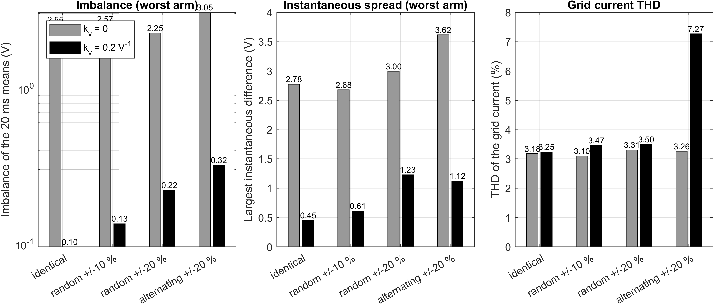
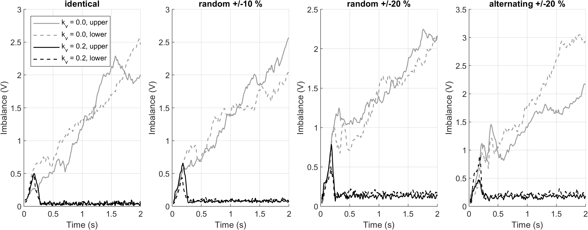
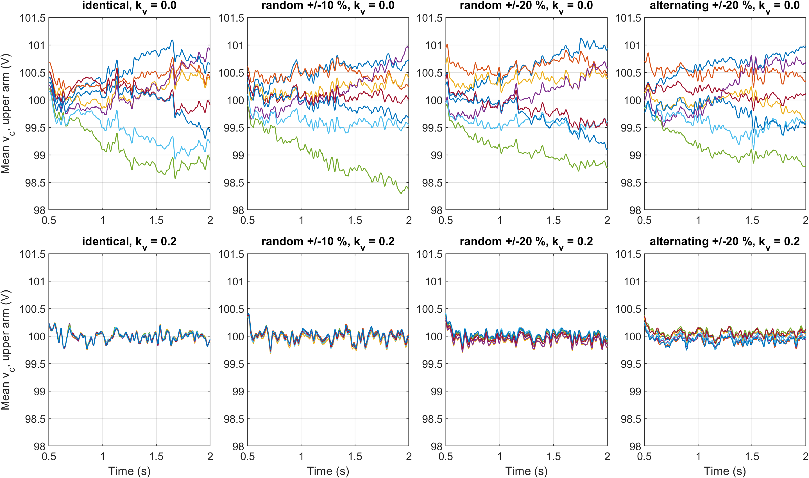
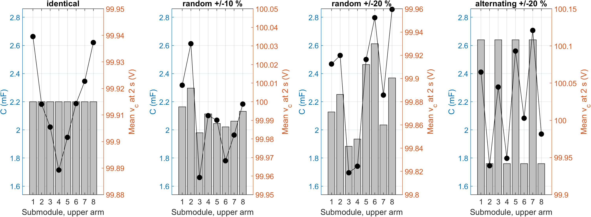
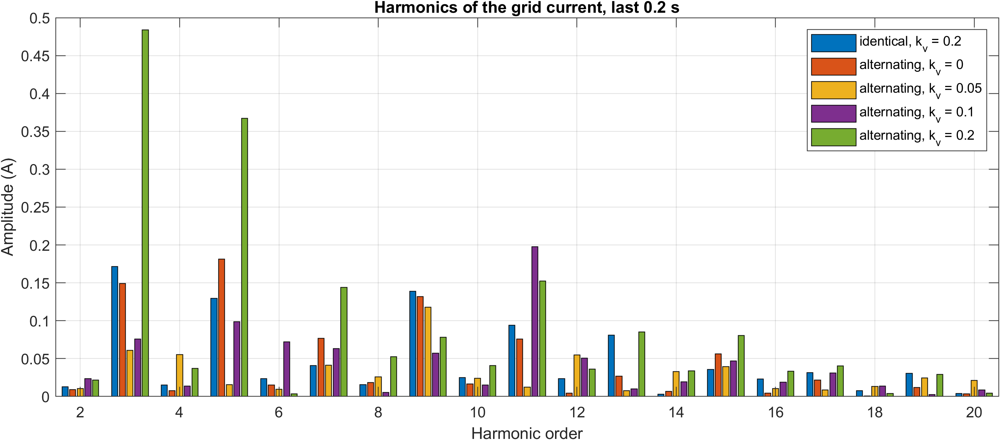
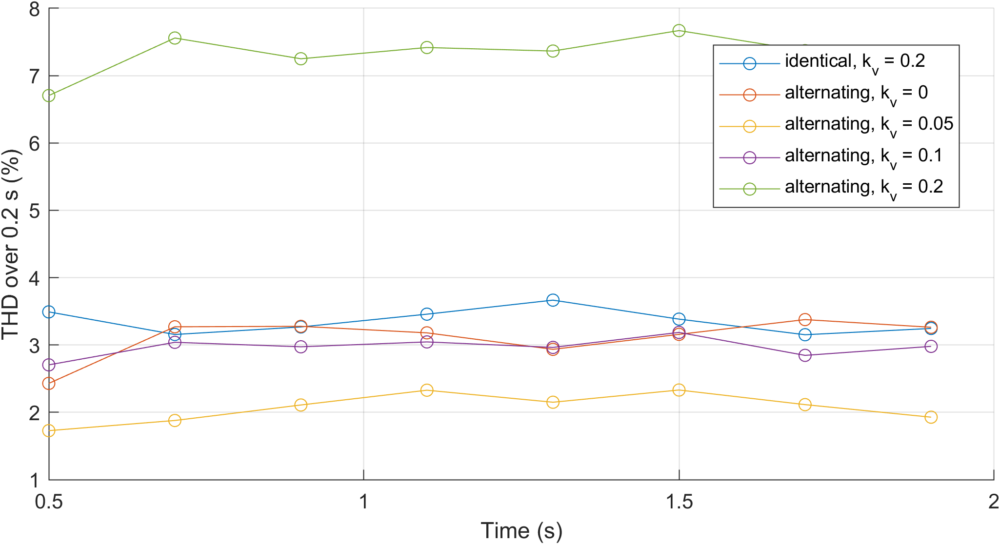

# Test 1 — figure-by-figure experiment guide

All six original PNGs are shown below **with the experimental setup, measurement method, result and interpretation directly underneath**. Select a figure-specific Markdown page for a standalone scientific caption.

[Experiment overview](../README.md) · [Main project](../../../README.md)

## 1. Capacitance tolerance: balancing OFF versus ON

**Test setup:** Four capacitor patterns are tested (identical, random ±10%, random ±20%, alternating ±20%), each with the local balancing coefficient k_v=0 and k_v=0.2 V⁻¹. Every 2 s run starts from 100 V per SM with P*=1,500 W.

**Method:** Read the three bar-chart panels: worst-arm spread among 20 ms-averaged SM voltages (left, logarithmic scale), peak instantaneous SM spread (center), and grid-current THD from 50 Hz harmonics 2–20 over the final 0.2 s (right). Use the same capacitance vector for each OFF/ON pair.

**Result:** Balancing improves the worst-arm 20 ms-averaged spread by 26.6× (identical), 19.0× (random ±10%), 10.2× (random ±20%) and 9.6× (alternating ±20%). However, in the alternating ±20% case THD rises from 3.26% (OFF) to 7.27% (ON).

**Interpretation:** Voltage balancing is effective under capacitance mismatch, but the strongest structured mismatch exposes a harmonic-distortion trade-off. Reduced voltage spread does not guarantee lower grid-current THD.

**[Open this original figure with its own explanation](ctol_A_comparison.md)**

## 2. Capacitance tolerance: voltage imbalance versus time

**Test setup:** Use the same eight 2 s capacitance-tolerance runs as Figure A, with k_v=0 and k_v=0.2. Upper and lower arm voltages are available for eight SMs per arm.

**Method:** Compute a trailing 20 ms moving average for each SM voltage separately, then plot the maximum-minus-minimum SM value in each arm versus time. Each capacitance pattern occupies one panel; inspect both arms and both balancing settings during 0.5–2.0 s.

**Result:** Without local correction, the worst-arm imbalance reaches 2.25–3.05 V across the tolerance patterns. With k_v=0.2, the worst-arm peak is 0.096–0.319 V. The alternating ±20% case retains the largest corrected mismatch.

**Interpretation:** Neighbor-based voltage balancing suppresses progressive separation of SM mean voltages across a range of capacitor tolerances, within the archived 2 s observation window.

**[Open this original figure with its own explanation](ctol_B_imbalance_vs_time.md)**

## 3. Upper-arm mean capacitor voltages — eight-panel comparison

**Test setup:** Plot the eight upper-arm SM voltages for four capacitance patterns: identical 2.2 mF, random ±10%, random ±20%, and alternating 1.76/2.64 mF. Use k_v=0 in the first row and k_v=0.2 V⁻¹ in the second row.

**Method:** For each SM compute a 20 ms trailing moving-average voltage and plot 0.5–2.0 s using a shared y-axis. Read each column vertically to isolate the effect of enabling local neighbor correction while holding its eight SM capacitances fixed.

**Result:** Without correction, upper-arm SM mean-voltage traces separate over time; with k_v=0.2 they remain clustered near 100 V. The upper-arm maximum filtered spreads are 2.289→0.095 V (identical), 2.565→0.123 V (random ±10%), 2.248→0.189 V (random ±20%), and 2.175→0.241 V (alternating ±20%).

**Interpretation:** This is the clearest visual comparison of local voltage equalization under capacitor mismatch. The curves are individually 20 ms-averaged SM voltages, not instantaneous switching ripple or arm-average voltage ripple.

**[Open this original figure with its own explanation](ctol_C_mean_voltages_upper.md)**

## 4. Assigned SM capacitances versus final upper-arm mean voltages

**Test setup:** Select the k_v=0.2 run for each of four capacitance distributions; include the eight upper-arm SM capacitor values and their 20 ms-averaged voltages at t=2 s.

**Method:** Use the left y-axis for each SM capacitance in mF (bars) and the right y-axis for final mean capacitor voltage in V (connected points). Compare the nominal, random and alternating patterns without changing the controller's nominal 2.2 mF arm-energy estimate.

**Result:** The alternating pattern assigns 1.76 mF and 2.64 mF to adjacent upper SMs (±20% around 2.2 mF). Nevertheless, the upper-arm voltage pattern stays around the 100 V nominal level with balancing active; the recorded maximum upper-arm filtered spread in that pattern is 0.241 V.

**Interpretation:** The controller maintains approximate voltage equalization despite heterogeneous physical SM capacitances. It does not imply equal capacitor energy, and it does not replace the separate current-distortion analysis.

**[Open this original figure with its own explanation](ctol_D_capacitance_vs_voltage.md)**

## 5. Grid-current harmonic spectrum for alternating capacitor mismatch

**Test setup:** Run identical-capacitance reference at k_v=0.2 and alternating ±20% capacitances at k_v=0, 0.05, 0.1 and 0.2, with P*=1,500 W for 2 s and balanced startup.

**Method:** From sampled i_ac over t=1.8–2.0 s, calculate amplitudes at 50 Hz harmonic orders h2–h20; compare their grouped bars, particularly h3 and h5, under the five controller settings.

**Result:** At alternating ±20% and k_v=0.2, h3≈0.484 A and h5≈0.367 A with THD(2–20)≈7.27%. Reducing k_v to 0.05 gives h3≈0.061 A and THD≈1.93%. The identical-capacitance k_v=0.2 baseline has THD≈3.25%.

**Interpretation:** The pronounced THD increase at high balancing gain is associated with stronger low-order harmonics, especially the third. The spectrum is limited to the 2nd–20th harmonics, not the full switching spectrum.

**[Open this original figure with its own explanation](thd_check_spectrum.md)**

## 6. Sliding-window grid-current THD over time

**Test setup:** Reuse the five comparison runs from check_thd.m (identical k_v=0.2 and alternating ±20% at four gains).

**Method:** Calculate THD from harmonics 2–20 in successive nonoverlapping 0.2 s windows, with window centers at 0.5, 0.7, …, 1.9 s. Inspect whether high THD occurs only at startup or persists under steady operation.

**Result:** For the alternating ±20% configuration, k_v=0.2 produces roughly 6.70–7.67% THD across the analyzed windows. At k_v=0.05, the corresponding range is about 1.73–2.33%. High-gain distortion persists after startup.

**Interpretation:** The harmonic penalty is a repeatable window-dependent feature of this simulated high-mismatch operating case rather than a single short startup transient.

**[Open this original figure with its own explanation](thd_check_vs_time.md)**

