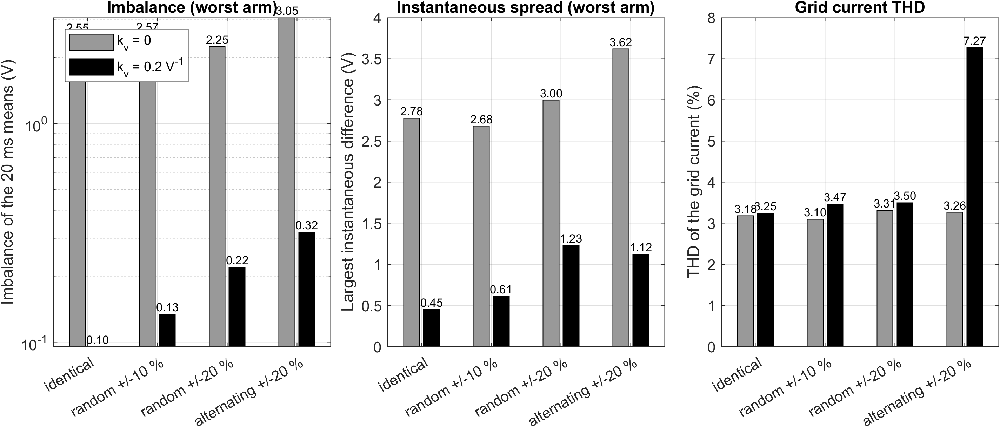

# Capacitance tolerance: balancing OFF versus ON

**Experiment:** Capacitance tolerance

**Test setup:** Four capacitor patterns are tested (identical, random ±10%, random ±20%, alternating ±20%), each with the local balancing coefficient k_v=0 and k_v=0.2 V⁻¹. Every 2 s run starts from 100 V per SM with P*=1,500 W.

**Test method / signals:** Read the three bar-chart panels: worst-arm spread among 20 ms-averaged SM voltages (left, logarithmic scale), peak instantaneous SM spread (center), and grid-current THD from 50 Hz harmonics 2–20 over the final 0.2 s (right). Use the same capacitance vector for each OFF/ON pair.

**Recorded result:** Balancing improves the worst-arm 20 ms-averaged spread by 26.6× (identical), 19.0× (random ±10%), 10.2× (random ±20%) and 9.6× (alternating ±20%). However, in the alternating ±20% case THD rises from 3.26% (OFF) to 7.27% (ON).

**Scientific interpretation:** Voltage balancing is effective under capacitance mismatch, but the strongest structured mismatch exposes a harmonic-distortion trade-off. Reduced voltage spread does not guarantee lower grid-current THD.

**Reproduction:** Run [`run_capacitance_tolerance.m`](../scripts/run_capacitance_tolerance.m) in MATLAB/Simulink with the supplied models and compare with the archived [`ctol_results.mat`](../data/ctol_results.mat). Numerical results are from the uploaded recordings; no additional simulation or physical experiment was performed.

[Project README](../../../README.md) · [Experiment README](../README.md) · [Full figure index](README.md) · [Original PNG](ctol_A_comparison.png)
