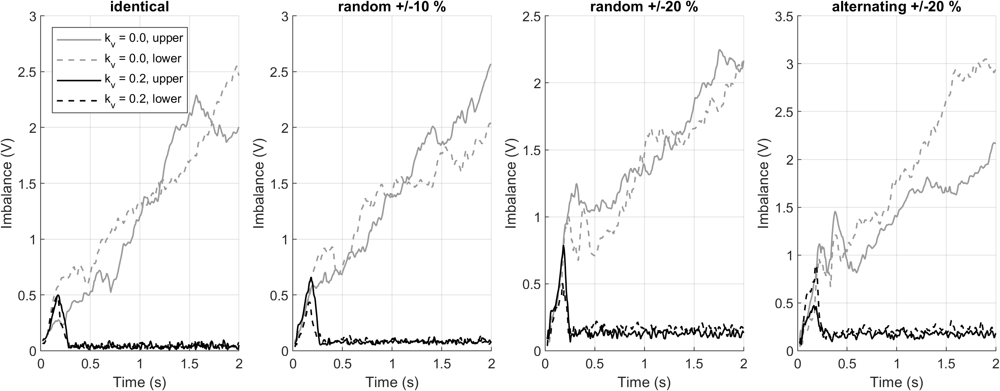

# Capacitance tolerance: voltage imbalance versus time

**Experiment:** Capacitance tolerance

**Test setup:** Use the same eight 2 s capacitance-tolerance runs as Figure A, with k_v=0 and k_v=0.2. Upper and lower arm voltages are available for eight SMs per arm.

**Test method / signals:** Compute a trailing 20 ms moving average for each SM voltage separately, then plot the maximum-minus-minimum SM value in each arm versus time. Each capacitance pattern occupies one panel; inspect both arms and both balancing settings during 0.5–2.0 s.

**Recorded result:** Without local correction, the worst-arm imbalance reaches 2.25–3.05 V across the tolerance patterns. With k_v=0.2, the worst-arm peak is 0.096–0.319 V. The alternating ±20% case retains the largest corrected mismatch.

**Scientific interpretation:** Neighbor-based voltage balancing suppresses progressive separation of SM mean voltages across a range of capacitor tolerances, within the archived 2 s observation window.

**Reproduction:** Run [`run_capacitance_tolerance.m`](../scripts/run_capacitance_tolerance.m) in MATLAB/Simulink with the supplied models and compare with the archived [`ctol_results.mat`](../data/ctol_results.mat). Numerical results are from the uploaded recordings; no additional simulation or physical experiment was performed.

[Project README](../../../README.md) · [Experiment README](../README.md) · [Full figure index](README.md) · [Original PNG](ctol_B_imbalance_vs_time.png)
