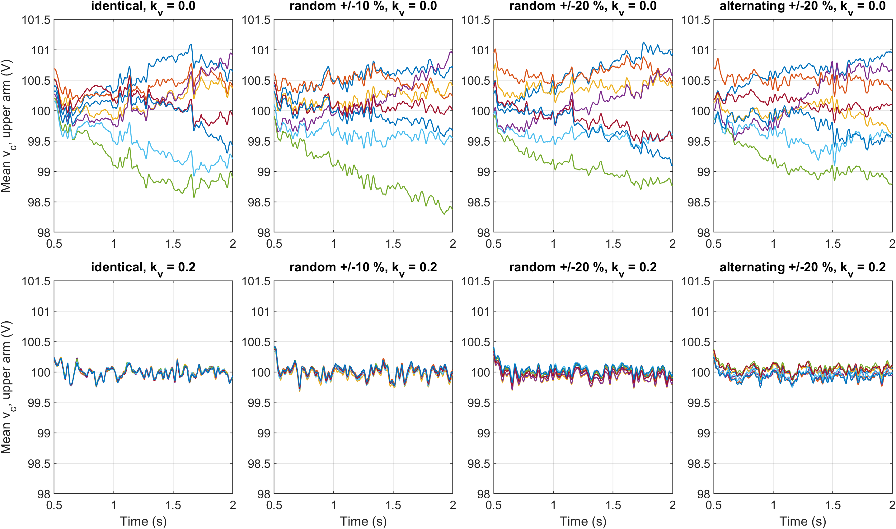

# Upper-arm mean capacitor voltages — eight-panel comparison

**Experiment:** Capacitance tolerance

**Test setup:** Plot the eight upper-arm SM voltages for four capacitance patterns: identical 2.2 mF, random ±10%, random ±20%, and alternating 1.76/2.64 mF. Use k_v=0 in the first row and k_v=0.2 V⁻¹ in the second row.

**Test method / signals:** For each SM compute a 20 ms trailing moving-average voltage and plot 0.5–2.0 s using a shared y-axis. Read each column vertically to isolate the effect of enabling local neighbor correction while holding its eight SM capacitances fixed.

**Recorded result:** Without correction, upper-arm SM mean-voltage traces separate over time; with k_v=0.2 they remain clustered near 100 V. The upper-arm maximum filtered spreads are 2.289→0.095 V (identical), 2.565→0.123 V (random ±10%), 2.248→0.189 V (random ±20%), and 2.175→0.241 V (alternating ±20%).

**Scientific interpretation:** This is the clearest visual comparison of local voltage equalization under capacitor mismatch. The curves are individually 20 ms-averaged SM voltages, not instantaneous switching ripple or arm-average voltage ripple.

**Reproduction:** Run [`run_capacitance_tolerance.m`](../scripts/run_capacitance_tolerance.m) in MATLAB/Simulink with the supplied models and compare with the archived [`ctol_results.mat`](../data/ctol_results.mat). Numerical results are from the uploaded recordings; no additional simulation or physical experiment was performed.

[Project README](../../../README.md) · [Experiment README](../README.md) · [Full figure index](README.md) · [Original PNG](ctol_C_mean_voltages_upper.png)
