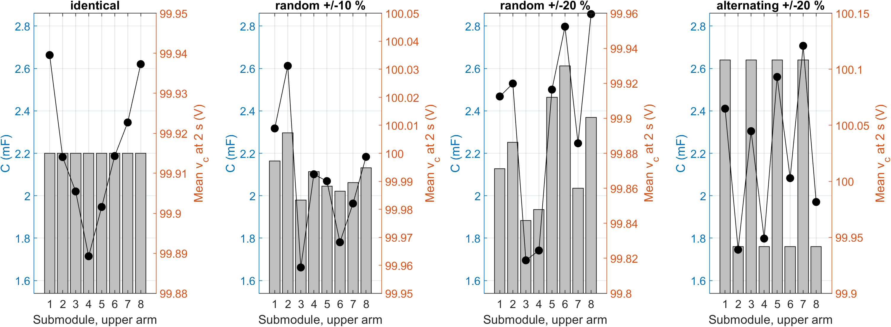

# Assigned SM capacitances versus final upper-arm mean voltages

**Experiment:** Capacitance tolerance

**Test setup:** Select the k_v=0.2 run for each of four capacitance distributions; include the eight upper-arm SM capacitor values and their 20 ms-averaged voltages at t=2 s.

**Test method / signals:** Use the left y-axis for each SM capacitance in mF (bars) and the right y-axis for final mean capacitor voltage in V (connected points). Compare the nominal, random and alternating patterns without changing the controller's nominal 2.2 mF arm-energy estimate.

**Recorded result:** The alternating pattern assigns 1.76 mF and 2.64 mF to adjacent upper SMs (±20% around 2.2 mF). Nevertheless, the upper-arm voltage pattern stays around the 100 V nominal level with balancing active; the recorded maximum upper-arm filtered spread in that pattern is 0.241 V.

**Scientific interpretation:** The controller maintains approximate voltage equalization despite heterogeneous physical SM capacitances. It does not imply equal capacitor energy, and it does not replace the separate current-distortion analysis.

**Reproduction:** Run [`run_capacitance_tolerance.m`](../scripts/run_capacitance_tolerance.m) in MATLAB/Simulink with the supplied models and compare with the archived [`ctol_results.mat`](../data/ctol_results.mat). Numerical results are from the uploaded recordings; no additional simulation or physical experiment was performed.

[Project README](../../../README.md) · [Experiment README](../README.md) · [Full figure index](README.md) · [Original PNG](ctol_D_capacitance_vs_voltage.png)
