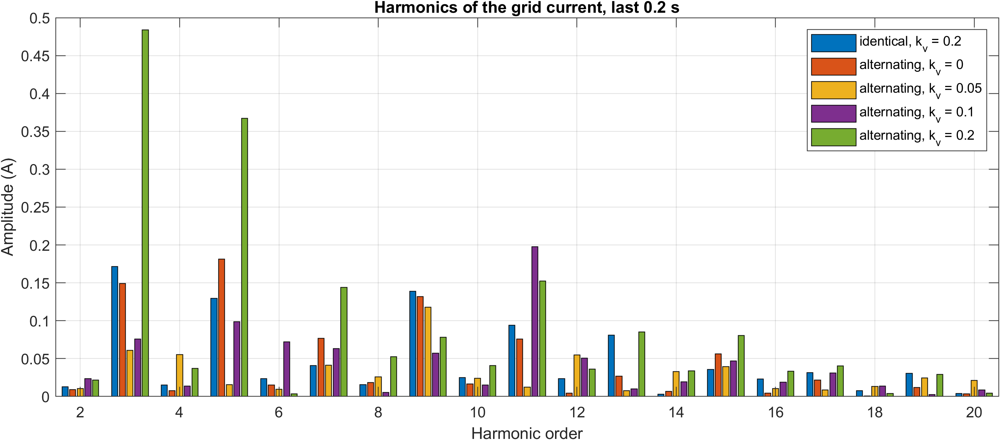

# Grid-current harmonic spectrum for alternating capacitor mismatch

**Experiment:** Grid-current harmonic quality

**Test setup:** Run identical-capacitance reference at k_v=0.2 and alternating ±20% capacitances at k_v=0, 0.05, 0.1 and 0.2, with P*=1,500 W for 2 s and balanced startup.

**Test method / signals:** From sampled i_ac over t=1.8–2.0 s, calculate amplitudes at 50 Hz harmonic orders h2–h20; compare their grouped bars, particularly h3 and h5, under the five controller settings.

**Recorded result:** At alternating ±20% and k_v=0.2, h3≈0.484 A and h5≈0.367 A with THD(2–20)≈7.27%. Reducing k_v to 0.05 gives h3≈0.061 A and THD≈1.93%. The identical-capacitance k_v=0.2 baseline has THD≈3.25%.

**Scientific interpretation:** The pronounced THD increase at high balancing gain is associated with stronger low-order harmonics, especially the third. The spectrum is limited to the 2nd–20th harmonics, not the full switching spectrum.

**Reproduction:** Run [`check_thd.m`](../scripts/check_thd.m) in MATLAB/Simulink with the supplied models and compare with the archived [`thd_check_results.mat`](../data/thd_check_results.mat). Numerical results are from the uploaded recordings; no additional simulation or physical experiment was performed.

[Project README](../../../README.md) · [Experiment README](../README.md) · [Full figure index](README.md) · [Original PNG](thd_check_spectrum.png)
