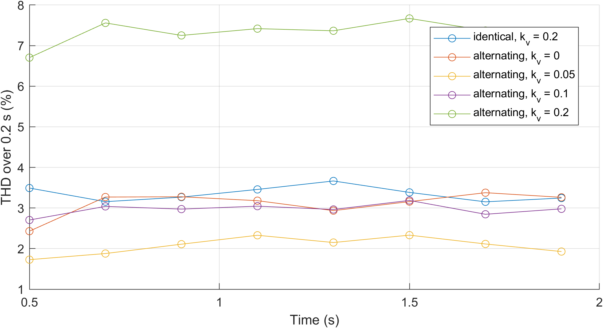

# Sliding-window grid-current THD over time

**Experiment:** Grid-current harmonic quality

**Test setup:** Reuse the five comparison runs from check_thd.m (identical k_v=0.2 and alternating ±20% at four gains).

**Test method / signals:** Calculate THD from harmonics 2–20 in successive nonoverlapping 0.2 s windows, with window centers at 0.5, 0.7, …, 1.9 s. Inspect whether high THD occurs only at startup or persists under steady operation.

**Recorded result:** For the alternating ±20% configuration, k_v=0.2 produces roughly 6.70–7.67% THD across the analyzed windows. At k_v=0.05, the corresponding range is about 1.73–2.33%. High-gain distortion persists after startup.

**Scientific interpretation:** The harmonic penalty is a repeatable window-dependent feature of this simulated high-mismatch operating case rather than a single short startup transient.

**Reproduction:** Run [`check_thd.m`](../scripts/check_thd.m) in MATLAB/Simulink with the supplied models and compare with the archived [`thd_check_results.mat`](../data/thd_check_results.mat). Numerical results are from the uploaded recordings; no additional simulation or physical experiment was performed.

[Project README](../../../README.md) · [Experiment README](../README.md) · [Full figure index](README.md) · [Original PNG](thd_check_vs_time.png)
