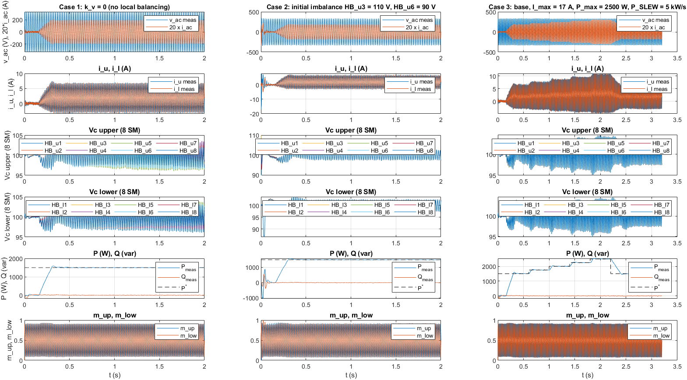

# Test 3 archive — independent folder for the repeated base experiments

> **Data provenance:** The supplied `test(3).zip` is **byte-for-byte identical** to the earlier `test.zip` and `test(1).zip` uploads. ZIP SHA-256 for all three: `828db9e060bb894e1f9ed05069efe5f40f24e73399f192ad08d18e3d40ad9052`.
>
> This folder provides an **independently navigable archive of the original three base tests**, as requested. It is **not an additional set of three different experiments**. The scientific study still consists of **11 unique recorded cases** overall: 3 base, 4 follow-up and 4 aligned-delay cases.

**All 18 PNG figures in the supplied `test(3).zip` are available below** with their original pixels and original filenames. Git reuses the same blob objects as the earlier `experiments/base/` upload; the repository contains two directory arrangements for the same source plots without modifying or re-encoding them.

## Cases

| Case | Scientific question | Conditions | Reproduced observation |
|---|---|---|---|
| T3.1 — Balancing disabled | Does capacitor-voltage dispersion drift without local regulation? | `k_v=0`, P*=1500 W, 2 s | Instantaneous upper-arm spread ~2.07 V at 2 s; upward drift |
| T3.2 — Initial mismatch | Can local neighbor balancing reduce a 20 V capacitor mismatch? | Upper SM3=110 V, SM6=90 V; `k_v=0.2`; 2 s | After current starts near 0.17 s, spread remains <1 V; after ~0.242 s remains <0.5 V; large startup transient |
| T3.3 — P staircase and PCC loads | Does per-arm control track P steps and maintain energy sharing during external load changes? | 1500→1750→2000→2250→2500→1500 W; loads at 2.4/2.7/3.0 s; 3.2 s | Settled steps near P reference (1506/1754/2003/2250/2502 W), slew-limited negative step and PCC power redistribution |

## View the figures and reproducible method

**[Figure-by-figure test protocol for all 18 images](figures/README.md)**.



## Asset map

```text
experiments/test3/
├── README.md                 # This experiment provenance and overview
├── figures/
│   ├── README.md             # Each plot: setup, method, signal and conclusion
│   ├── 13 PNGs               # Original base case figures
│   └── nvb/                 # Five historical/reference plots
├── scripts/
│   ├── run_three_cases.m
│   └── export_all_results.m
└── models/
    └── README.md             # Where the original .slx and MAT data can be imported
```

### Recovering MATLAB binaries from the supplied ZIP

The original `test(3).zip` contains `three_cases_results.mat`, `three_cases_results.xlsx`, the three `MMC_Per_arm_outer_v5_G2_case*.slx` models, `ripplecase3.fig`, and the original MATLAB scripts. **The large MAT/SLX/FIG assets are not yet present in this GitHub folder.** Extract them into `models/` and `data/` according to [binary import guidance](models/README.md).

The supplied ZIP also contains `slprj/` and `*.slxc` MATLAB caches: leave those out of source control.

## Scientific caveats

- The figures are **original saved MATLAB/Simulink exports**; they were not regenerated or validated on hardware in this repository update.
- Instantaneous SM spread differs from spread computed after separate 20 ms moving averages.
- Recorded 100 µs logged data cannot establish full-band switching-frequency THD; do not substitute lower-band THD from another experiment.
- The supplemental NVB figures include analyses of an **earlier base-model version**, as well as a reduced-model expectation. Do not treat them as direct measurements of cases T3.1–T3.3 without checking provenance.
- Neither this folder nor the existing aligned-delay experiment constitutes experimental proof of a physical, peer-to-peer communication system.
