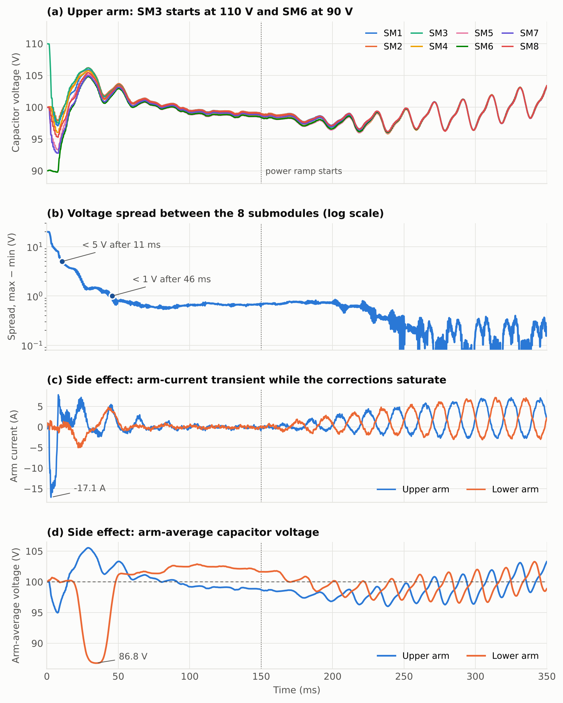

# Initial capacitor mismatch and current stress

**Experiment setup:** Plot the 110 V / 90 V upper-SM initial condition and simultaneous upper-arm current during T3.2.

**Test procedure / measurements:** Check fast spread decay at startup and any current excursion during clipped/unclipped PWM duty saturation; note when the current reference becomes active.

**Recorded result:** The upper-arm spread starts at 20 V, initially crosses below 1 V at ~46 ms and stays below 0.5 V after ~242 ms. The original *unclipped* correction produces a high startup upper-arm current of about −17.1 A, motivating correction limiting.

**Interpretation:** These statements describe the supplied simulation and its recorded analysis. No new MATLAB or physical HIL/TWIST run was performed to produce this page. Voltage spread, arm-average ripple and low-order sampled-current THD should not be treated as interchangeable metrics.

**Sources:** [Independent archive overview](../README.md) · [All figures and methods](README.md) · [Original PNG](FigB_initial_imbalance.png)
