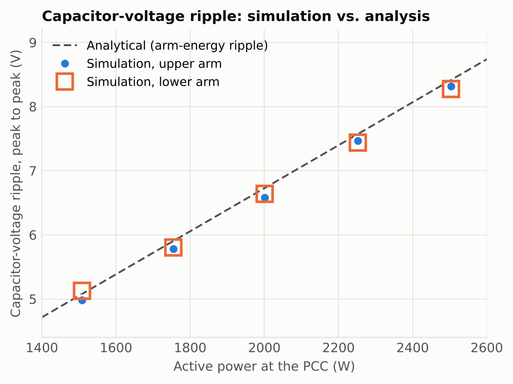

# Capacitor ripple versus active power

**Experiment setup:** For T3.3, take the last 100 ms of each steady P level and compute peak-to-peak ripple of the arm-average Vc; compare against the analytical energy-ripple estimate.

**Test procedure / measurements:** Plot both upper and lower values versus P and the analytical curve; inspect *relative* analytical error.

**Recorded result:** Measured upper-arm ripple rises approximately 4.98→8.32 V and lower-arm ripple 5.13→8.27 V from 1500→2500 W.

**Interpretation:** These statements describe the supplied simulation and its recorded analysis. No new MATLAB or physical HIL/TWIST run was performed to produce this page. Voltage spread, arm-average ripple and low-order sampled-current THD should not be treated as interchangeable metrics.

**Sources:** [Independent archive overview](../README.md) · [All figures and methods](README.md) · [Original PNG](FigD_ripple_vs_P.png)
