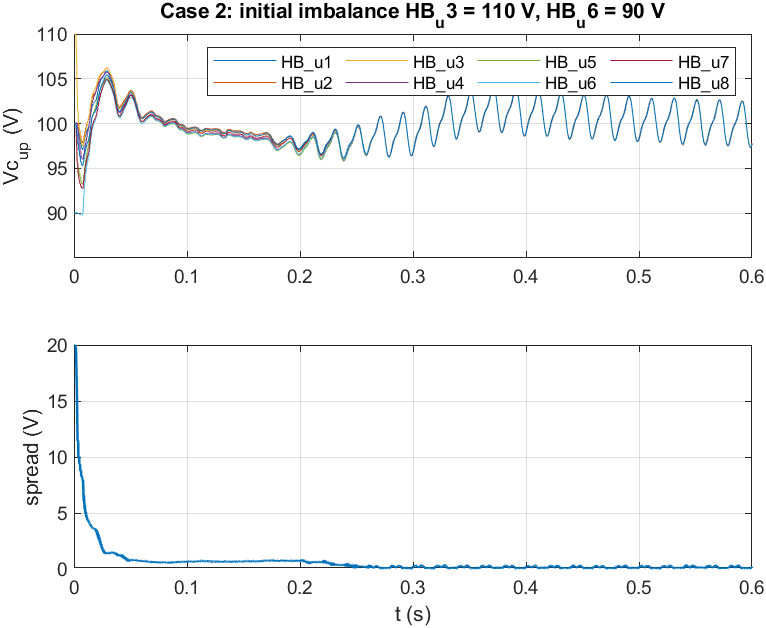

# Focused transient recovery from ±10 V mismatch

**Experiment setup:** From T3.2 plot SM capacitor voltages, min–max spread and startup arm current around 0–0.3 s.

**Test procedure / measurements:** Mark initial spread 20 V, onset of current ~0.17 s and first *sustained* crossing of 1 V / 0.5 V thresholds.

**Recorded result:** Effective mismatch recovery with a potentially excessive early arm-current excursion; include protection/clipping before embedded implementation.

**Interpretation:** These statements describe the supplied simulation and its recorded analysis. No new MATLAB or physical HIL/TWIST run was performed to produce this page. Voltage spread, arm-average ripple and low-order sampled-current THD should not be treated as interchangeable metrics.

**Sources:** [Independent archive overview](../README.md) · [All figures and methods](README.md) · [Original PNG](fig2_case2_initial_imbalance.png)
