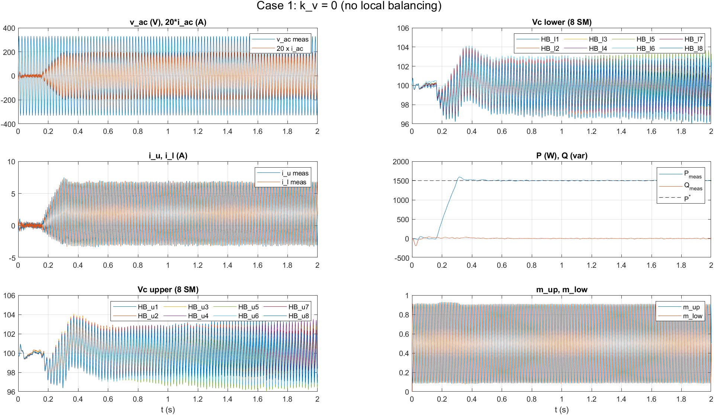

# T3.1 — balancing OFF, full scope

**Experiment setup:** Set `k_v=0` in all 16 local SM controllers. Start all capacitor voltages equally; command P*=1500 W for 2 s.

**Test procedure / measurements:** Inspect all upper/lower Vc traces, their instantaneous min–max spread, and whether arm currents and active power remain bounded.

**Recorded result:** At 2 s the instantaneous upper spread is ~2.07 V; this negative-control test shows growing SM voltage dispersion without local correction.

**Interpretation:** These statements describe the supplied simulation and its recorded analysis. No new MATLAB or physical HIL/TWIST run was performed to produce this page. Voltage spread, arm-average ripple and low-order sampled-current THD should not be treated as interchangeable metrics.

**Sources:** [Independent archive overview](../README.md) · [All figures and methods](README.md) · [Original PNG](grid_case1_kv0.png)
