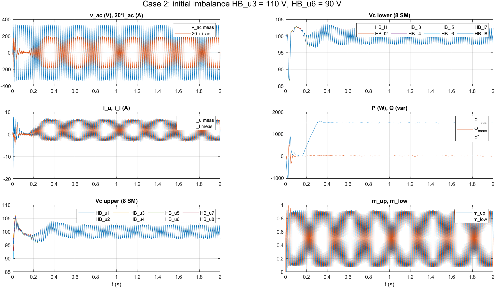

# T3.2 — initial mismatch, full scope

**Experiment setup:** With `k_v=0.2`, initialize upper SM3 to 110 V and SM6 to 90 V, leaving the rest nominal. Run 2 s and log SM voltages and arm/grid currents.

**Test procedure / measurements:** Measure instantaneous spread; find the *last time* that spread exceeds 1 V and 0.5 V. Inspect the startup peak current as a possible saturation side effect.

**Recorded result:** The archived run stays below 1 V from ~0.170 s and below 0.5 V from ~0.242 s; a large initial current transient remains a limitation.

**Interpretation:** These statements describe the supplied simulation and its recorded analysis. No new MATLAB or physical HIL/TWIST run was performed to produce this page. Voltage spread, arm-average ripple and low-order sampled-current THD should not be treated as interchangeable metrics.

**Sources:** [Independent archive overview](../README.md) · [All figures and methods](README.md) · [Original PNG](grid_case2_imbalance.png)
