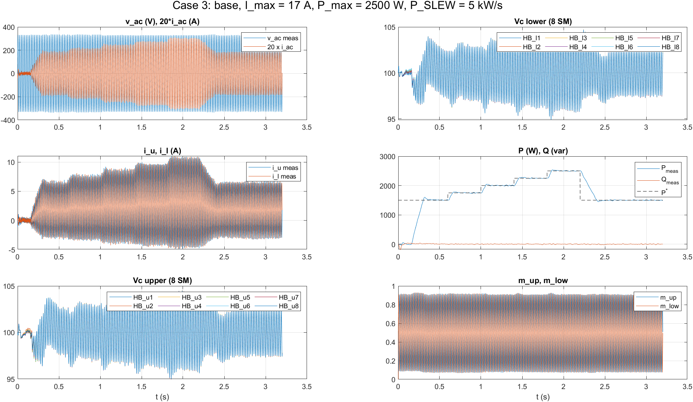

# T3.3 — staircase and PCC-load scope

**Experiment setup:** Apply P*=1500→1750→2000→2250→2500→1500 W at 0.6/1.0/1.4/1.8/2.2 s. Connect 1 kW load at 2.4 s, another at 2.7 s, disconnect the second at 3.0 s.

**Test procedure / measurements:** Verify P tracking, upper/lower arm currents and Vc, modulation staying inside [0,1], and PCC power balance.

**Recorded result:** Steady P near targets in increasing staircase; the 2.2 s downward command uses a 5 kW/s slew limiter.

**Interpretation:** These statements describe the supplied simulation and its recorded analysis. No new MATLAB or physical HIL/TWIST run was performed to produce this page. Voltage spread, arm-average ripple and low-order sampled-current THD should not be treated as interchangeable metrics.

**Sources:** [Independent archive overview](../README.md) · [All figures and methods](README.md) · [Original PNG](grid_case3_base.png)
